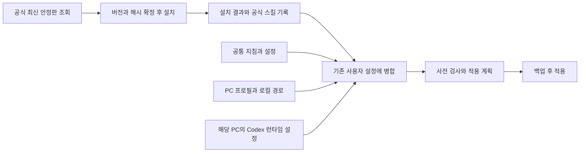

# Personal Harness

Roylabs Desktop의 Codex User Harness를 기준으로 사용자 지침, 스킬, 공통 설정을 관리한다.
공통 설정을 각 PC의 기존 설정에 병합하고, 앱 경로와 실행 중 생성되는 값은 해당 PC에서 유지한다.

[한 명령으로 설치](docs/remote-install.md) · [관리 범위와 기준 구성](docs/baseline.md) · [적용과 복구](docs/deployment.md) · [원본과 버전](sources/NOTICE.md)

## 시작하기

Windows x64에서 Node.js 22 이상과 npm, Git, Python 3.11 이상, Codex가 필요하다.
Git에서 이 비공개 저장소에 접근할 수 있도록 GitHub 인증을 준비한다.
처음 사용하는 PC에서는 Codex를 한 번 실행해 로컬 런타임 설정을 생성한다.
어느 폴더에서든 다음 명령으로 전체 Harness를 설치한다.

```powershell
npx --yes --prefer-online git+https://github.com/tttaliesin/personal-harness.git install
```

갱신할 때는 마지막 인자를 `update`로 바꾼다.

```powershell
npx --yes --prefer-online git+https://github.com/tttaliesin/personal-harness.git update
```

저장소는 비공개로 유지한다.
소스는 설치기가 사용자 전용 경로에서 관리한다.
PC별 경로와 의존성 기록은 `%LOCALAPPDATA%/PersonalHarness/state`에 보관한다.
Codex가 생성한 런타임과 인증은 기존 Codex 홈에서 유지한다.
기존 저장소의 `.local`을 재사용하거나 설치 경로를 지정하는 방법은 [설치 문서](docs/remote-install.md)를 참고한다.

## 저장소에서 개발하기

Windows, Python 3.11 이상, Codex 데스크톱 앱과 [Task](https://taskfile.dev/docs/installation)가 필요하다.
Task가 없다면 `winget install --id Task.Task --exact`로 설치한다.
처음 사용하는 PC에서는 Codex를 한 번 실행해 로컬 런타임 설정을 생성한다.
이후 명령은 모두 저장소 루트에서 실행한다.

```powershell
task
task setup
task plan
```

`task`는 사용 가능한 명령을 표시한다.
`task setup`은 Python 가상환경과 저장소 실행에 필요한 패키지를 준비한다.
`task plan`은 변경할 파일과 공통 설정, 누락된 의존성을 표시한다.

```powershell
# 공식 최신 안정판을 조회하고 설치 계획을 확인한다.
task update:plan

# 최신 안정판 설치, Harness 적용과 검증을 수행한다.
task install
```

설치 도우미는 실행할 때 pstack, EGM, agent-desktop의 공식 최신 안정 릴리스와 CodeGraph의 npm `latest` 배포를 조회한다.
실제 설치에 사용할 commit과 배포 해시를 확정한 뒤 도구를 설치한다.
설치와 검증을 마치면 그 결과를 `sources/dependencies.lock.json`에 기록한다.
agent-desktop의 공식 스킬과 참조 문서도 같은 릴리스로 갱신한다.
생성한 PC 경로는 Git에서 제외되는 `.local/<hostname>.toml`에 저장한다.
Codex 실행 파일을 찾지 못하면 `task install -- -Codex 'D:/tools/codex.exe'`로 지정한다.
Ego lite와 함께 제공되는 `ego-browser` 스킬은 각 PC의 브라우저가 관리한다.
이 저장소는 Ego의 설치 여부나 버전을 검사하지 않고, 브라우저의 스킬 파일과 링크를 만들거나 수정하지 않는다.

공통 파일만 다시 적용할 때는 다음 명령을 사용한다.

```powershell
task apply
task check
```

`task apply`는 사전 검사가 통과한 경우에만 쓰고, 기존 파일을 Codex 홈의 `harness-backups`에 백업한다.
`task check`는 공통 구성과 일치하고 의존성이 준비돼 있으면 성공한다.
적용 후 Codex를 재시작하거나 새 채팅에서 지침과 도구 구성을 확인한다.
설치 과정에서 요구하는 hook 신뢰 승인은 해당 PC에서 처리한다.

호스트는 현재 PC 이름으로 선택한다.
다른 호스트나 Python 실행 파일은 Task 변수로 지정한다.

```powershell
task plan HOST=roylabs-desktop
task check PYTHON='D:/Python/python.exe'
task plan -- -HomeDirectory 'D:/Test Profile'
```

`--` 뒤의 인자는 내부 PowerShell 스크립트로 전달한다.

## 최신 버전으로 갱신하기

```powershell
# 최신 버전 조회만 수행한다.
task update:plan

# 최신 조회, 설치, 공통 구성 적용과 검증을 이어서 수행한다.
task update

# 기록된 버전을 재현할 때만 -Locked를 사용한다.
task install -- -Locked
```

`task install`과 `task update`는 같은 설치·적용 절차를 사용한다.
갱신은 명령을 실행할 때만 수행한다.
별도의 예약 작업이나 백그라운드 자동 업데이트는 등록하지 않는다.
공식 최신 버전을 조회하지 못하면 오류로 종료하고 기존 버전으로 성공한 것처럼 처리하지 않는다.

## 관리하는 파일

| 위치 | 역할 |
|---|---|
| [Taskfile.yml](Taskfile.yml) | 루트에서 사용하는 준비, 설치, 갱신, 적용과 검증 명령 |
| [common/AGENTS.md](common/AGENTS.md) | 전역 사용자 지침. `${CODEX_HOME}`은 적용 대상 PC에서 치환 |
| [common/config.toml](common/config.toml) | 모델, 추론 수준, 사용자 정책, Desktop 설정, 플러그인 선택, CodeGraph MCP |
| [skills](skills) | `create-readme`, `agent-desktop`, `agent-desktop-windows` 원본과 참조 문서 |
| [hosts](hosts) | PC 이름, 운영체제 설정, 로컬 경로의 기본 규칙 |
| `.local/<hostname>.toml` | 해당 PC에서만 사용하는 경로와 선택적 설정 덮어쓰기. Git 제외 |
| [sources/dependencies.lock.json](sources/dependencies.lock.json) | 마지막으로 설치·검증한 외부 도구 버전, Git revision, 배포 해시 |
| [scripts](scripts) | 원격 설치 진입점과 Task가 사용하는 설치·적용 구현 |
| [package.json](package.json) | 비공개 Git 패키지의 실행 명령과 배포 파일 목록 |



저장소에서 PC 경로를 바꾸려면 [hosts/local.example.toml](hosts/local.example.toml)을 `.local/<hostname>.toml`로 복사한다.
한 명령 설치에서는 같은 형식의 설정을 설치 상태 경로의 `<hostname>.toml`에 둔다.
설정 병합 순서는 **현재 설정 → 공통 설정 → PC 프로필 → 로컬 덮어쓰기**다.
공통 파일에서 지정한 키만 덮어쓰며, 사용자 스킬의 선택 목록은 이름 또는 경로를 기준으로 병합한다.

## 검증

```powershell
task test
```

테스트는 임시 사용자 홈에서 설정 보존, 반복 적용, 백업과 실패 시 복구, 경로 보호를 확인한다.
실제 Homelab 적용 결과와 실행 검증은 [적용 문서](docs/deployment.md)에 기록한다.
