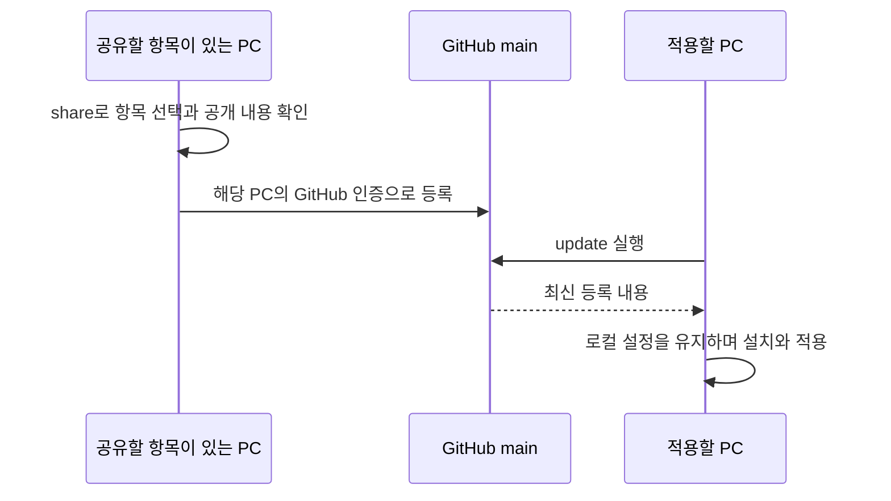
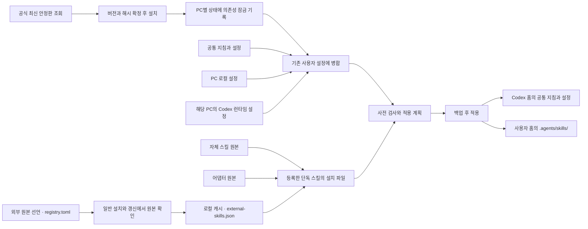

# Personal Harness

Roylabs Desktop의 Codex User Harness를 기준으로 공통 지침과 설정을 각 PC의 기존 Codex 프로필에 병합한다.
설치기는 등록한 스킬과 필요한 개발 도구도 각 PC에 배포한다.
자체 플러그인 세 개는 같은 저장소의 Codex Git 마켓플레이스에서 설치한다.

[한 명령으로 설치](docs/remote-install.md) · [관리 범위와 기준 구성](docs/baseline.md) · [개발 도구 사용](docs/development-tools.md) · [적용과 복구](docs/deployment.md) · [원본과 버전](packages/harness/resources/dependencies/NOTICE.md)

## 시작하기

Windows x64에서 Node.js 22.12.0 이상과 npm, Git, Python 3.11 이상, Codex가 필요하다.
공개 저장소에서 소스를 받는 데 GitHub 인증은 필요하지 않다.
처음 사용하는 PC에서는 Codex를 한 번 실행해 로컬 런타임 설정을 생성한다.
어느 폴더에서든 다음 명령으로 공통 Harness를 설치한다.

```powershell
npx --yes --prefer-online git+https://github.com/tttaliesin/personal-harness.git install
```

갱신할 때는 마지막 인자를 `update`로 바꾼다.

```powershell
npx --yes --prefer-online git+https://github.com/tttaliesin/personal-harness.git update
```

저장소는 공개로 운영한다.
소스는 명령 실행 중에만 사용하고 종료할 때 삭제한다.
PC별 경로와 의존성 기록은 `%LOCALAPPDATA%/PersonalHarness/state`에 보관한다.
이 상태 경로에는 외부 스킬 캐시도 둔다.
Codex가 생성한 런타임과 인증은 기존 Codex 홈에서 유지한다.
기존 저장소의 `.local`을 재사용하거나 설치 경로를 지정하는 방법은 [설치 문서](docs/remote-install.md)를 참고한다.

Codex Desktop은 내장 Computer Use를 앱과 함께 설치한다.
Windows 앱 화면을 확인하거나 앱에 직접 입력해야 할 때 Codex는 내장 Computer Use를 선택한다.

## 자체 플러그인 설치

Windows Agent Devkit과 Worker Orchestrator를 실행하려면 Node.js 24 이상이 필요하다.
터미널에서 다음 명령으로 마켓플레이스와 플러그인을 설치한다.

```powershell
codex plugin marketplace add tttaliesin/personal-harness
codex plugin add repo-governance@personal-harness
codex plugin add windows-agent-devkit@personal-harness
codex plugin add worker-orchestrator@personal-harness
```

Codex는 공개 저장소의 Git 기본 브랜치인 `main`에서 `personal-harness` 카탈로그를 읽는다.
PC마다 번들 폴더를 준비하거나 경로를 설정할 필요가 없다.
설치 후 Codex Desktop을 다시 열거나 터미널에서 `codex`로 새 세션을 시작한다.
플러그인 목록에서 `personal-harness`의 세 항목이 활성 상태인지 확인한다.
[기존 설치 전환과 갱신](docs/deployment.md#codex-git-마켓플레이스)

## 설치한 플러그인과 MCP 공유하기

공유할 항목이 있는 PC에서 다음 명령을 실행한다.
저장소를 직접 clone할 필요는 없다.

```powershell
npx --yes --prefer-online git+https://github.com/tttaliesin/personal-harness.git share
```

목록에서 항목을 선택하고, 공개될 등록 내용을 확인한 뒤 업로드한다.
업로드에는 그 PC의 GitHub CLI에 저장된 `tttaliesin` 계정 인증을 사용한다.
처음 사용하는 PC는 `gh auth login --hostname github.com`으로 해당 계정에 로그인한다.
기존 로그인이 있으면 다시 로그인할 필요가 없다.
`share`는 기본 활성 계정을 바꾸지 않고, 실행하는 GitHub 요청에만 해당 인증을 적용한다.
명령 실행 환경에 `GH_TOKEN` 또는 `GITHUB_TOKEN`을 직접 제공했다면 그 인증을 우선 사용한다.
토큰은 파일이나 저장소에 기록하지 않는다.

목록만 보거나 업로드 없이 내용을 확인할 수도 있다.
`<항목 ID>`는 `share --list`에 표시된 공유 대상의 ID로 바꾼다.

```powershell
npx --yes --prefer-online git+https://github.com/tttaliesin/personal-harness.git share --list
npx --yes --prefer-online git+https://github.com/tttaliesin/personal-harness.git share --select '<항목 ID>' --dry-run
```

공유하는 내용은 설치 출처와 공통 등록 정보다.
실행 경로, 실행 인자, 환경변수 값, 인증 헤더와 앱 런타임은 해당 PC에 남는다.
대상 PC에 필요한 경로와 인증도 그 PC에서 설정한다.
앱이 제공하는 런타임과 설치 출처를 확인할 수 없는 항목은 자동 업로드하지 않는다.

등록이 `main`에 반영되면 필요한 PC에서 기존 `update` 명령으로 가져온다.
새 항목을 가져올 때는 `--locked`를 붙이지 않는다.



## 저장소에서 개발하기

Windows, Python 3.11 이상, Codex 데스크톱 앱과 [Task](https://taskfile.dev/docs/installation)가 필요하다.
Task가 없다면 `winget install --id Task.Task --exact`로 설치한다.
처음 사용하는 PC에서는 Codex를 한 번 실행해 로컬 런타임 설정을 생성한다.
이후 명령은 모두 저장소 루트에서 실행한다.

```powershell
task
task setup
task plan
```

`task`는 사용 가능한 명령을 표시한다.
`task setup`은 Python 가상환경과 저장소 실행에 필요한 패키지를 준비한다.
`task plan`은 변경할 파일과 공통 설정, 누락된 의존성을 표시한다.

```powershell
# 공식 최신 안정판을 조회하고 설치 계획을 확인한다.
task update:plan

# 최신 안정판 설치, Harness 적용과 검증을 수행한다.
task install
```

설치 도우미는 실행할 때 `registry.toml`에 등록된 외부 플러그인과 MCP를 각 항목의 갱신 기준으로 조회한다.
CodeGraph와 OpenSpec의 npm `latest` 배포도 조회한다.
Microsoft Learn MCP는 `registry.toml`의 공식 원격 HTTP 연결을 적용하며 별도 의존성 패키지를 설치하지 않는다.
NuGet MCP는 공식 `NuGet.Mcp.Server`와 하네스 전용 .NET 실행 환경을 버전·해시로 고정해 설치한다.
기존 프로젝트의 .NET 버전과 전역 PATH를 유지하며 C# 패키지 작업에서 필요할 때 자율적으로 선택한다.
공식 .NET·Windows 자료가 필요하면 명시적인 호출 없이 선택하며 자세한 기준은 [개발 도구 사용](docs/development-tools.md#microsoft-learn-선택과-연결-구성)에 있다.
실제 설치에 사용할 commit과 배포 해시를 확정한 뒤 도구를 설치한다.
설치기는 검증한 의존성의 버전과 배포 해시를 `<state-root>/sources/dependencies.lock.json`에 기록한다.
체크아웃의 기본 경로는 Git에서 제외되는 `.local/sources/dependencies.lock.json`이다.
생성한 PC 경로는 Git에서 제외되는 `.local/<hostname>.toml`에 저장한다.
Codex 실행 파일을 찾지 못하면 `task install -- -Codex 'D:/tools/codex.exe'`로 지정한다.
Ego lite와 함께 제공되는 `ego-browser` 스킬은 각 PC의 브라우저가 관리한다.
이 저장소는 Ego의 설치 여부나 버전을 검사하지 않고, 브라우저의 스킬 파일과 링크를 만들거나 수정하지 않는다.

새 의존성을 설치하지 않고 공통 파일을 다시 적용할 때는 다음 명령을 사용한다.

```powershell
task apply
task check
```

`task apply`는 사전 검사를 통과하면 기존 파일을 Codex 홈의 `harness-backups`에 백업한 뒤 변경을 적용한다.
`task check`는 적용할 변경과 미해결 항목이 없을 때 성공한다.
적용 후 Codex를 재시작하거나 새 채팅에서 지침과 도구 구성을 확인한다.
설치 과정에서 요구하는 hook 신뢰 승인은 해당 PC에서 처리한다.

설치기는 현재 PC 이름이 [package.json](package.json)의 `supportedHosts`에 등록됐는지 확인한다.
다른 호스트나 Python 실행 파일은 Task 변수로 지정한다.

```powershell
task plan HOST=roylabs-desktop
task check PYTHON='D:/Python/python.exe'
task plan -- -HomeDirectory 'D:/Test Profile'
```

계획·검사·적용·설치·갱신 명령은 `--` 뒤의 인자를 해당 PowerShell 스크립트로 전달한다.

## 최신 버전으로 갱신하기

`task install`과 `task update`는 같은 설치·적용 절차를 사용한다.
일반 설치와 갱신은 외부 스킬의 `channel`에 맞는 커밋을 조회한다.
설치기는 선택한 커밋과 검증한 파일 내용을 담은 캐시를 원자적으로 교체한다.
외부 원본의 조회, 다운로드 또는 파일 검증에 실패하면 이전 캐시를 보존하고 오류를 반환한다.

체크아웃의 기본 캐시는 `.local/external-skills.json`이다.
상태 루트를 지정하면 `<state-root>/external-skills.json`을 쓴다.
`task plan`, `task check`, `task apply`는 외부 스킬을 이 캐시에서 오프라인으로 읽는다.
`task plan`과 `task apply`는 캐시에서 누락됐거나 검증을 통과하지 못한 외부 스킬을 건너뛴다.
두 명령은 `DEFERRED` 줄에 사유를 표시한다.
다른 사전 검사를 통과하면 `task apply`는 적용 가능한 변경을 반영한다.
`task check`는 보류 항목이 남아 있으면 0이 아닌 종료 코드를 반환한다.

기록한 버전을 재현할 때는 `-Locked`를 사용한다.
잠금 설치에서 필요한 캐시가 없거나 현재 등록과 호환되지 않으면 명령은 실패한다.

```powershell
task install -- -Locked
```

갱신은 명령을 실행할 때만 수행한다.
별도의 예약 작업이나 백그라운드 자동 업데이트는 등록하지 않는다.
공식 최신 버전을 조회하지 못하면 오류로 종료하고 기존 버전으로 성공한 것처럼 처리하지 않는다.

## 저장소 구조

하네스 설치기는 `packages/harness/installer/`에 둔다.
설치기가 읽는 배포 원본은 `packages/harness/resources/`에 둔다.
자체 플러그인은 각각 `packages/<name>/`에서 관리한다.

| 위치 | 역할 |
|---|---|
| [common/AGENTS.md](packages/harness/resources/common/AGENTS.md) | 전역 사용자 지침. `${CODEX_HOME}`은 적용 대상 PC에서 치환 |
| [common/config.toml](packages/harness/resources/common/config.toml) | 사용자 정책, Windows sandbox와 Desktop 공통 설정, 앱 제공 플러그인 선택, CodeGraph MCP |
| `.local/<hostname>.toml` | 해당 PC에서만 사용하는 경로와 선택적 설정 덮어쓰기. Git 제외 |
| [registry.toml](packages/harness/resources/registry.toml) | 단독 스킬과 외부 참조의 출처, 외부 플러그인과 MCP의 등록 정보 |
| [.agents/plugins/marketplace.json](.agents/plugins/marketplace.json) | Codex가 읽는 `personal-harness` 카탈로그 |
| [skills/custom/](packages/harness/resources/skills/custom/) | 자체 스킬인 `create-readme`, `development-environment`, `korean-typography`, `repository-artifacts` |
| [skills/adapters/](packages/harness/resources/skills/adapters/) | 연동·호환 어댑터인 `openspec-workflow`, `ste-ko`, `taste-windows-runtime`, `humanize-windows-runtime` |
| `.local/external-skills.json` | 외부 스킬과 참조 자료의 로컬 캐시. Git 제외 |
| `.local/sources/dependencies.lock.json` | 기본 상태 루트에 설치한 의존성의 버전, 커밋, 배포 해시. Git 제외 |
| [dependencies/dependencies.lock.json](packages/harness/resources/dependencies/dependencies.lock.json) | 설치 상태가 없을 때 읽는 초기 잠금 파일 |
| [dependencies/NOTICE.md](packages/harness/resources/dependencies/NOTICE.md) | 외부 원본의 출처와 라이선스 안내 |
| [dependencies/roylabs-2026-11-12.json](packages/harness/resources/dependencies/roylabs-2026-11-12.json) | 초기 Roylabs 기준 구성의 출처와 파일 해시 |
| [packages/repo-governance/](packages/repo-governance/) | 소스와 테스트. 공개 배포 경로는 `plugin/` |
| [packages/windows-agent-devkit/](packages/windows-agent-devkit/) | 소스와 테스트. 검증한 공개 배포본은 `release/` |
| [packages/worker-orchestrator/](packages/worker-orchestrator/) | 소스와 테스트. 검증한 공개 배포본은 `release/` |
| [packages/harness/installer/](packages/harness/installer/) | 설치·갱신·적용 구현. `npx` 진입점은 `personal-harness.mjs`. Python 의존성은 `requirements.txt` |
| [packages/harness/tests/](packages/harness/tests/) | 하네스 테스트와 픽스처 |
| [tests/test_codex_marketplace.py](tests/test_codex_marketplace.py) | 여러 플러그인 패키지와 루트 카탈로그를 함께 검사하는 테스트 |
| [Taskfile.yml](Taskfile.yml) | 저장소 루트에서 사용하는 준비, 설치, 갱신, 적용과 검증 명령 |
| [package.json](package.json) | Git 패키지의 실행 명령, 배포 파일, 설치 대상 PC 이름 |
| [docs/repository-workflows.md](docs/repository-workflows.md) | 개발환경·문서·테스트 산출물의 자율 판단과 저장소 governance 역할 경계 |

단독 스킬을 배포하려면 `registry.toml`의 `[[skills]]`에 설치 폴더 이름 `name`과 원본의 역할을 나타내는 `role`을 적는다.
자체 스킬은 `role = "custom"`으로, 어댑터는 `role = "adapter"`로 선언한다.
두 역할 모두 `registry.toml`이 있는 `packages/harness/resources/`를 기준으로 원본 경로를 `path`에 적는다.
어댑터의 연동 대상은 `adapts`에 적는다. [스킬과 외부 도구](docs/baseline.md#스킬과-외부-도구)

`feature-sliced-design`과 `humanize-korean`은 `role = "upstream"`으로 등록한다.
외부 원본의 `source`에는 HTTPS GitHub 저장소를 지정한다.
`channel`은 기본 브랜치의 `default-branch` 또는 최신 안정 릴리스의 `latest-release`다.
`files`의 키는 설치할 스킬 폴더를 기준으로 한 경로다.
각 키의 값은 외부 저장소 안의 상대 경로다.
키가 `"."`이면 지정한 원본 디렉터리의 내용 전체를 스킬 폴더에 배치한다.

`ste-ko`는 로컬 `SKILL.md`를 사용하며 외부 참조 자료는 같은 출처 필드로 선언한다.
외부 단독 스킬과 STE-KO 원본 참조 자료는 로컬 캐시에 보관한다.
`role`과 `adapts`가 모두 없는 기존 로컬 스킬에는 기존 등록 규칙을 적용한다.

설치기는 등록한 로컬 파일과 캐시의 외부 파일을 `~/.agents/skills/<name>/`에 배치한다.
`requires`를 지정한 스킬은 잠금 파일에 해당 의존성이 있을 때 설치한다.
`openspec-workflow`의 `requires`는 `openspec`이다.
작업 중 스킬을 사용하는 기준은 `packages/harness/resources/common/AGENTS.md`에서 관리한다.

자체 플러그인의 소스는 `packages/<name>/`에서 수정한다.
카탈로그가 가리키는 배포 경로와 새 버전을 게시하는 방법은 [자체 플러그인 소스와 배포본](docs/deployment.md#자체-플러그인-소스와-배포본)을 참고한다.



저장소에서 PC 경로를 바꾸려면 [로컬 설정 예시](docs/local.example.toml)를 `.local/<hostname>.toml`로 복사한다.
한 명령 설치에서는 같은 형식의 설정을 설치 상태 경로의 `<hostname>.toml`에 둔다.
설정 병합 순서는 **현재 설정 → 공통 설정 → 등록한 플러그인·MCP 설정 → PC 로컬 덮어쓰기**다.
공통 파일에서 지정한 키만 덮어쓰며, 사용자 스킬의 선택 목록은 이름 또는 경로를 기준으로 병합한다.

설치기는 `model`, `model_reasoning_effort`, `desktop.composer-predictions-enabled`의 기존 프로필 값을 유지한다.
PC별 TOML에 같은 키를 지정하면 그 값이 우선한다.

## 검증

```powershell
task test
```

`Taskfile.yml`의 `test` 작업은 Python `unittest`를 직접 실행한다.
`task test`는 `--` 뒤의 인자를 `unittest`에 전달한다.
`task test`는 하네스 테스트와 루트 카탈로그 검사를 실행한다.
하네스 테스트는 임시 사용자 홈에서 설정 보존, 반복 적용, 백업과 실패 시 복구, 경로 보호를 확인한다.
과거 적용·검증 이력은 저장소의 `docs/history/`에 보관한다.
이력 문서는 설치 패키지에 포함하지 않는다.
