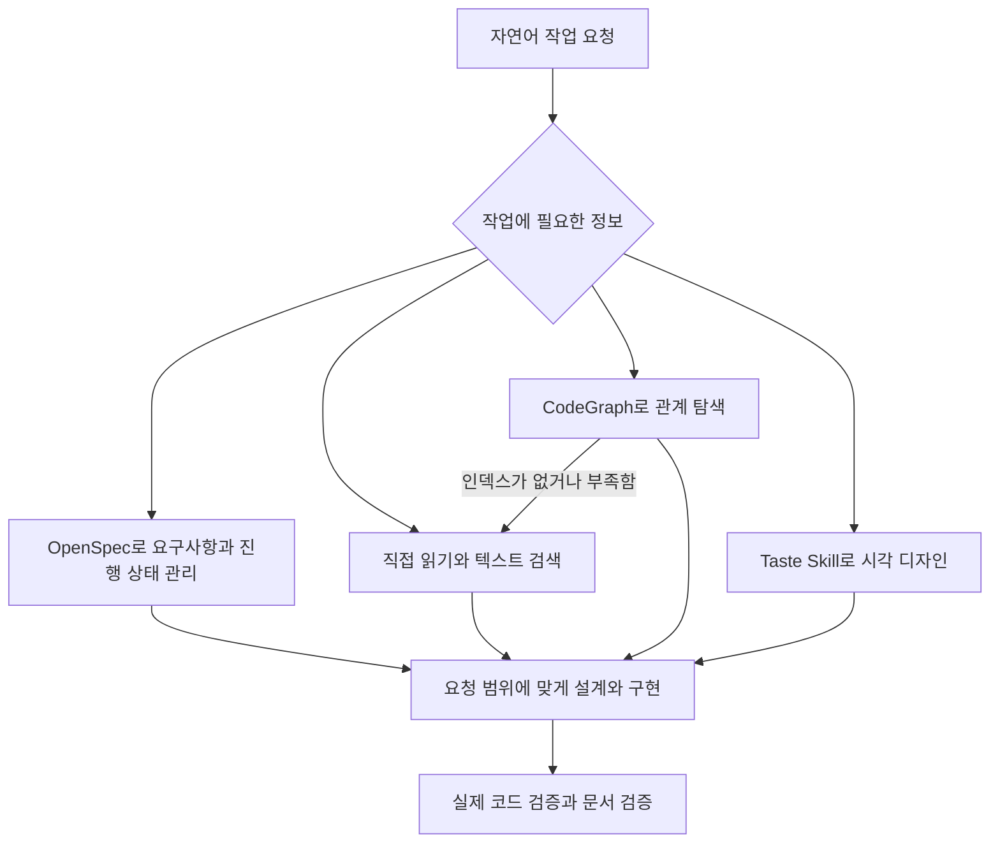

# 개발 도구 선택과 사용

CodeGraph는 코드의 관계를 찾고 OpenSpec는 요구사항과 변경 진행 상태를 남긴다.
Taste Skill의 `design-taste-frontend`는 웹사이트 제작과 시각 디자인 개선에 사용한다.
모델은 자연어로 요청받은 작업의 목적에 따라 적합한 도구를 선택한다.
스킬 이름이나 슬래시 명령을 직접 입력할 필요는 없다.

| 도구 | 사용하는 상황 | 준비 조건 |
|---|---|---|
| CodeGraph | 호출 관계, 영향 범위, 여러 모듈의 구조 탐색 | 해당 저장소에 `.codegraph/` 인덱스가 있음 |
| OpenSpec | 기존 변경 이어가기, 지속적인 요구사항이 필요한 기능·구조 변경 | 해당 저장소에서 OpenSpec 도입을 요청했거나 이미 사용 중임 |
| Taste Skill | 웹사이트 제작, 시각 디자인·리디자인·완성도 개선 | 원본 `taste-skill@taste-skill` 플러그인의 `design-taste-frontend` 사용 가능 |
| Korean Typography | 한국어 웹·앱 UI의 서체·혼합 조판·줄바꿈·로딩 검토 | `korean-typography` 사용자 스킬 사용 가능 |

알려진 파일 읽기와 정확한 텍스트 검색은 바로 수행한다.
설명, 작은 수정, 기계적인 편집에는 별도의 명세 변경을 요구하지 않는다.
구현을 요청하면 필요한 설계와 구현·검증을 같은 작업에서 이어갈 수 있다.
사용자가 결정해야 할 중요한 모호함이나 실제 권한 경계가 있을 때만 해당 부분을 확인한다.
기존 repo-governance와 저장소 자체의 개발 규칙은 유지한다.



## Taste Skill 선택

두 PC의 설치 대상은 `design-taste-frontend`를 제공하는 원본 플러그인 `taste-skill@taste-skill`이다.
정확한 버전과 출처는 검증된 lock으로 확인한다.
각 PC의 설치 여부는 실제 적용 결과로 확인한다.

웹사이트 제작이나 시각 디자인 개선에 적합하면 명시적인 호출 없이 스킬을 선택한다.

기존 프로젝트의 프레임워크, SSR·API·인증·데이터 흐름, 컴포넌트·디자인 토큰과 배포 경로는 유지한다.
기존 저장소의 개발 규칙도 유지한다.
사용자와 프로젝트의 제약은 스킬의 호환되지 않는 기본값보다 우선한다.
원본의 Next.js 정적 내보내기 규칙 때문에 기존 프로젝트를 정적 내보내기로 전환하지 않는다.

선택 기준은 공통 사용자 지침에서 관리한다.
원본 플러그인 파일과 캐시는 수정하지 않는다.
스킬 사용을 위한 별도 작업 흐름이나 새로운 필수 승인·검증 단계를 추가하지 않는다.

Taste Skill은 시각 디자인에 사용한다.
Sites는 요청에 호스팅·게시 또는 기존 Site 유지보수가 포함되고 해당 목적에 적합할 때 선택한다.
Taste Skill 선택만으로 Site 생성이나 게시를 시작하지 않는다.

원본은 [Taste Skill 공식 저장소](https://github.com/Leonxlnx/taste-skill)에서 제공한다.
설치·검증 결과는 [2026년 11월 16일 적용 기록](history/taste-skill-2026-11-16.md)에 남겼다.

## 한글 타이포그래피

한국어 결과물에는 `korean-typography`를 자동 선택해 적용한다.
Taste를 사용할 때도 기존 브랜드 서체와 프로젝트 토큰을 우선한다.
한글을 지원하는 서체를 선택하고 실제 렌더링된 글꼴과 혼합 문자열을 확인한다.
Latin-only 폰트의 선언이나 다운로드 성공만으로 한글이 같은 서체로 표시됐다고 판단하지 않는다.

후보 서체와 출처는 [서체 참조](../skills/korean-typography/references/fonts.md)에 있다.
이 후보를 모두 로드하거나 모든 화면을 같은 서체로 통일할 필요는 없다.
폰트는 필요한 프로젝트에서만 연결하며 OS 전체 서체를 설치하지 않는다.
수치·줄바꿈·CSS 적용 예시는 [조판 패턴](../skills/korean-typography/references/patterns.md)에 있다.

이 지침은 일반 한국어 대화나 백엔드 작업의 필수 단계가 아니다.
기존 스택과 repo-governance, Taste 원본은 보존한다.
두 PC의 배포와 렌더링 검증은 [한글 타이포그래피 적용 기록](history/korean-typography-2026-11-16.md)에 남겼다.

## CodeGraph와 OpenSpec 설치·갱신

`task install` 또는 `task update`는 두 CLI의 npm 최신 안정판을 조회한다.
정확한 버전과 배포 integrity를 확인한 뒤 각각 `state/tools/codegraph`와 `state/tools/openspec`에 설치한다.
저장소에서 설치할 때의 기본 상태 경로는 `.local`이다.
한 명령 설치에서는 `%LOCALAPPDATA%/PersonalHarness/state`를 사용한다.
각 PC의 기존 경로 덮어쓰기는 보존한다.

`openspec-workflow`는 `~/.agents/skills`에 배포한다.
실제 CLI가 PATH 밖에 있으면 생성된 사용자 지침의 `Local tool executables`에 실행 경로를 기록한다.
이 기록은 셸이나 실행 중인 Codex의 PATH를 바꾸지 않는다.
OpenSpec는 CLI로 사용하며 추가 MCP나 hook을 등록하지 않는다.

기존 lock에 OpenSpec가 없으면 `-Locked`로 새 도구를 추가하지 않는다.
일반 `task update`가 새 버전을 조회하고 OpenSpec를 포함한 lock을 만든다.
임시 프로필 테스트와 계획 조회는 실제 PC에 적용한 결과와 구분한다.

## 저장소에 도입

모델에게 해당 저장소에서 CodeGraph와 OpenSpec를 사용하도록 요청한다.
인덱싱과 OpenSpec 초기화의 대상은 그 저장소다.
다른 저장소나 사용자 홈을 자동으로 초기화하지 않는다.

CodeGraph는 `codegraph init <repository> --yes`로 처음 인덱스를 만든다.
전체 재구축에는 `codegraph index <repository>`를 사용한다.
정확한 실행 파일은 사용자 지침에 기록된 PC별 위치를 사용한다.
인덱스는 파생 데이터이며 Git에 포함하지 않는다.
변경 이후 관계가 오래되었으면 `codegraph status <repository> --json`과 `codegraph sync <repository>`로 확인·갱신한다.
결론에 중요한 사실은 현재 소스와 관련 검증으로 확인한다.

OpenSpec는 다음 명령으로 프로젝트 구조를 만든다.
기존 OpenSpec 통합이 있다면 초기화가 정리할 파일을 먼저 확인한다.

```text
openspec init --tools none --profile core --no-animation
```

전역 연동 스킬이 Codex 작업 흐름을 제공하므로 프로젝트별 공식 스킬을 추가로 생성하지 않는다.
`openspec/config.yaml`에는 해당 저장소의 schema와 필요한 프로젝트 맥락을 둔다.
명세와 변경 기록은 해당 저장소에서 관리한다.
이미 다른 방식으로 도입한 프로젝트의 통합은 그대로 사용한다.

OpenSpec의 `status`와 `instructions`가 현재 schema의 의존성과 출력 위치를 정한다.
`openspec validate`는 문서의 일관성을 확인한다.
코드 동작은 저장소의 실제 테스트와 실행으로 확인한다.
완료한 변경은 저장소의 완료 절차에 따라 보관한다.

공식 참고: [OpenSpec CLI](https://github.com/Fission-AI/OpenSpec/blob/main/docs/cli.md), [Codex 지원 방식](https://github.com/Fission-AI/OpenSpec/blob/main/docs/supported-tools.md), [CodeGraph](https://github.com/colbymchenry/codegraph).
