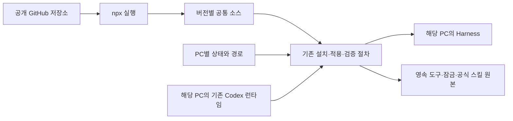

# 한 명령으로 Harness 설치하기

설치기는 공개 GitHub 저장소에서 받은 공통 정책과 스킬을 해당 PC의 Codex 설정에 병합한다.
의존성 설치, Harness 적용과 상태 검증을 하나의 명령으로 실행한다.
사용자가 소스를 직접 clone하거나 Task를 설치할 필요는 없다.

## 준비

Windows x64에서 Node.js 22 이상과 npm, Git, Python 3.11 이상, Codex가 필요하다.
대상 PC에서 Codex를 한 번 실행해 로컬 런타임 설정을 생성한다.
공개 소스를 내려받는 데 GitHub 로그인은 필요하지 않다.
Codex 사용에 필요한 계정과 인증은 해당 PC의 기존 설정을 사용한다.

다음 명령으로 저장소 접근을 확인한다.

```powershell
git ls-remote https://github.com/tttaliesin/personal-harness.git HEAD
```

공개 소스는 Git과 npm이 내려받는다.
설치기는 토큰을 추출하거나 별도 파일에 저장하지 않는다.
npm 레지스트리에 패키지를 게시하지 않고 GitHub 소스에서 직접 실행한다.

## 설치와 갱신

어느 폴더에서든 다음 명령을 실행한다.

```powershell
npx --yes --prefer-online git+https://github.com/tttaliesin/personal-harness.git install
```

갱신도 같은 진입점을 사용한다.

```powershell
npx --yes --prefer-online git+https://github.com/tttaliesin/personal-harness.git update
```

두 명령은 공식 최신 안정판 조회, 의존성 설치, Harness 적용과 검증을 차례로 수행한다.
소스 갱신은 npm의 Git 패키지 조회를 사용한다.
`--prefer-online`은 캐시에 있는 Git 참조의 최신성을 다시 확인하게 한다.
업데이트는 명령을 실행할 때만 수행한다.

호스트 프로필은 현재 PC 이름으로 선택한다.
다른 프로필을 사용하려면 명시한다.

```powershell
npx --yes --prefer-online git+https://github.com/tttaliesin/personal-harness.git install --host homelab-desktop
```

지원하는 프로필은 `homelab-desktop`과 `roylabs-desktop`이다.
Python이나 Codex를 자동으로 찾지 못하면 `--python 'D:/Python/python.exe'` 또는 `--codex 'D:/tools/codex.exe'`를 추가한다.
WindowsApps의 Python 실행 별칭은 인터프리터로 사용하지 않는다.
기록한 의존성 버전을 재현할 때는 `--locked`를 추가한다.
`--locked`도 없는 배포물은 다운로드한다.

## 소스와 PC별 상태

기본 설치 루트는 `%LOCALAPPDATA%/PersonalHarness`다.
소스의 내용 해시에 따라 `releases/<해시>`에 소스 사본을 보관한다.
공식 스킬 갱신과 PC별 상태는 이 소스 사본을 수정하지 않는다.

| 위치 | 보관 내용 |
|---|---|
| `<설치 루트>/releases/<해시>` | 실행 코드, 공통 정책, 호스트 프로필과 초기 잠금 |
| `<설치 루트>/active.json` | 적용과 검증을 모두 마친 마지막 실행의 기록 |
| `<상태 루트>/<hostname>.toml` | 해당 PC의 경로와 선택적 설정 덮어쓰기 |
| `<상태 루트>/tools` | agent-desktop과 CodeGraph 실행 파일 |
| `<상태 루트>/python` | 설치기용 Python 가상환경 |
| `<상태 루트>/sources/dependencies.lock.json` | 실제로 설치한 버전과 commit, 배포 해시 |
| `<상태 루트>/skills` | 같은 잠금에 대응하는 공식 desktop 스킬 원본 |
| `<상태 루트>/source-backups` | 공식 스킬 원본 갱신 전 백업 |
| `<Codex 홈>/harness-backups` | 공통 파일 적용 전 백업 |

기본 상태 루트는 `<설치 루트>/state`다.
도구와 가상환경은 npm 임시 캐시를 가리키지 않는다.
기존 상태 잠금이 있으면 새 소스에 들어 있는 초기 잠금으로 덮어쓰지 않는다.
인증, 계정, 세션, 프로젝트 신뢰와 앱이 생성한 런타임은 기존 Codex 프로필에 남는다.
Ego와 `ego-browser`는 해당 PC의 브라우저가 관리한다.



## 경로 지정과 기존 상태 재사용

설치 위치를 바꾸려면 같은 `--install-root`를 설치와 갱신에 지정한다.
상태 위치를 따로 지정하려면 같은 `--state-root`를 계속 사용한다.
경로 선택을 바꾸면 별도의 설치 상태를 선택한다.
상태 루트는 설치 소스와 겹치지 않는 경로로 지정한다.

```powershell
npx --yes --prefer-online git+https://github.com/tttaliesin/personal-harness.git install --install-root 'D:/Personal Harness' --state-root 'D:/Harness State'
```

기존 저장소에서 생성한 `.local`을 유지하려면 그 경로를 상태 루트로 지정한다.
다음 예시의 경로는 해당 PC의 실제 저장소 경로로 바꾼다.

```powershell
npx --yes --prefer-online git+https://github.com/tttaliesin/personal-harness.git update --state-root 'D:/workspace/personal-harness/.local'
```

기존 `<hostname>.toml`의 경로와 설정은 유지한다.
상태 잠금이 아직 없으면 인접한 기존 저장소의 잠금을 초기값으로 사용한다.
원래 저장소의 잠금은 변경하지 않는다.
새로 생성하는 도구 경로는 선택한 상태 루트 안에 기록한다.
로컬 설정의 절대경로는 계속 해당 PC에서만 관리한다.
`${STATE_ROOT}`로 선택한 상태 루트를 참조할 수도 있다.
기존 `${REPO_ROOT}`와 상대경로는 현재 실행 소스를 기준으로 해석하므로 영속 도구에는 절대경로나 `${STATE_ROOT}`를 사용한다.

대상 사용자 홈을 별도로 지정하면 해당 홈 아래에 설치 상태를 격리한다.
`--install-root`를 함께 지정하면 그 경로가 우선한다.

```powershell
npx --yes --prefer-online git+https://github.com/tttaliesin/personal-harness.git install --home 'D:/Test Profile' --host homelab-desktop
```

이 경우 기본 Codex 홈은 `D:/Test Profile/.codex`다.
다른 Codex 홈을 쓰려면 `--codex-home`을 추가한다.
대상 Codex 홈에도 먼저 앱이 생성한 런타임 설정이 있어야 한다.

## 실패와 재실행

명령은 필요한 단계 중 하나라도 실패하면 0이 아닌 종료 코드를 반환한다.
`active.json`은 마지막 상태 검증까지 성공했을 때만 갱신한다.
실패한 실행 뒤에 남은 이전 성공 기록은 현재 상태의 검증을 대신하지 않는다.
오류를 해결한 뒤 같은 명령으로 재실행한다.

도구나 플러그인 설치 도중 실패하면 일부 의존성이 이미 갱신됐을 수 있다.
공통 파일 적용 백업은 의존성 전체를 되돌리는 기능이 아니다.
백업과 파일 복구 방법은 [적용과 복구](deployment.md)를 참고한다.
동일한 설치 상태나 대상 프로필을 갱신하는 명령은 겹쳐 실행하지 않는다.
기존 저장소의 Task 명령과도 동시에 설치하지 않는다.

루트 Task 명령은 저장소에서 개발하거나 설치 계획을 검토할 때 계속 사용할 수 있다.
`task plan`, `task check`, `task update:plan`은 기존 읽기 전용 동작을 유지한다.
