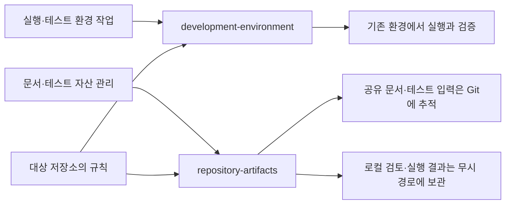

# 개발환경과 저장소 산출물

이 가이드는 스킬과 플러그인을 개발할 때 사용할 환경과 산출물의 보관 위치를 설명한다.

## 역할과 선택

| 담당 | 역할 |
|---|---|
| [`development-environment`](../skills/custom/development-environment/SKILL.md) | 기존 스택에서 실행·테스트 환경을 구성하고 필요한 의존성이나 시뮬레이터를 검증 |
| [`repository-artifacts`](../skills/custom/repository-artifacts/SKILL.md) | 공유할 문서와 테스트 자산을 정하고 로컬 검토 자료와 실행 결과의 보관 위치를 확인 |
| 대상 저장소의 repo-governance 계약 | 채택한 문서 경로, Git 추적 제약과 검사 규칙을 정의 |
| 대상 저장소 | 실제 환경 설정, 실행 파일, 테스트와 CI 설정을 관리 |

스킬은 작업 목적에 따라 선택한다.
대상 저장소가 repo-governance 계약을 채택했다면 해당 경로와 제약을 우선한다.
스킬 설치와 repo-governance 계약 채택은 각 저장소에서 독립적으로 정한다.

## 개발환경과 테스트

기존 실행·테스트 명령으로 충분하면 그 명령을 사용한다.
개발환경을 보완할 때는 런타임, 잠금 파일, 지원 프레임워크와 배포 경로부터 확인한다.
Windows 서비스의 호스트 동작은 실제 Windows에서 필요한 범위를 검증한다.
Deployment Simulator는 검증할 외부 경계나 장애 시나리오에 필요할 때 선택한다.

이 저장소의 루트에서는 `npm test`로 단독 스킬의 배치와 카탈로그의 배포 파일을 확인한다.
플러그인의 빌드와 테스트는 각 패키지에서 실행한다. [플러그인별 명령](deployment.md#새-버전-게시)

## 문서와 테스트 자산

| 자료 | 이 저장소에서 보관할 위치 |
|---|---|
| 유지하는 배포·개발 가이드 | `docs/`에서 Git 추적 |
| OpenSpec 제안·설계·명세·진행 상태 | `openspec/`의 기존 규약에 따라 Git 추적 |
| 공유할 검증 보고서 | `docs/history/`에서 Git 추적 |
| 로컬 검토 초안과 원시 진단 결과 | Git에서 무시하는 `.local/reviews/` 또는 `.local/artifacts/` |
| 플러그인 테스트, 픽스처와 승인된 기준 데이터 | 해당 `packages/<name>/`에서 Git 추적 |
| 공개 배포를 검사하는 공통 테스트 | [`tests/distribution.test.mjs`](../tests/distribution.test.mjs)에서 Git 추적 |
| 생성한 테스트 보고서, 커버리지와 추적 로그 | Git에서 무시하는 도구의 출력 경로 또는 로컬 경로 |

새 도구의 출력 경로를 확인할 때는 `git check-ignore -v -- <path>`로 실제 제외 여부를 확인한다.
커밋할 때는 staged 파일 목록과 diff를 확인한다.
추적 중인 파일을 정리할 때는 현재 트리와 과거 커밋을 각각 확인한다. [Git의 제외 규칙](https://git-scm.com/docs/gitignore)
