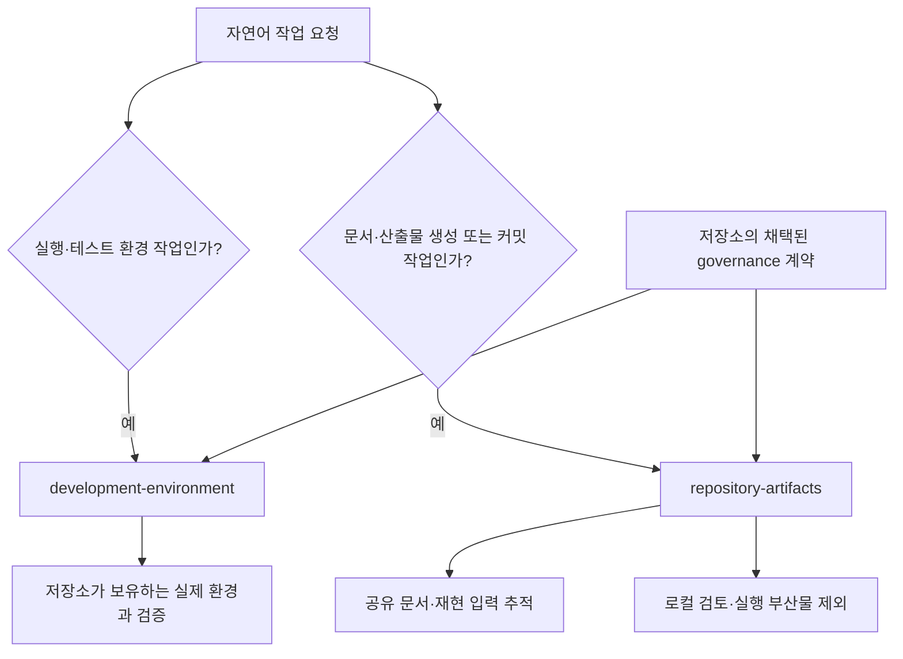

# 개발환경과 저장소 산출물

이 가이드는 두 PC에 배포하는 공통 판단 기준을 설명한다.
실제 실행환경과 파일 경로는 대상 저장소의 기존 규약을 따른다.

## 역할과 선택

| 담당 | 역할 |
|---|---|
| Personal Harness | 작업 목적에 맞는 스킬을 명시적 호출 없이 선택하도록 사용자 지침을 배포 |
| `development-environment` | 저장소의 기존 스택으로 실행·테스트 환경을 구성하고 필요한 의존성·시뮬레이터를 검증 |
| `repository-artifacts` | 공유 문서·로컬 검토 자료·테스트 입력·생성 결과의 보존과 추적 여부 판단 |
| 대상 저장소의 repo-governance 계약 | 채택된 문서 경로·추적 제약·검사 규칙의 소유권 유지 |
| 대상 저장소 | 실제 Compose·스크립트·시뮬레이터·테스트·ignore·CI 설정 보유 |

repo-governance에 채택된 규칙이 있으면 해당 경로와 제약을 우선한다.
공통 스킬은 그 제약 안에서 구현하고 규칙이 없는 작업의 기본 판단을 제공한다.
파일 포함·제외의 권위 있는 규칙과 기계 검사는 repo-governance 또는 대상 저장소가 소유한다.
이 문서의 기본 판단은 그 검사에 대한 두 번째 규약을 만들지 않는다.
두 PC에 스킬을 설치하는 것은 개별 저장소의 governance 채택을 뜻하지 않는다.
채택된 계약에 오류나 차단 조건이 있으면 해당 계약의 해결 절차를 따른다.
공통 스킬이 별도 승인 단계·hook·일괄 검사를 추가하지 않는다.
repo-governance 플러그인과 캐시는 이 기능의 배포 대상이 아니다.

## 개발환경의 범위

기존 실행·테스트 명령으로 충분하면 환경을 추가하지 않는다.
개발환경 보완이 필요하면 기존 런타임·lock·TFM·명령 실행기·배포 경로부터 확인한다.
Compose는 호환되는 의존성을 실행하는 선택지다.
Windows 서비스의 호스트 동작은 실제 Windows에서 필요한 범위를 검증한다.
시뮬레이터는 관련 외부 경계와 결정적인 장애 시나리오에 필요할 때 선택한다.
Deployment Simulator를 포함한 시뮬레이터는 모든 작업의 선행 조건이 아니다.

새 애플리케이션 레이어나 `infra/`·`simulators/` 디렉터리를 일괄 생성하지 않는다.
실제로 쓰는 자산만 저장소의 기존 위치에 둔다.
지속적으로 유지할 개발 가이드에는 준비·실행·readiness·테스트·상태 초기화·종료와 미검증 경계를 기록한다.

## 문서와 테스트 자산

| 종류 | 이 저장소의 처리 |
|---|---|
| 유지하는 설치·개발·운영 가이드 | `docs/`에서 Git 추적 |
| OpenSpec 제안·설계·명세·진행 상태 | 기존 `openspec/` 생명주기로 Git 추적 |
| 공유하기로 남긴 적용·검증 기록 | 기존 `docs/history/` 추적 유지 |
| 일회성 검토 초안·원시 진단 결과 | 무시되는 `.local/reviews/` 또는 `.local/artifacts/` |
| 하네스 테스트·픽스처·승인된 기준 데이터 | `packages/harness/tests/`에서 Git 추적 |
| 플러그인 테스트·픽스처·승인된 기준 데이터 | 각 `packages/<name>/`의 테스트 위치에서 Git 추적 |
| 여러 패키지에 걸친 마켓플레이스 테스트 | 루트 `tests/test_codex_marketplace.py`에서 Git 추적 |
| 생성된 테스트 보고서·coverage·trace | 무시되는 로컬 경로나 도구의 지정 출력 디렉터리 |

검토 문서라는 이름만으로 추적을 해제하지 않는다.
실행 스크린샷과 회귀 테스트 기준 이미지는 목적이 다르다.
산출물 판단 기준을 추가하는 변경만으로 기존 `docs/history/`나 테스트 자산을 옮기지 않는다.

이 저장소는 `.local/`, `.audit/`와 지정한 루트 테스트 출력 디렉터리를 제외한다.
새 도구의 실제 출력 경로는 별도로 확인한다.
모든 저장소에 같은 ignore 목록을 배포하지 않는다.

## Git과 패키지의 경계

커밋 준비 시 staged 파일과 diff를 확인한다.
이미 추적 중인 파일은 ignore 규칙만 추가해도 추적이 해제되지 않는다.
현재 트리에서 제거해도 과거 커밋이 삭제되는 것은 아니다.
필요한 정리는 허용된 범위의 파일에 한정한다.

`package.json`의 `files`와 Git 제외는 별도다.
현재 패키지에서는 `docs/history/`를 제외하지만 Git에는 추적한다.
CI 보고서 업로드와 보존 기간도 Git 추적과 별도다.

공식 근거는 [Git ignore 설명](https://git-scm.com/docs/gitignore)과 [npm 패키지 파일 선택](https://docs.npmjs.com/cli/v11/configuring-npm/package-json/#files)을 참고한다.
