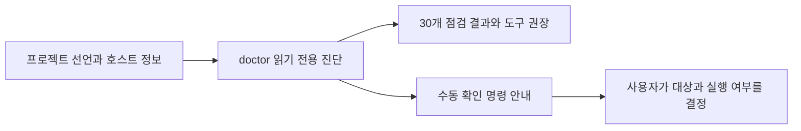

# Codex 플러그인의 기능 범위

로컬 플러그인은 도구 권장, 읽기 전용 진단, 수동 확인 명령 안내를 제공합니다.
이전 버전의 Codex 앱 관찰은 [검증 기록](verification.md)에서 확인합니다.
명령 사용법은 [진단 CLI 사용법](diagnostic-cli.md)에 기록합니다.
전체 제품의 목적은 [프로젝트 범위](project-scope.md)에 기록합니다.

## 대상 환경

지원 대상 계열은 Node.js·Python·Go·Rust·Zig·C#입니다.
Node.js 계열에는 JavaScript와 TypeScript 프로젝트를 포함합니다.
C#은 .NET SDK를 기준으로 다룹니다.
필요한 계열은 프로젝트 선언과 사용자가 선택한 실행 문맥에서 결정합니다.

CLI의 실행 기준은 Windows 11 x64, Node.js 24 이상과 PowerShell 7입니다.
Windows 네이티브·WSL 2·Docker 기반 Linux 컨테이너를 서로 다른 실행 문맥으로 다룹니다.
이 범위는 모든 아키텍처와 도구 조합의 실호스트 검증 완료 목록이 아닙니다.
ARM64와 앱별 셸 동작은 별도 검증이 필요합니다.

## 기본 점검

플러그인의 Skill은 `environment-doctor` 하나입니다.
CLI는 `doctor`를 사용합니다.
매니페스트의 기능 표시는 `Read`입니다.
정적 분석과 허용한 읽기 전용 조회를 30개 점검 ID에 연결합니다.
프로젝트 요구·명령 후보·확인한 실행 버전·공식 지원 계열·권장 구성의 차이를 구분합니다.
조회 실패와 실제 요구 위반을 다른 결과로 보고합니다.
미검증 wrapper·proxy·shim은 실행을 보류합니다.
조회할 실행 파일은 경로와 PE 형식 등을 확인합니다.

상위 버전 선언, 명시적인 패키지 작업 공간과 GitHub Actions의 정적 요구를 분석합니다.
Python 가상환경은 선언된 요구와 실제 선택된 인터프리터의 관찰을 구분합니다.
Process Compose의 셸·작업 경로·의존·건강 확인·포트는 정적으로 확인합니다.
Compose 서비스와 devcontainer 문맥은 별도 근거로 기록합니다.
DB 서비스가 있다는 이유로 앱의 호스트 언어 요구를 제외하지 않습니다.
mise tasks·Taskfile·Justfile·Makefile·npm scripts는 선언을 정적으로 확인합니다.

기본 점검은 설치·사용자 프로필 변경·프로젝트 명령 실행·서비스 기동을 수행하지 않습니다.
WSL 호스트 조회는 배포판 내부 실행과 구분합니다.
Docker 클라이언트·context·Compose 조회는 엔진과 서비스의 실제 실행 검증과 구분합니다.
Lazydocker는 TUI 기동 없이 명령과 관련 메타데이터를 확인합니다.

## 도구 권장과 수동 확인 명령

권장 구성과의 차이는 프로젝트 요구 위반과 구분합니다.
권장안은 기존 런타임 선언·패키지 관리자·잠금 파일·빌드 명령·CI를 고려합니다.
이미 저장된 유지 사유는 `--state-dir`로 지정한 경로에서 읽을 수 있습니다.

`RUST-02`, `WSL-02`, `CTR-02`, `PC-02`의 실제 동작 확인은 사용자가 맡습니다.
`doctor`는 각 ID를 `skipped`로 두고 필요한 확인 명령을 안내합니다.
JSON은 `commandGuidance`의 각 항목에 `tool`, `args`, `description`을 담습니다.
안내할 명령이 있으면 텍스트 보고서의 **직접 실행할 명령** 절에 표시합니다. [명령과 결과 형식](diagnostic-cli.md#수동-확인-명령)

## 공식 지원의 해석

공식 지원은 2026-11-17 기준의 오프라인 정책 스냅샷으로 판정합니다.
스냅샷은 30일간 유효하며 만료일은 2026-12-17입니다.
기간 밖의 정책과 수록하지 않은 도구는 미확인으로 남깁니다.
릴리스 계열 지원은 최신 패치·취약점·모든 플랫폼 조합의 확인과 구분합니다.

## 패키지와 앱 검증

플러그인은 로컬에서 설치하고 실행할 수 있는 패키지로 구성합니다.
기존 Codex 셸과 파일 기능으로 충족하는 작업에 별도 MCP 서버를 추가하지 않습니다.
클라우드 서버와 사이트 호스팅을 기본 의존성으로 두지 않습니다.
번들에는 실행 의존성 네 개를 포함합니다.
esbuild는 빌드할 때만 사용합니다.
배포 패키지는 설치 루트의 `dist/cli.mjs`를 진입점으로 사용합니다.
설치와 대상 프로젝트의 경로 지정 방법은 [CLI 사용법](diagnostic-cli.md#실행-전제조건)에 기록합니다.

`--app`은 앱과 공유하는 플러그인 설치 목록을 조회합니다.
`--ide`는 VS Code와 네이티브 빌드 도구의 선택적 점검을 요청합니다.
실제 Skill 호출의 근거는 Codex 앱에서 설치본의 CLI를 실행한 기록입니다.

## 이전 구현 이력

0.1.0은 제한된 정적 분석과 로컬 조회를 제공하는 첫 플러그인 소스였습니다.
설정 적용과 P1 실행 검증을 후속 범위로 남겼습니다.
0.2에는 계획·적용·복구·예외·선택 실행 검증을 구현했습니다.
0.2.1 및 이전 버전의 실제 호출은 과거 검증 이력입니다. [검증 기록](verification.md)
