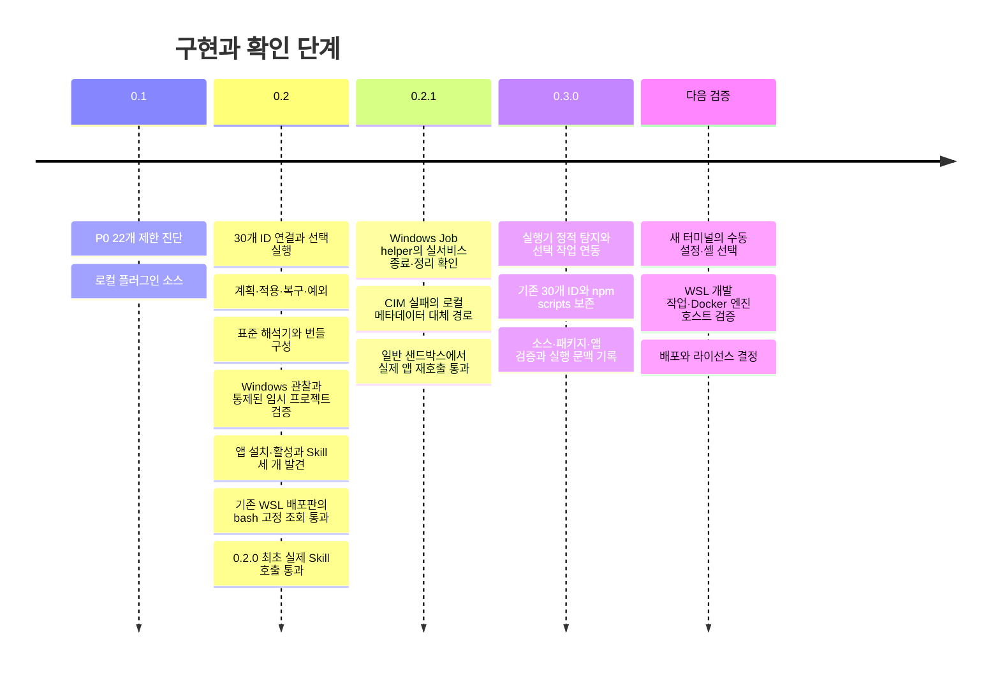

# 구현과 검증 이력

이 문서는 2026-11-18 로드맵에 기록한 버전별 구현과 검증을 보존합니다.
아래의 후속 항목은 당시 계획입니다.
설정 적용·기동 검증·작업 실행은 당시 범위에 속합니다.

현재 기능은 [플러그인 범위](plugin-scope.md)에서 확인할 수 있습니다.
소스·패키지·실호스트·앱의 관찰은 [검증 기록](verification.md)에 있습니다.

## 0.3.1 실행 검증과 판정 개선

- [x] 선택한 작업에 실행 근거가 없으면 종료 코드 1을 반환합니다.
- [x] WSL의 호스트 조회와 선택 작업의 결과를 구분합니다.
- [x] Rust 링크 검증을 시작하려면 Rust 대상 또는 작업 문맥을 명시합니다.
- [x] 프로젝트 분석과 SDK 확인에 같은 `global.json` 해석 규칙을 적용합니다.
- [x] Python이 사용 중인 가상환경의 경로를 프로젝트에서 확인한 경로와 비교합니다.
- [x] 텍스트 보고서에 버전 요구 범위와 선언 출처, 다음 조치를 표시합니다.
- [x] 설치용 CLI 번들과 PowerShell 런타임 파일을 현재 소스와 대조합니다.

## 0.3.0 작업 실행기 통합

0.3.0은 작업 실행기 탐지·권장 비교·선택 실행 연동을 포함합니다.
구현 상태와 실제 검증 근거는 [검증 기록](verification.md)에 맞춰 확정합니다.

- [x] 신규 다중언어 프로젝트의 기본 권장에 mise tasks를 명시했습니다.
- [x] 기존 Task·just·Make·npm scripts의 전환안과 유지 사유를 구분했습니다.
- [x] 역할·파일 예시·Windows 셸·CI·언어 CLI·서비스 관리 도구의 관계를 [독립 가이드](task-runners.md)에 기록했습니다.
- [x] 실행기 정적 탐지와 includes·동적 문법의 `unknown` 처리에 대한 통합 검사를 통과했습니다.
- [x] 기존 SH-01·ENV-02·PATH-01·REQ-01·RCM-01과 30개 check ID 계약의 보존을 확인했습니다.
- [x] mise·task·just·make와 프로젝트 내부 `cwd`·`env`의 실행 계약을 검증했습니다.
- [x] mise 자동 설치 비활성화와 별도 신뢰 변경 명령을 추가하지 않는 계약을 확인했습니다.
- [x] 원시 출력·환경 값·비밀 값이 보고서에 포함되지 않는지 확인했습니다.
- [x] 0.3.0의 소스 테스트·패키지 검사·실제 앱 검증 결과를 각각 기록했습니다.

기본 진단은 목록 조회나 dry run을 자동 실행하지 않습니다.
`--task-file`은 플러그인 JSON이며 Go Task의 Taskfile 옵션이 아닙니다.
실행기의 필수 설치·기존 설정 자동 변환·새 hook·필수 마이그레이션을 추가하지 않습니다.
기존 npm scripts와 Node.js 24·PowerShell 7의 실행 기준을 보존합니다.

## 구현한 기준

- [x] 지원 대상 계열을 Node.js·Python·Go·Rust·Zig·C#으로 정했습니다.
- [x] Windows 네이티브·WSL 2·Docker 문맥을 구분했습니다.
- [x] 프로젝트 요구와 공통 권장 구성의 차이를 별도로 판정했습니다.
- [x] 기존 런타임·패키지 관리자·잠금 파일·빌드 명령·CI를 보존하는 원칙을 반영했습니다.

도구의 역할과 선택 조건은 [Windows 개발환경](windows-environment.md)에 기록합니다.
제품과 플러그인의 범위는 [프로젝트 범위](project-scope.md)와 [플러그인 범위](plugin-scope.md)에 기록합니다.

## 0.2 진단 구현

- [x] 기본 `doctor`에 P0 22개와 P1 8개의 점검 ID를 연결했습니다.
- [x] 표준 TOML·YAML과 언어별 버전 비교 라이브러리를 적용했습니다.
- [x] 상위 버전 선언의 경계와 언어별 가까운 선언의 우선순위를 분석했습니다.
- [x] 명시적인 패키지 작업 공간과 GitHub Actions의 정적 요구를 기록했습니다.
- [x] Python 가상환경과 Process Compose·Compose·devcontainer 메타데이터를 분석했습니다.
- [x] 호스트 언어의 적용 근거와 컨테이너 서비스의 존재를 구분했습니다.
- [x] 검증한 PE 실행 파일과 허용한 읽기 전용 조회를 사용했습니다.
- [x] mise 설치 목록·실제 경로·.NET SDK 선택·Git 정책의 추가 조회를 연결했습니다.
- [x] WSL·Docker·Lazydocker·Process Compose의 호스트 진단을 연결했습니다.
- [x] 앱·IDE·보조 도구·저장소 볼륨의 선택적 점검을 연결했습니다.
- [x] 30일 유효기간의 오프라인 공식 지원 정책을 연결했습니다.

모든 ID가 연결되어도 해당 요청이 없거나 근거가 부족하면 생략 또는 미확인으로 보고합니다.
실행 방법은 [진단 CLI 사용법](diagnostic-cli.md)에 기록합니다.
점검 ID의 의미는 [환경 점검 설계안](environment-checks.md)을 따릅니다.

## 0.2 설정과 복구 구현

- [x] 역할과 정확한 버전을 선택하는 `plan`을 구현했습니다.
- [x] 검토한 계획을 적용하는 `apply --execute`를 구현했습니다.
- [x] 선택한 프로필의 관리 블록과 프로젝트 mise 선언을 처리했습니다.
- [x] 저장소 밖의 계획·백업·저널·예외 기록을 구현했습니다.
- [x] 계획과 입력 해시가 바뀌면 적용을 거부하는 검사를 구현했습니다.
- [x] 같은 계획의 재적용과 변경 없는 결과를 처리했습니다.
- [x] 사용자 편집을 보존하는 `rollback --execute`를 구현했습니다.
- [x] 프로젝트·역할·이유·범위의 유지 예외를 저장했습니다.
- [x] 공유 설치의 자동 제거와 파일 복구를 구분했습니다.

모듈 계약과 보존 조건은 [완료 계약](completion-contract.md)에 기록합니다.
실제 사용자 프로필과 설치 도구를 변경하는 검증은 별도 요청 범위에서 수행해야 합니다.

## 0.2 실행 검증과 패키지 구현

- [x] `validate --execute`로 실행 범위를 구분했습니다.
- [x] 임시 소스의 Rust target 링크와 실제 산출물을 검사하는 경로를 구현했습니다.
- [x] 선택한 WSL 배포판의 Linux 작업 경로·셸·도구를 확인하는 경로를 구현했습니다.
- [x] Docker context·엔진·로컬 이미지·선택 Compose 서비스의 검증 경로를 구현했습니다.
- [x] Process Compose의 시작·준비 상태·종료와 자체 세션 정리를 구현했습니다.
- [x] 신뢰한 작업 파일의 native·rust·wsl 실행 문맥을 구분했습니다.
- [x] 호스트 개발 작업의 상태·종료 코드를 별도 `task` 필드로 보고했습니다.
- [x] 네 개의 실행 의존성을 포함하는 Node.js 24 번들 빌드를 구현했습니다.
- [x] 로컬 플러그인 패키지와 서드파티 고지 생성을 구현했습니다.

기동 코드를 구현했다는 사실과 실제 개발 서비스의 검증 성공은 구분합니다.
빌드와 모듈 구조는 [구현 구조](implementation-plan.md)에 기록합니다.

## 과거 실호스트 검증 계획

### 확인한 관찰

- [x] 실제 Windows에서 30개 ID의 doctor 보고서를 생성했습니다.
- [x] Node.js와 Python의 실제 실행·버전 확인에 성공했습니다.
- [x] Go PE 실행 파일의 내장 버전을 확인했습니다.
- [x] 통제된 임시 프로젝트에서 plan preview를 확인했습니다.
- [x] 통제된 임시 프로젝트에서 실제 apply와 동일 계획의 재적용이 통과했습니다.
- [x] 통제된 임시 프로젝트에서 실제 rollback과 exception 저장이 통과했습니다.
- [x] 통제된 임시 npm 프로젝트의 개발 작업이 실제 실행에서 통과했습니다.
- [x] 실제 Process Compose 서비스의 시작이 통과했습니다.
- [x] 실제 Process Compose 서비스의 readiness가 통과했습니다.
- [x] Windows Job helper로 실제 Process Compose 서비스의 stop이 통과했습니다.
- [x] 실제 정리 결과의 `forced: false`와 `proof: windows_job_empty`를 확인했습니다.
- [x] 기존 Ubuntu-24.04의 지정 경로에서 `--linux-tools bash`로 `WSL-02: pass`를 확인했습니다.
- [x] WSL 고정 조회로 Linux·x86_64와 `/usr/bin/sh`·`/usr/bin/bash` 5.2.21을 확인했습니다.

Go PE 내장 버전은 Go 명령 실행과 다른 관찰입니다.
30개 보고서 생성은 모든 ID의 통과를 뜻하지 않습니다.
통제된 임시 프로젝트의 결과를 실제 사용자 설정 전체에 일반화하지 않습니다.

### 남은 확인

- [ ] 다양한 실제 프로젝트에서 30개 ID의 적용·생략·미확인 근거를 대조합니다.
- [ ] 실제 실행 경로와 선택 버전이 관리자 설치 목록과 일치하는지 확인합니다.
- [ ] 실제 프로필 적용과 사용자 편집 이후의 복구 충돌을 확인합니다.
- [ ] 요청한 WSL 배포판과 Linux 작업 경로에서 개발 명령을 확인합니다.
- [ ] 요청한 Docker context에서 테스트 자원의 생성·준비·정리를 확인합니다.
- [ ] 실제 사용자 환경의 상태 디렉터리와 백업·저널·예외 보존을 확인합니다.
- [ ] 통제된 임시 프로젝트 외의 기존 빌드·테스트 명령을 선택 실행해 결과를 남깁니다.

WSL에서는 기존 배포판의 고정 조회만 실행했으며 전체 언어 환경을 설치하지 않았습니다.
프로젝트 개발 명령과 추가 Linux 도구의 실제 검증은 남아 있습니다.
Docker 엔진은 검증할 호스트가 없어 CI·모의 조회의 확인 범위에 머뭅니다.
Process Compose는 Windows Job helper의 실서비스 start·readiness·stop과 정리 근거까지 확인했습니다.
0.2.1에는 로컬 CIM 실패 시 프로세스·레지스트리 메타데이터의 읽기 전용 대체 경로를 반영했습니다.
일반 샌드박스의 최신 0.2.1 앱 재호출에서 `context.metadataSource: local-process-and-registry`를 확인했습니다.
이 실행에는 권한 상승이 없었습니다.
전달된 소스 테스트는 총 264개 중 통과 261개·실패 0개·생략 3개입니다.

실호스트 검증은 사용자가 선택한 대상과 명시적인 실행 요청으로 한정합니다.
기존 서비스와 사용자 자료의 정리를 검증 절차에 포함하지 않습니다.
확인 결과는 [검증 기록](verification.md)에 반영합니다.

## 과거 앱 검증과 배포 계획

### 확인한 관찰

- [x] 로컬 플러그인 0.2.0을 설치했습니다.
- [x] 설치 상태의 `enabled: true`를 확인했습니다.
- [x] Codex 앱의 플러그인 화면에서 Skill 세 개를 발견했습니다.
- [x] 화면 스크린샷을 추적하지 않는 `.local/`에 보관했습니다.
- [x] 0.2.0의 최초 실제 Skill 호출에서 30개 ID 보고서를 확인했습니다.
- [x] 최초 앱 호출 결과의 `CODEX-01: pass`를 확인했습니다.
- [x] 최신 0.2.1을 일반 샌드박스의 `use_default`로 실제 재호출했습니다.
- [x] 권한 상승 없이 첫 실행의 종료 코드 0을 확인했습니다.
- [x] 메타데이터 출처 `local-process-and-registry`를 확인했습니다.
- [x] checkId 수와 고유 ID 수가 각각 30개임을 확인했습니다.
- [x] 통과 11개·실패 0개·검토 0개·미확인 4개·생략 15개의 집계를 확인했습니다.
- [x] 최신 앱 호출의 `CODEX-01: pass`에서 설치·활성과 버전 0.2.1을 확인했습니다.

### 남은 확인

- [ ] 새 터미널의 수동 설정 선택과 에이전트 실행 문맥의 셸 경로·프로필을 각각 확인합니다.
- [ ] 설치용 번들이 소스 체크아웃 의존성 없이 필요한 지원 파일을 찾는지 확인합니다.
- [ ] 공개 배포 전 라이선스와 등록·업데이트 방식을 결정합니다.

로컬 패키지 생성과 계정 등록·공개 게시를 같은 완료 상태로 취급하지 않습니다.

## 이전 로드맵 이력

0.1의 미완료 목록에는 상위 선언·관리자 선택·엔진 연결·실행 검증·설정 적용이 포함되어 있었습니다.
이 항목의 구현 진도는 위의 0.2 목록으로 갱신했습니다.
당시의 후속 구현 표현을 현재 기능 부재로 해석하지 않습니다.
실호스트와 앱의 미확인 항목은 다음 검증 목록에 남깁니다.
