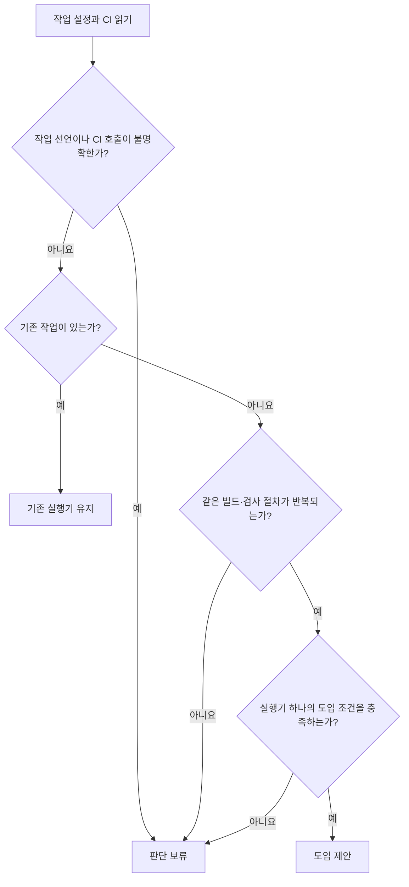
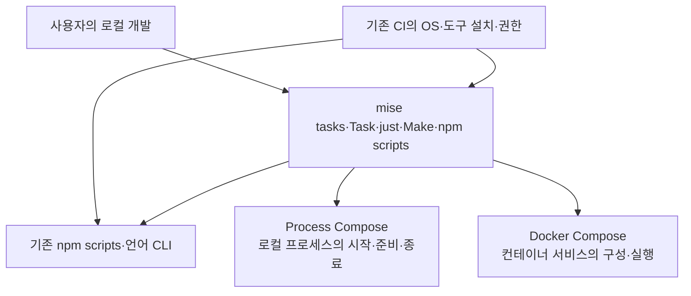

# 프로젝트 작업 실행기 선택 가이드

플러그인은 기존 작업을 우선 유지합니다.
새 공통 작업이 필요한 근거를 찾으면 실행기 도입을 제안합니다.
공식 자료 확인일은 2026-11-19입니다.
플러그인의 버전별 검증은 [검증 기록](verification.md)에서 확인합니다.

## 신규 프로젝트와 기존 프로젝트의 선택

제약이 없는 신규 다중언어 프로젝트에는 mise tasks를 기본 권장합니다.
도구 버전 선언과 공통 작업 진입점을 같은 구성에서 관리하려는 저장소의 선택입니다.
기존 선언과 CI가 연결된 프로젝트는 현재 작업 진입점을 우선합니다.

| 선택 | 설정 파일과 호출 예 | 기존 구성을 유지하는 근거 | 새 구성을 제안하는 근거 |
| --- | --- | --- | --- |
| mise tasks | `mise.toml`의 `[tasks]`, `mise run check` | 선언한 mise 작업을 CI나 로컬에서 진입점으로 쓸 수 있음 | 반복 절차가 선언된 두 언어 이상을 쓰거나 루트 mise에서 이미 해당 언어 도구를 관리함 |
| Go Task | `Taskfile.yml`, `task check` | 기존 YAML 작업의 이름과 호출 관계를 확인함 | 절차가 반복되고 저장소 도구 버전 선언이나 해당 CI 작업들이 Go Task를 선택함 |
| just | `justfile`, `just check` | 기존 레시피 이름과 작업 범위를 확인함 | 절차가 반복되고 저장소 도구 버전 선언이나 해당 CI 작업들이 just를 선택함 |
| GNU Make | `Makefile`, `make check` | 기존 파일 대상과 선행 조건을 보존할 수 있음 | 저장소 설정이나 관련 CI가 GNU Make를 선택하고 반복 절차에서 컴파일 산출물이 링크 입력으로 연결됨 |
| npm scripts | `package.json`의 `scripts`, `npm run check` | 루트 스크립트 선언 또는 해당 선언과 CI 호출의 일치를 확인함 | 루트 Node.js 패키지가 npm을 사용하고 반복되는 절차가 Node.js 작업으로 구성됨 |

### 자동 판정 기준

플러그인은 이름이 있는 기존 작업을 유지할 근거로 사용합니다.
CI 호출의 경로와 작업 이름이 일치하면 해당 작업의 선언 파일을 표시합니다.
여러 실행기에서 작업을 확인하면 각 실행기의 유지를 권장합니다.



신규 제안은 서로 다른 GitHub Actions 호스트 작업이 기본 checkout 이후 저장소 루트에서 같은 빌드·검사 절차를 반복 선언할 때 검토합니다.
반복 절차로 판정하려면 두 개 이상의 연속 `run` 단계가 각각 같은 정적 명령 한 줄을 같은 순서로 선언해야 합니다.
의존성 설치나 실행기 버전 확인은 공통 작업의 빌드·검사 명령으로 계산하지 않습니다.
Go Task·just·GNU Make는 반복 절차의 CI가 공통으로 준비하는 실행기나 프로젝트에 고정한 실행기 버전으로 선택 근거를 확인합니다.
Makefile을 제안하려면 한 컴파일 단계의 오브젝트 파일이 뒤따르는 링크 단계의 입력으로 쓰이는 사실도 확인합니다.
루트 Node.js 패키지가 npm을 사용한다는 근거는 npm 잠금 파일이나 매니페스트의 정확한 npm 버전에서 확인합니다.
다른 실행기가 명시적으로 선택되어 있으면 그 도구의 제안 조건부터 확인합니다.
Node.js 전용 절차에 npm 선택 근거가 있으면 npm scripts를 우선합니다.

CI 호출 범위나 호출한 작업의 선언을 확인하지 못하면 판단을 보류합니다.
선택 근거가 서로 충돌해도 판단을 보류합니다.
플러그인은 판정에 사용한 설정 파일과 CI 위치를 보여줍니다.
작업 실행은 별도로 검증합니다.
실행기 설치와 설정 파일 생성은 별도 적용 단계의 변경 작업입니다.

작업 실행기별 선언과 의존 관계는 공식 자료를 대조했습니다. [mise tasks](https://mise.jdx.dev/tasks/) · [Go Task 의존 작업](https://taskfile.dev/docs/guide/dependencies) · [just 매뉴얼](https://just.systems/man/en/) · [GNU Make 규칙](https://www.gnu.org/software/make/manual/html_node/Rules.html) · [npm scripts](https://docs.npmjs.com/cli/using-npm/scripts)

`node --test test/task-runner-report.test.mjs test/task-runners.test.mjs`로 판정 기준을 재현할 수 있습니다.
반복 절차 중 한 곳의 명령 순서를 바꾸면 해당 절차를 근거로 한 도입 제안은 사라져야 합니다.
링크 입력에서 앞서 만든 오브젝트 파일을 빼면 GNU Make 도입 제안은 사라져야 합니다.

mise도 작업 의존 순서와 캐시 기능을 지원합니다.
`depends`로 선행 작업을 선언할 수 있습니다.
`sources`와 `outputs`로 입력·산출물의 변경에 따른 실행 생략을 구성할 수 있습니다.
별도의 산출물 캐시는 확인일의 문서에서 실험 기능으로 구분합니다.
실제 프로젝트의 mise 버전이 제공하는 범위를 대조합니다. [mise 작업 설정](https://mise.jdx.dev/tasks/task-configuration.html), [mise 작업 캐시](https://mise.jdx.dev/tasks/caching.html)

Task도 입력과 산출물의 변경을 기준으로 실행 여부를 정할 수 있습니다. [Task 변경 판정](https://taskfile.dev/docs/guide/up-to-date)
just는 프로젝트 명령을 실행하는 도구로 설명됩니다. [just 매뉴얼](https://just.systems/man/en/)
GNU Make의 규칙은 대상·선행 조건·recipe를 연결합니다. [GNU Make 규칙 문법](https://www.gnu.org/software/make/manual/html_node/Rule-Syntax.html)

## 설정 파일의 최소 예시

다음 예시는 설정 형식과 호출 관계를 보여줍니다.
각 명령은 해당 프로젝트에 이미 존재하는 검사 명령으로 바꿉니다.
예시를 읽는 것만으로 설정 파일을 생성하거나 작업을 실행하지 않습니다.

### mise.toml

이 예시는 Node.js 검사와 Python 검사를 공통 `check` 작업에 연결합니다.
PowerShell 7을 사용하는 작업에는 `shell`을 명시합니다.
런타임 버전은 기존 프로젝트의 선언을 보존합니다.

```toml
[tasks."check:node"]
shell = "pwsh -NoProfile -NonInteractive -Command"
run = "node --test"

[tasks."check:python"]
shell = "pwsh -NoProfile -NonInteractive -Command"
run = "python -m unittest discover"

[tasks.check]
depends = ["check:node", "check:python"]
```

호출은 `mise run check`입니다.
공유 자원을 사용하는 검사라면 프로젝트의 실제 실행 순서를 별도로 설계합니다.
mise tasks의 역할과 기본 호출은 [공식 작업 안내](https://mise.jdx.dev/tasks/)를 따릅니다.

### Taskfile.yml

Taskfile은 YAML로 이름 있는 작업과 실행 명령을 정의합니다.
이 예시의 `check`는 Node.js의 기존 검사 명령을 호출합니다.

```yaml
version: '3'
tasks:
  check:
    cmds:
      - node --test
```

호출은 `task check`입니다.
Task의 `includes`나 동적 변수는 정적 진단에서 실행해 해석하지 않습니다.

### Justfile

Justfile은 이름 있는 recipe를 정의합니다.
이 예시는 Windows에서 사용하는 셸을 PowerShell 7로 명시합니다.
just 1.52.0과 호환되는 Windows 셸 설정을 사용합니다.

```just
set windows-shell := ["pwsh", "-NoLogo", "-NoProfile", "-Command"]

check:
    node --test
```

호출은 `just check`입니다.
최신 공식 문서의 `[windows]`와 `set shell` 조합을 설치 버전에 그대로 적용하지 않습니다.
공유된 just 1.52.0 실호스트 관찰에서는 이 조합이 속성 오류로 실패했습니다.
설정 구문은 프로젝트의 just 버전과 대조합니다. [just 셸 설정](https://just.systems/man/en/shell.html)

### Makefile

Makefile은 대상과 선행 조건 아래에 recipe를 둡니다.
검사처럼 파일을 만들지 않는 진입점은 `.PHONY`로 표시합니다.
아래 `node --test` 행은 실제 탭 문자로 들여씁니다.

```make
.PHONY: check
check:
	node --test
```

호출은 `make check`입니다.
플러그인은 Makefile을 읽기 위해 `make`를 실행하지 않습니다.

## Windows에서 셸을 구분하는 방법

실행기를 PowerShell에서 호출해도 내부 작업이 PowerShell 문법을 사용한다는 뜻은 아닙니다.
대화형 셸과 실행기의 명령 해석기를 각각 확인합니다.
`$env:NAME`, `%NAME%`, `$NAME`은 같은 셸 문법으로 취급하지 않습니다.

| 실행기 | 확인일의 기본 동작 | PowerShell 7이 필요한 작업 |
| --- | --- | --- |
| mise | Windows 인라인 작업의 기본 해석기는 `cmd /c` | 작업의 `shell = "pwsh -NoProfile -NonInteractive -Command"`처럼 명시 |
| Task | Windows에서도 내장 셸 인터프리터 사용 | 명령에서 `pwsh -NoProfile -NonInteractive -File <스크립트.ps1>` 호출 |
| just | Windows에서도 기본값은 `sh -cu` | just 1.52.0 예시는 `set windows-shell := ["pwsh", "-NoLogo", "-NoProfile", "-Command"]` 사용 |
| GNU Make | 배포 환경과 `SHELL` 등의 설정을 확인 | 기존 recipe의 해석기를 보존하고 필요한 곳에 `pwsh` 명시 |

mise의 기본 셸은 [mise 설정](https://mise.jdx.dev/configuration/settings.html)의 Windows 셸 항목을 근거로 합니다.
Task는 대화형 셸의 시작 설정을 불러오는 방식으로 동작하지 않습니다. [Task v3.54.0 플랫폼과 셸](https://github.com/go-task/task/blob/v3.54.0/website/src/latest/docs/guide/platforms.md)
just의 기본 셸과 Windows 재정의는 [공식 셸 안내](https://just.systems/man/en/shell.html)를 근거로 합니다.
GNU Make의 Windows 셸 선택은 사용하는 배포와 선언을 함께 확인합니다. [GNU Make 셸 선택](https://www.gnu.org/software/make/manual/html_node/Choosing-the-Shell.html)

## CI와 언어 CLI 및 서비스 관리 도구의 관계

작업 실행기는 기존 언어 CLI와 프로젝트 명령을 묶는 진입점입니다.
CI는 선택한 운영체제와 설치 환경에서 그 진입점 또는 기존 명령을 호출합니다.
`npm run`, `python -m`, `go test`, `cargo test`, `zig build`, `dotnet test`의 의미는 각 도구에 남습니다.
서비스의 준비 상태와 종료는 Process Compose 또는 Docker Compose의 설정과 실제 실행 결과로 확인합니다.
작업 이름이 `check`이거나 명령이 종료됐다는 사실만으로 서비스 전체의 정상 동작을 확정하지 않습니다.



Process Compose와 Docker Compose의 선택 범위는 [개발 중 서비스 관리](windows-environment.md#개발-중-서비스-관리)에 기록합니다.
기존 CI 호출을 실행기 도입과 함께 자동 변경하지 않습니다.
이 저장소의 `doctor`·`test`·`check`·`build`·`package` npm scripts도 유지합니다.

## 플러그인의 정적 진단 경계

기본 `doctor`는 실행기 파일과 해석 가능한 작업 선언을 정적으로 탐지합니다.
파일 존재와 작업 이름의 발견은 해당 작업의 실행 성공을 뜻하지 않습니다.
includes·import·원격 참조·동적 변수·템플릿·Make 함수 등 지원하지 않는 표현은 `unknown`으로 남깁니다.
탐지하지 못한 작업을 없다고 단정하지 않습니다.
명령 원문과 환경 값은 보고서에 복사하지 않습니다.

목록 조회나 dry run도 설정을 평가할 수 있습니다.
`mise tasks ls`, `task --list`, `just --list`, `make -n`을 정적 진단의 대체 절차로 자동 실행하지 않습니다.
mise는 작업 파일을 읽는 동안 템플릿을 평가할 수 있습니다. [mise 작업 발견과 신뢰](https://mise.jdx.dev/tasks/task-discovery.html)
작업의 실제 동작은 사용자가 대상 프로젝트에서 해당 명령으로 확인합니다.

| 기존 점검 ID | 실행기에서 설명할 근거 |
| --- | --- |
| SH-01 | 실행기 내부 셸과 대화형 셸의 구분 |
| ENV-02 | 실행 문맥과 프로젝트 내부 작업 디렉터리 |
| PATH-01 | 선택한 실행기와 하위 언어 CLI의 실행 경로 |
| REQ-01 | 설정 파일·작업 이름·정적 요구와 해석의 한계 |
| RCM-01 | 다섯 실행기의 유지·신규 제안·판단 보류 근거 |

기존 P0 22개와 P1 8개의 30개 check ID 계약을 보존합니다.
실행기용 필수 ID를 추가하지 않습니다.

## 사용자가 직접 확인할 작업

프로젝트 루트의 작업 선언과 CI 호출이 일치하면 `doctor`는 해당 작업을 수동 확인 명령으로 안내할 수 있습니다.
아래 표는 확인한 작업 이름이 `check`인 경우입니다.

| 실행기 | 직접 실행할 명령 | JSON의 `tool` | JSON의 `args` |
| --- | --- | --- | --- |
| mise tasks | `mise run check` | `mise` | `["run", "check"]` |
| Go Task | `task check` | `task` | `["check"]` |
| just | `just check` | `just` | `["check"]` |
| GNU Make | `make check` | `make` | `["check"]` |
| npm scripts | `npm run check` | `npm` | `["run", "check"]` |

사용자는 프로젝트에 선언된 작업과 의존 작업을 확인합니다.
필요한 명령은 프로젝트 루트에서 직접 실행합니다. [수동 확인 명령의 결과 형식](diagnostic-cli.md#수동-확인-명령)

직접 실행할 mise 작업에는 설치한 mise 버전의 자동 설치와 설정 신뢰 정책이 적용됩니다.
도구 설치 경로는 `MISE_DATA_DIR`, 상태 경로는 `MISE_STATE_DIR`입니다. [mise 자동 설치 설정](https://mise.jdx.dev/configuration/settings.html) · [mise 설정 신뢰](https://mise.jdx.dev/security.html) · [mise 디렉터리](https://mise.jdx.dev/directories.html)

## 기존 실행기의 전환안과 유지 사유

현재 실행기의 선언·작업·셸·작업 디렉터리·CI 호출을 먼저 정적으로 확인합니다.
RCM-01에는 현재 실행기와 권장 근거를 설명합니다.
확인 가능한 `npm ci` 호출은 CI의 의존성 설치 단계로 기록합니다.
텍스트와 JSON에 유지·제안·판단 보류와 확인한 선언 또는 CI 위치를 표시합니다.
전환안에는 보존할 명령·변경할 진입점·검증할 동작·복구할 파일을 적습니다.
기존 유지 사유가 저장돼 있으면 해당 프로젝트의 이유와 적용 범위를 진단 결과에 표시합니다.

| 관찰한 구성 | 제시할 전환안 | 유지 사유의 예 |
| --- | --- | --- |
| npm scripts가 언어별 검사 제공 | 기존 script를 호출하는 mise 작업을 선택적으로 추가 | 단일 패키지이며 공통 실행기 추가 필요가 없음 |
| Task includes와 CI 작업이 연결됨 | 포함 파일·의존 관계·동적 필드를 먼저 대조 | 기존 Task 계약과 플랫폼 분기의 유지가 필요 |
| just recipe가 팀 명령을 제공 | 인수·변수 평가·셸 설정을 대조 | 현재 recipe 사용법과 CI가 요구를 충족 |
| Makefile이 산출물 의존 관계를 관리 | 기존 Make 규칙을 호출하는 공통 진입점 검토 | 파일 기반 증분 빌드와 생성 규칙의 유지가 필요 |

전환으로 동작이 같아진다는 가설은 같은 소스와 도구 버전에서 기존 명령과 후보 진입점을 비교해 확인합니다.
종료 코드나 산출물이 다르면 동등하다는 가설을 기각합니다.
실제로 비교하지 않은 전환안은 미검증 제안으로 표시합니다.
성능 비교가 필요하면 같은 작업과 캐시 조건에서 실행 시간을 별도로 측정합니다.

## 공식 자료의 적용 범위

확인일은 2026-11-17입니다.
mise 링크는 확인일의 공식 문서를 대상으로 합니다.
Task의 Windows 셸 근거는 v3.54.0으로 고정합니다.
just 매뉴얼과 GNU Make 매뉴얼은 실제 설치 버전의 지원 범위와 대조합니다.

| 도구 | 공유된 실호스트 설치 버전 | 문서와 예시의 적용 범위 |
| --- | --- | --- |
| mise | 2026.9.4 | 최신 문서의 기능·설정이 해당 버전에도 있는지 별도 확인 |
| Task | 3.54.0 | Windows 셸의 고정 출처인 v3.54.0 문서와 대조 |
| just | 1.52.0 | 위 Justfile 예시는 `set windows-shell` 형식 사용 |

mise와 Task의 버전 조회 결과에 제품명 접두사가 있다고 가정하지 않습니다.
공유된 mise 2026.9.4와 Task 3.54.0 호스트의 버전 출력은 제품명 접두사가 없는 형식입니다.
이 설치 버전과 관찰은 통합 담당자가 공유한 근거입니다.
본 문서 작업에서 실행기 예시를 실호스트에서 재실행한 결과가 아닙니다.
공식 문서 확인은 현재 PC에서 네 실행기의 실제 작업을 실행한 결과가 아닙니다.
플러그인의 구현·패키지·앱 검증 결과는 [검증 기록](verification.md)의 해당 버전 근거를 따릅니다.
