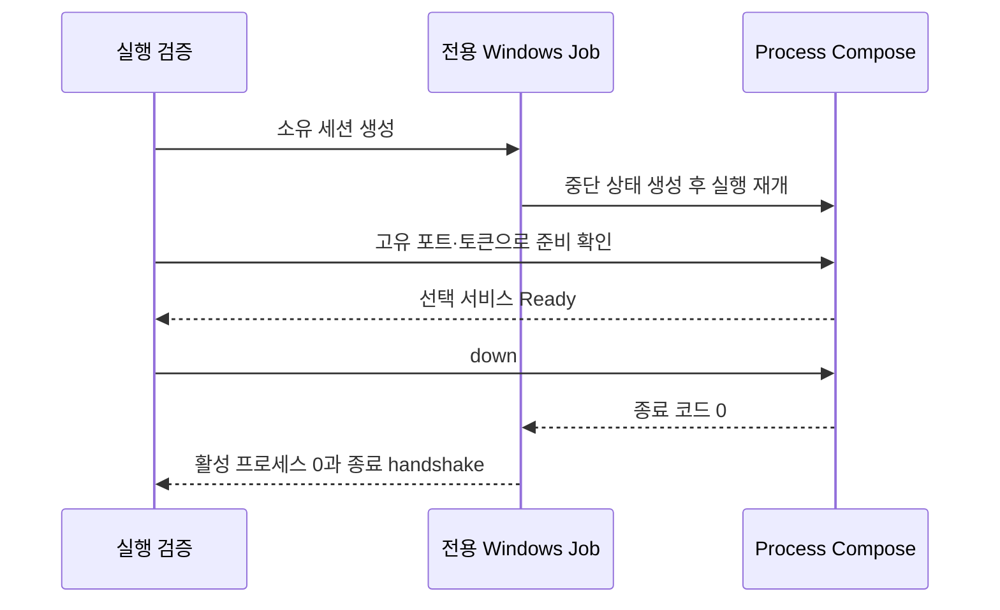

# 구현 검증 기록

이 문서는 플러그인의 자동 검사와 실제 호스트·앱에서 확인한 결과를 기록합니다.
마지막으로 기록한 검증일은 2026-11-20입니다.

설정 적용·실행 검증·Compose 정리·WSL 작업 등록의 이전 검증은 시험 시점의 구현을 대상으로 합니다.
현재 사용법은 [진단 CLI 사용법](diagnostic-cli.md)에 있습니다.

## 읽기 전용 0.3.5의 Codex 앱 검증

2026-11-20에 Codex 데스크톱 앱에서 Windows Agent Devkit 0.3.5를 읽기 전용 패키지로 갱신했습니다.
설치본의 파일 20개가 준비한 패키지와 SHA-256 기준으로 모두 일치했습니다.
설치본의 `dist/cli.mjs` SHA-256은 `8420A9AAAE59A6D435D04ECC0A4A82C6150E026CA6A606BE4C891133B8E8F16B`였습니다.
앱은 `windows-agent-devkit:environment-doctor` 스킬 하나를 활성 상태로 표시했습니다.
매니페스트가 선언한 기능은 `Read`였습니다.

| 대상과 명령 | 관찰 결과 | CLI 종료 코드 |
| --- | --- | --- |
| 이 저장소에서 `doctor --app --format json` | 30개 점검 항목을 반환했습니다. `CODEX-01`과 `NODE-01`은 `pass`였습니다. 작업 실행기는 기존 `npm scripts` 유지(`keep`)로 판정했습니다. `node --version`과 `npm run test`를 안내했습니다. | 0 |
| Compose와 Process Compose를 선언한 테스트 프로젝트에서 `doctor --containers --process-compose --format json` | `docker compose ps`와 `npm run verify`를 안내했습니다. 로컬 Docker 클라이언트 점검은 `fail`이었습니다. 엔진은 `not_contacted`, 서비스 실행은 `not_run`이었습니다. | 1 |

테스트 프로젝트에서 `RUST-02`, `WSL-02`, `CTR-02`, `PC-02`는 모두 `skipped`와 `not_run`을 반환했습니다.
점검 전후에 테스트 프로젝트의 파일 해시가 일치했습니다.
진단은 지정한 새 상태 경로와 작업 실행 표식 파일을 생성하지 않았습니다.

| 이전 명령 또는 옵션 | 앱 설치본의 응답 | CLI 종료 코드 |
| --- | --- | --- |
| `validate --execute`, `apply --execute`, `wsl-register --execute` | 지원하지 않는 명령 | 2 |
| `doctor --execute`, `doctor --output` | 지원하지 않는 옵션 | 2 |

진단과 명령 거부 검증은 같은 앱 대화의 기본 샌드박스에서 설치본으로 수행했습니다.
플러그인을 갱신하고 검증을 마친 뒤 비교한 Codex 설정과 허용 규칙의 파일 내용, 수정 시각, 접근 권한은 갱신 전과 일치했습니다.

## Docker Compose 정리 판정

플러그인은 Docker 삭제 명령이 시간 초과돼도 엔진에서 컨테이너와 네트워크 목록을 다시 조회합니다.
두 목록을 모두 성공적으로 조회해 시험 자원이 사라진 것을 확인하면 `compose.stop`을 `pass`로 보고합니다.
기동 완료가 불확실하거나 정리 유예 시간 안에 시험 자원의 부재를 확인할 수 없으면 `unknown`을 반환합니다.

`node --test test/validation.test.mjs`는 삭제 명령이 시간 초과된 뒤 시험 자원이 사라지는 경우와 남아 있는 경우를 검사합니다.

### Codex 앱에서 실제 Docker 검증

2026-11-19에 WSL 2에서 실행한 임시 Docker Engine 29.9.3과 Windows용 Compose 5.8.0으로 검증했습니다.
같은 앱 대화에서 기존 0.3.5 설치본과 수정 패키지의 CLI를 각각 호출했습니다.
앱 기본 샌드박스에서 Docker 소켓 연결이 차단돼 검증에는 기존 건별 승인 절차를 사용했습니다.

두 패키지에서 단독 `alpine:3.22` 컨테이너와 `python:3.13-alpine`으로 구성한 Compose `smoke` 서비스를 실행했습니다.
Alpine 컨테이너는 모두 종료 코드 0을 반환했습니다.
Compose 서비스는 모두 HTTP 준비 검사를 통과했습니다.

| 시험 대상 | 실행 횟수 | Compose 정리 판정 | CLI 종료 코드 |
| --- | --- | --- | --- |
| 기존 앱 설치본 | 1회 | `unknown`과 `cleanup_unverified` | 1 |
| 수정 패키지 | 3회 | 3회 모두 `pass`와 `owned_resources_removed` | 모두 0 |

수정 패키지의 세 실행에서 각각 Docker 조회 한 건이 `timed_out`으로 기록됐습니다.
플러그인은 후속 조회에서 세 번 모두 `absenceConfirmed: true`를 기록했습니다.
Docker 엔진은 네 번의 시험마다 Compose 컨테이너와 네트워크의 삭제 이벤트를 기록했습니다.
최종 조회에서 남은 시험 컨테이너, 네트워크, 볼륨은 각각 0개였습니다.

## Windows Job 시작 제한 시간

PR #5의 Windows CI에서 자연 종료 테스트가 같은 커밋으로 두 차례 실패했습니다.
실패한 두 실행은 약 11.7초와 11.9초에 끝났습니다.
당시 CI 로그는 실패 상태를 기록했습니다.
helper의 시작과 종료 메시지는 해당 로그에 없었습니다. [PR #5 Windows CI](https://github.com/tttaliesin/windows-agent-devkit/actions/runs/44465195673)

Windows에서 같은 Node.js 작업과 10초 시작 제한으로 수정 전후를 비교했습니다.
대조 실험에서는 helper가 시작 코드를 실행하기 전에만 10.05초를 지연시켰습니다.

| 조건 | 수정 전 관찰 | 수정 후 관찰 |
| --- | --- | --- |
| 지연 없음 | 자연 종료와 종료 코드 0 | 자연 종료와 종료 코드 0 |
| helper의 시작을 10.05초 지연 | 부모가 약 10.16초에 `stop`을 보냈습니다. 약 11.87초에 작업이 시작됐고 `stop_requested`와 종료 코드 1을 반환했습니다. | 부모가 약 10.20초에 `stop`을 보냈습니다. helper는 작업을 만들기 전에 취소했고 부모는 `timed_out`을 반환했습니다. |

helper는 준비를 마친 뒤 부모의 `start` 메시지를 기다립니다.
부모는 시작 제한 시간 안에 유효한 준비 메시지를 받으면 작업 시작을 승인합니다.
시작 승인 전에 제한 시간이 끝나면 부모는 `stop`을 보내고 `timed_out`으로 보고합니다.
시작 승인을 받은 작업에서만 root PID를 실행 근거로 사용합니다.

`node --test test/job-session.test.mjs`로 준비 단계 취소와 실제 Windows 자연 종료를 검사할 수 있습니다.
준비 단계에서 취소한 실제 Windows 검사는 root PID가 비어 있고 빈 Job 확인을 반환해야 통과합니다.
자연 종료 시험의 helper 시작 제한은 25초입니다.
해당 시험의 작업 실행 제한은 5초입니다.

### Codex 앱 설치본 검증

`main`의 PR #6 머지 커밋 `ebda9cb`에서 만든 패키지와 앱 설치본 0.3.5의 파일 24개가 SHA-256 기준으로 일치했습니다.
같은 Codex 앱 대화의 기본 샌드박스에서 설치본의 `validate --execute --task-file`을 호출했습니다.
선택한 Node.js 작업은 실행되면 표식 파일을 쓰고 종료 코드 0을 반환합니다.

시작 제한 초과 시험에서는 설치된 helper의 실행 직전에 16초 지연을 넣었습니다.
부모는 helper 호출 후 약 15.17초에 `stop`을 보냈습니다.
helper는 약 17.46초에 `ready`를 보낸 뒤 `start_cancelled`를 반환했습니다.

| 조건 | 작업 상태 | 작업 종료 코드 | CLI 종료 코드 | 작업 실행 증거 |
| --- | --- | --- | --- | --- |
| 지연 없음 | `succeeded` | 0 | 0 | 표식 파일 생성 |
| helper 시작을 16초 지연 | `timed_out` | `null` | 1 | 시작 이벤트 0건, 표식 파일 없음 |

두 경우 모두 앱 설치 확인은 `CODEX-01: pass`였습니다.
두 경우 모두 종료 후 빈 Job 증거 `windows_job_empty`를 반환했습니다.
검증 전후의 Codex 설정 파일과 권한 규칙이 일치했습니다.
WSL 승인 상태도 일치했습니다.

## 0.3.5 작업 실행기 권장 판정

Codex 데스크톱 앱 26.1111.2228.0에서 Windows Agent Devkit 0.3.5의 설치와 활성화를 확인했습니다.
앱 대화에서 설치한 Doctor 스킬의 CLI를 실행했습니다.
설치본과 소스에서 빌드한 CLI의 SHA-256은 `3E739E5A119D3FC4C00EFB3ABA273C21A2FA0639009D44B9C378F6B82924707B`로 일치했습니다.

이 저장소에서 `doctor --app`은 종료 코드 0과 `CODEX-01: pass`를 반환했습니다.
Doctor는 CI의 `build`, `test`, `check`, `package` 호출을 루트 `package.json`과 연결했습니다.
작업 실행기 판정은 `keep`이었고 텍스트 보고서에는 `기존 npm scripts 유지`가 표시됐습니다.

### 도입 제안과 판단 보류

설치한 CLI로 두 GitHub Actions 작업이 같은 절차를 선언한 테스트 프로젝트를 점검했습니다.
도입 조건을 충족한 다섯 사례는 `suggest`를 반환했습니다.
아래 대조 사례에서 조건을 하나씩 바꾸자 모두 `defer`를 반환했습니다.
열 건의 CLI 종료 코드는 모두 0이었으며 실제 프로젝트 작업은 실행하지 않았습니다.

| 실행기 | 도입 제안 근거 | 판단 보류 대조 |
| --- | --- | --- |
| mise tasks | 로컬에 Node.js와 Go가 선언되어 있고 CI가 두 언어의 검사를 반복 | `go.mod` 제거 |
| Go Task | 반복 절차를 선언한 두 CI 작업이 모두 Go Task를 준비 | 한 작업의 준비 단계 제거 |
| just | 루트 `.tool-versions`에 just 버전을 고정 | just 버전 고정 제거 |
| GNU Make | CI가 GNU Make를 준비하고 링크 단계가 앞서 컴파일한 `main.o`를 사용 | 링크 입력을 `other.o`로 변경 |
| npm scripts | Node.js 전용 절차가 반복되고 루트에 `package-lock.json`이 있음 | `package-lock.json` 제거 |

`node --test test/task-runner-report.test.mjs test/task-runners.test.mjs`로 판정과 대조 조건을 재검사할 수 있습니다.
자동 판정의 적용 범위는 [작업 실행기 가이드](task-runners.md#자동-판정-기준)에 기록합니다.

### 기존 작업 유지와 CI 불일치

`main` 머지 커밋 `9e947c3`의 패키지와 앱 설치본의 파일 24개를 SHA-256으로 대조했습니다.
같은 앱 대화에서 설치된 0.3.5 Doctor로 테스트 프로젝트를 점검했습니다.
네 단독 사례에서 Doctor는 루트 작업 선언을 CI 호출과 연결하고 `keep`을 반환했습니다.

| 실행기 | 루트 작업 선언 | CI 호출 |
| --- | --- | --- |
| mise tasks | `mise.toml`의 `lint` | `mise run lint` |
| Go Task | `Taskfile.yml`의 `check-schema` | `task check-schema` |
| just | `Justfile`의 `format-check` | `just format-check` |
| GNU Make | `Makefile`의 `verify` | `make verify` |

혼합 사례에서는 위 네 호출과 루트 `package.json`의 `npm test`를 각각 CI 작업에 연결했습니다.
Doctor는 다섯 실행기를 모두 유지 목록에 넣었습니다.
단일 실행기 추천 필드인 `recommended`는 `null`이었습니다.
이 사례에서 `CODEX-01: pass`도 확인했습니다.

혼합 사례의 Make 호출만 선언에 없는 `make missing-target`으로 바꿨습니다.
Doctor는 `defer`와 `ci_task_not_declared`를 반환했습니다.
텍스트 보고서에서도 기존 실행기의 유지와 CI 불일치 시의 판단 보류를 확인했습니다.

여섯 건 모두 CLI 종료 코드 0을 반환했습니다.
Doctor는 프로젝트 작업을 실행하지 않았습니다.
검증 전후의 Codex 설정 파일과 권한 규칙의 해시가 일치했습니다.
WSL 승인 상태도 일치했습니다.

### 권한과 로컬 검사

Doctor 호출에는 앱 대화의 기본 권한을 사용했습니다.
플러그인 설치 직전과 직후의 Codex 사용자 설정값과 프로젝트 규칙은 일치했습니다.
같은 대화의 샌드박스와 승인 정책은 `workspace-write`, `on-request`, `auto_review`로 일치했습니다.

로컬 `node --test`는 409개 중 404개 통과와 실패 0개를 기록했습니다.
Windows 파일 심볼릭 링크 권한이 필요한 네 검사와 별도로 켜는 실제 WSL 실행기 검사 한 개를 생략했습니다.
플러그인 소스 검사와 설치 패키지의 독립 실행 검사도 통과했습니다.

## 0.3.3 프로젝트별 WSL 고정 실행기

Codex 데스크톱 앱 26.1111.2228.0에 설치한 0.3.3 번들로 기존 검증 대화에서 확인했습니다.
설치본 CLI의 SHA-256은 `FC46DC114684153C7CF6BDE35A810DF82AAF7FD8B4DC14FF859BB8B38F0EC335`였습니다.
프로젝트 규칙을 한 번 로드한 뒤 대조 작업의 종료 코드 0을 확인했습니다.
새 작업 등록부터 같은 UUID의 철회 후 재호출까지 같은 대화를 다시 로드하지 않았습니다.

| 검사 | 관찰 결과 |
| --- | --- |
| 등록과 실행 | 새 UUID를 작은따옴표로 감싸 호출하자 Ubuntu 24.04의 `./scripts/check.sh`가 실행됐습니다. WSL-02와 작업의 종료 코드 0을 확인했습니다. |
| 철회 | 실행 허가 파일을 제거한 뒤 같은 UUID와 호출 방식으로 재실행하자 종료 코드 1이 반환됐습니다. Linux 결과 파일의 줄 수가 그대로였습니다. |
| 권한 | 기존 `workspace-write`와 `on-request` 설정에서 기본 권한 호출만 사용했습니다. 대화의 실행 승인 이벤트는 0건이었습니다. |
| 허용 범위 | 등록과 철회 전후에 고정 실행 파일과 프로젝트 허용 규칙의 해시가 일치했습니다. 기존 Codex 설정과 기존 규칙의 해시도 일치했습니다. |
| 샌드박스 쓰기 | 프로젝트 규칙, 실행 파일, 등록 기록 및 설치 CLI를 쓰기 모드로 열 수 없었습니다. 기본 권한으로 등록 디렉터리에 파일을 추가할 수도 없었습니다. |

새 UUID를 따옴표 없이 전달한 첫 시도는 WSL 경로 확인 단계에서 종료 코드 1을 반환했습니다.
같은 대화에서 UUID를 작은따옴표로 감싼 호출은 성공했습니다.

`WINDOWS_DEVKIT_TEST_WSL_LAUNCHER=1`을 지정한 로컬 동작 검사는 358개 중 354개 통과, 0개 실패였습니다.
호스트에 파일 심볼릭 링크 생성 권한이 필요한 네 검사를 생략했습니다.
설치 패키지의 독립 번들 검사도 통과했습니다.

## 0.3.2 WSL 작업 등록

설치한 0.3.2 번들을 Codex 데스크톱 앱 26.1111.2228.0의 신뢰된 로컬 프로젝트에서 실행했습니다.
검증 대화의 권한 모드는 `workspace-write`였으며 승인 정책은 `on-request`였습니다.
앱 검증 당시의 설치본 CLI와 소스 빌드의 SHA-256은 `1D78BD4046F398A26218E0260B550080212F3E6B81BB5754C1664C162A3E4E52`로 일치했습니다.

| 검사 | 관찰 결과 |
| --- | --- |
| 등록 검토 | 확인 지문을 생성하는 동안 프로젝트 규칙은 그대로였습니다. 작업 JSON을 바꾼 뒤 이전 지문으로 등록하자 종료 코드 2를 반환했습니다. |
| 앱 목록 조회 | 설치본의 `wsl-tasks`가 등록한 작업을 `active`로 표시했습니다. |
| 등록 작업 | Ubuntu 24.04의 Linux 프로젝트에서 `./scripts/check.sh`가 실행됐습니다. 스크립트가 남긴 결과 파일, `WSL-02: pass`, 작업과 CLI의 종료 코드 0을 확인했습니다. |
| 승인 기록 | 기본 권한으로 호출했고, 검증 대화의 승인 이벤트는 0건이었습니다. |
| 미등록 작업 | 같은 배포판과 작업 디렉터리에서 다른 스크립트를 일반 `validate`로 요청하자 `not_run`과 CLI 종료 코드 1이 기록됐습니다. 미등록 스크립트의 결과 파일은 생성되지 않았습니다. |
| 범위를 바꾼 호출 | 앱에서 전용 실행 파일에 추가 인수를 붙인 호출이 거부됐습니다. Windows 호스트에서 다른 작업 디렉터리로 바꾼 호출도 거부됐습니다. |
| 등록 철회 | 규칙과 활성화 파일이 제거됐고 조회 목록에서 사라졌습니다. 성공 실행에 사용한 앱 대화에서 이전 실행 파일을 다시 호출하자 종료 코드 1을 반환했고 Linux 결과 파일은 그대로였습니다. |
| 기존 권한 확인 | Codex 사용자 설정과 기존 프로젝트 규칙의 파일 해시를 비교해 변경이 없음을 확인했습니다. |

머지 전 잠금 복구 회귀 검사에서 종료된 프로세스의 작업별 잠금을 회수한 뒤 기존 실행 권한을 철회하고 새 경로로 재등록했습니다.
로컬 동작 검사는 342개 중 337개가 통과했고 실패는 0개였습니다.
생략된 5개 중 실제 WSL 전용 실행 파일 검사는 `WINDOWS_DEVKIT_TEST_WSL_LAUNCHER=1`을 지정해 별도로 실행했고 통과했습니다.
나머지 네 검사는 Windows 심볼릭 링크 생성 권한이 필요했습니다.
별도 WSL 검사는 Windows 드라이브 마운트, 실행 파일의 Linux 링크 대상 변경, 고정 작업 파일 변경, 실행 인수 추가와 등록 철회에 대한 거부를 확인했습니다.
소스 검사와 설치 패키지의 독립 실행 검사도 통과했습니다.

## 0.3.1 실행 검증과 판정 개선

| 검사 | 관찰 결과 |
| --- | --- |
| 로컬 `node --test` | 329개 중 325개 통과, 0개 실패입니다. |
| 파일 심볼릭 링크 회귀 | 로컬에서 링크 생성 권한이 필요한 4개는 생략됐습니다. |
| WSL 인수 검증 | 실제 `createQuery` 경로에서 사전 조회, 도구 버전 조회, 선택한 작업이 차례로 실행기에 전달됐습니다. |
| WSL 종료 코드 | 사전 조회가 성공하고 작업이 미실행인 경우 CLI 종료 코드 1과 작업의 `execution: not_run`을 확인했습니다. |
| Rust 실행 선택 | Cargo 선언과 네이티브 작업만 있는 경우 `RUST-02`의 링크 실행기를 호출하지 않는 것을 확인했습니다. |
| .NET SDK | 주석이 있는 `global.json`의 버전·정책이 프로젝트 분석과 SDK 조회에 동일하게 반영되는 것을 회귀 테스트로 확인했습니다. |
| 설치 패키지 | 소스와 같은 버전의 독립 번들 바이트 및 세 PowerShell 런타임 파일을 확인했습니다. |

패키지 사본의 CLI 바이트를 바꾸자 버전이 같은 상태에서도 패키지 검사가 실패했습니다.
초기 push CI는 Windows Job 테스트의 임시 폴더 삭제에서 `EBUSY`를 보고했습니다.
테스트 임시 폴더 삭제에만 제한된 재시도를 적용했습니다.

### 실제 Windows 호스트

Ubuntu 24.04에서 `/tmp`를 작업 경로로 지정했습니다.
신뢰한 `/usr/bin/true`는 작업과 CLI 모두 종료 코드 0을 반환했습니다.
같은 범위에서 신뢰하지 않은 작업은 `trusted_task_required`와 CLI 종료 코드 1을 반환했습니다.

Python 3.14로 만든 외부 가상환경을 사용하자 `PY-02`가 `different_virtual_environment_selected` 경고를 보고했습니다.
기본 진단에서 프로젝트 내부의 Python 실행 파일을 실행할 수 없는 경우 선언 메타데이터를 표시하고 현재 prefix를 미확인으로 남겼습니다.

### 실제 Codex 데스크톱 앱

로컬 마켓플레이스에서 0.3.1 설치·활성화를 확인했습니다.
앱의 플러그인 상세 화면에서 Doctor·Setup·Validate 스킬 세 개를 확인했습니다.
검증 채팅에서 설치된 Doctor와 Validate 스킬을 읽고 설치본의 `dist/cli.mjs`를 일반 샌드박스로 호출했습니다.
호출한 CLI와 소스 빌드의 SHA-256은 `FF891693F6C5AA91E5A70D53ADDFF6F39BE31AED0B79F27B35922AF09B174477`로 일치했습니다.

| 검증 사례 | 앱에서 관찰한 결과 |
| --- | --- |
| `doctor --app` | 고유 ID 30개와 `CODEX-01: pass`를 확인했습니다. |
| 배포판과 경로가 빠진 WSL 작업 | `WSL-02`의 작업이 `not_run`이고 CLI는 종료 코드 1을 반환했습니다. |
| Ubuntu 24.04의 `/tmp`에서 신뢰한 WSL 작업 | 배포판 목록 조회의 근거가 빠져 `WSL-01`은 `unknown`이었습니다. `WSL-02`의 작업이 `not_run`이고 CLI는 종료 코드 1을 반환했습니다. |
| 같은 앱 세션의 `wsl.exe` 직접 호출 | 동일한 배포판·작업 경로·도구로 직접 호출해 `Wsl/E_ACCESSDENIED`를 확인했습니다. |
| Cargo 프로젝트의 네이티브 `node --version` | `RUST-02`는 `skipped`였습니다. Node 작업은 종료 코드 0과 `windows_job_empty`를 반환했습니다. |
| Node 요구 불일치 | 기본 텍스트에서 선언한 범위와 파일·필드, 다음 조치를 확인했습니다. |
| 주석이 있는 `global.json` | SDK 선언을 읽었습니다. 이 호스트에서 .NET 실행 파일을 찾지 못해 실제 SDK 선택은 회귀 테스트에서 검증했습니다. |

Rust가 설치되지 않은 fixture에서는 별도의 `RUST-01` 진단 결과가 CLI 종료 코드에 반영됐습니다.
Windows 호스트의 성공 결과와 일반 샌드박스의 접근 거부 결과를 각각 기록했습니다.

## 0.3.0 작업 실행기 통합

0.3.0은 mise tasks 기본 권장과 Taskfile·Justfile·Makefile·npm scripts의 정적 탐지를 포함합니다.
기존 30개 점검 ID에 선언·경로·셸·권장 비교 근거를 연결합니다.
목록 조회와 dry-run으로 프로젝트 작업을 평가하지 않습니다.
동적 계산·외부 포함·지원하지 않는 문법은 미확인으로 남깁니다.

| 검사 | 실제 결과 |
| --- | --- |
| 로컬 `node --test` | 314개 중 통과 310개·실패 0개·생략 4개입니다. |
| 파일 심볼릭 링크 검사 | 로컬의 네 검사는 링크 생성 권한이 없어 생략됐습니다. |
| `node scripts/check-package.mjs` | 현재 소스의 독립 번들·TOML·YAML·네 실행기와 npm scripts 분석·원본 보존 검사를 통과했습니다. |
| 설치 패키지 | `node scripts/package-plugin.mjs`와 패키지의 독립 실행 검사를 통과했습니다. |
| 출력 비공개 | 원시 명령·환경 값·오류 출력과 잘못된 JSON 입력 값의 비노출을 검사했습니다. |
| 실행 상태 | 선택 실행·실패·timeout·경로·환경 제한과 Windows Job 정리 근거를 검사했습니다. |

잘못된 JSON의 파서 오류는 원문을 포함하지 않는 고정 메시지로 바꿨습니다.
CI에서 mise 호출만 확인한 경우 로컬 작업 채택은 미확인으로 남깁니다.
Windows Job의 제한 시간 초과를 `timed_out`으로 보존합니다.
실제 Windows 프로세스의 제한 시간 검사에서도 이 상태와 빈 Job 종료 근거를 확인했습니다.

### 실제 Windows 작업 실행

통제된 새 프로젝트에서 다음 검사를 실행했습니다.

```powershell
node scripts/smoke-task-runners.mjs
```

이 검사는 설치된 실행기를 사용하며 도구를 설치하지 않습니다.
결과 파일은 Git에서 제외한 `.local/task-runners`에 저장합니다.

| 실행기 | 관찰한 버전 | 실제 결과 |
| --- | --- | --- |
| mise | 2026.9.4 | `run check` 실행과 marker 생성을 확인했습니다. |
| Task | 3.54.0 | `check` 실행과 marker 생성을 확인했습니다. |
| just | 1.52.0 | `check` 실행과 marker 생성을 확인했습니다. |
| GNU Make | 4.4.1 | `check` 실행과 marker 생성을 확인했습니다. |

네 작업은 종료 코드 0을 반환했습니다.
네 작업의 정리는 `confirmed: true`, `forced: false`, `proof: windows_job_empty`였습니다.
marker의 실행기 이름과 실제 작업 경로를 확인했습니다.
mise의 두 자동 설치 비활성화 환경 값도 확인했습니다.
진단과 실행 전후의 fixture 원본은 보존됐습니다.

Make는 현재 Windows PATH와 확인한 WSL 경로에 없었습니다.
정상 실행 검증에는 Git 제외 경로의 격리된 MSYS2 배포본을 사용했습니다.
검증 프로세스에만 이 배포본의 경로를 추가했습니다.
다운로드한 Make 4.4.1-5 패키지의 SHA-256은 `871f760657a360279f29b945a7fd7d9655fe46a3e1e06dd783c9e74514aa0b27`로 공식 배포 메타데이터와 일치했습니다. [MSYS2 Make 패키지](https://packages.msys2.org/packages/mingw-w64-ucrt-x86_64-make?repo=ucrt64)
같은 배포처의 gettext-runtime 1.0-1과 기존 Git for Windows의 런타임 DLL을 사용했습니다. [MSYS2 gettext-runtime](https://packages.msys2.org/packages/mingw-w64-ucrt-x86_64-gettext-runtime)
이 결과는 검증용 Windows 배포본의 관찰입니다.

just 1.52.0은 최신 문서의 `[windows]` 속성을 사용한 설정에서 `extraneous attribute`로 실패했습니다.
`set windows-shell := ["pwsh", "-NoLogo", "-NoProfile", "-Command"]`로 바꾼 실제 작업은 통과했습니다.
가이드에는 확인한 버전의 구문을 반영했습니다.

### 앱의 설치본 검증

앱과 공유하는 설치 목록에서 0.3.0의 설치·활성화를 확인했습니다.
앱의 플러그인 화면에서 0.3.0과 세 Skill을 확인했습니다.
앱의 기존 검증 대화에서 설치본의 두 Skill을 읽고 같은 설치 루트의 CLI를 호출했습니다.

첫 일반 샌드박스 호출에서 doctor는 고유 ID 30개를 반환했습니다.
상태 집계는 pass 10·fail 0·warn 0·unknown 2·skipped 18이었습니다.
`CODEX-01`은 pass였고 mise tasks 권장 비교는 aligned였습니다.
Task·just·Make의 실행과 새 marker 세 개를 확인했습니다.

mise의 첫 호출과 단독 재시도는 종료 코드 1로 실패했습니다.
같은 샌드박스에서 실행한 별도 진단은 공유 mise 상태의 `tracked-configs`와 `trusted-configs` 경로에 `os error 5`를 보고했습니다.
이 오류와 marker 부재를 작업 성공으로 바꾸지 않았습니다.
원시 출력이 없는 Windows Job 보고서만으로 오류 원인을 확정하지 않았습니다.

후속 검증의 mise 작업 JSON에는 해당 작업용 `MISE_STATE_DIR`를 새 fixture 내부로 명시했습니다.
전역 상태 경로와 기존 신뢰 기록을 변경하거나 복사하지 않았습니다.
mise 자체의 신뢰 처리는 실행기 버전과 paranoid 설정을 따릅니다.
프로필 없는 문맥에서는 Task·just가 검증되지 않은 mise shim으로 선택되는 경우도 확인했습니다.
이때 작업은 `unknown / not_run`이므로 실행 성공으로 보고하지 않습니다.
명시한 작업의 미실행 상태에도 CLI가 0을 반환하던 문제는 종료 코드 1로 수정했습니다.
최종 검증 프로세스에는 확인한 Node·Task·just·PowerShell·Make의 실행 파일 디렉터리를 명시했습니다.
전역 PATH는 변경하지 않았습니다.

| 최종 앱 실행의 관찰 | 결과 |
| --- | --- |
| 설치본 버전 | 0.3.0입니다. |
| 설치본 SHA-256 | `AF50869E0A5CF4D433AFAED972CF1A43EC32D3DDA1FF9A0ECA2CA019BD88E512`로 현재 빌드와 일치했습니다. |
| 실행 권한 | 일반 샌드박스이며 추가 권한 요청이 없었습니다. |
| doctor | 고유 ID 30개와 `CODEX-01: pass`를 반환했습니다. |
| doctor 상태 | pass 10·fail 0·warn 0·unknown 2·skipped 18이었습니다. |
| 권장 비교 | mise tasks가 aligned였습니다. |
| 네 실행기 | mise·Task·just·Make 모두 `pass / succeeded`, 작업과 CLI 종료 코드 0이었습니다. |
| 프로세스 정리 | 네 작업 모두 `confirmed: true`, `forced: false`, `windows_job_empty`였습니다. |
| 실행 결과 파일 | 새 marker 네 개의 도구 이름과 작업 경로가 검증 대상과 일치했습니다. |
| mise 자동 설치 | 두 환경 값이 모두 문자열 `"0"`이었습니다. |
| 입력 보존 | fixture 입력 아홉 개의 실행 전후 SHA-256이 모두 같았습니다. |

검증 대화는 설치된 Skill과 CLI를 사용했습니다.
이전 실패 보고서와 원시 진단 로그는 Git 제외 경로에 보존했습니다.
최종 앱 검증의 상태 경로와 PATH는 명시적으로 선택한 검증 프로세스의 구성입니다.
다른 앱 샌드박스와 기존 전역 상태 경로에서도 같은 결과가 난다고 일반화하지 않습니다.
Windows CI의 현재 커밋 결과는 [PR 검사](https://github.com/tttaliesin/windows-agent-devkit/pull/1/checks)에서 확인합니다.

## 0.2.1 기존 기능의 검증

이 문서는 구현한 기능의 자동 검사와 실제 실행 결과를 구분해 기록합니다.
검증일은 2026-11-17입니다.
로컬 호스트는 Windows 11 Pro x64의 build 26300입니다.
진단 실행에는 Node.js 24.18.1과 PowerShell 7.6.9를 사용했습니다.

## 확인 범위

| 대상 | 실제 확인한 결과 | 확인 범위의 한계 |
| --- | --- | --- |
| 기본 진단 | 30개 고유 ID와 상태 집계를 반환했습니다. | 특정 PC의 집계가 다른 PC의 기대값은 아닙니다. |
| 언어 도구 | Node.js 24.18.1과 Python 3.14.6을 실행했습니다. | 여섯 언어의 모든 빌드 조합을 실행하지 않았습니다. |
| Go | 실제 PE 파일의 내장 버전 go1.26.5를 읽었습니다. | Go 프로세스와 telemetry를 실행하지 않았습니다. |
| 설정 | 임시 프로젝트에서 계획·미리보기·적용·재적용·복구가 통과했습니다. | 사용자 실프로필과 전역 설치를 변경하지 않았습니다. |
| 개발 명령 | 기존 npm 스크립트를 실행하고 생성 결과를 확인했습니다. | 원시 명령 출력은 보고서에 복사하지 않습니다. |
| 유지 예외 | 저장한 프로젝트·역할 예외를 다음 doctor에서 확인했습니다. | 다른 프로젝트에 전역 적용하지 않습니다. |
| WSL | 기존 Ubuntu-24.04의 Linux 경로와 Bash 5.2.21 조회가 통과했습니다. | 여섯 언어 전체의 WSL 개발환경을 설치하거나 검증하지 않았습니다. |
| Process Compose | 실제 서비스의 시작·준비 검사·종료가 모두 통과했습니다. | 선택한 서비스와 해당 릴리스의 관찰입니다. |
| 앱 | 0.2.1 설치·활성화·Skill 발견·설치본의 실제 CLI 호출을 확인했습니다. | 공개 디렉터리 등록과 게시를 수행하지 않았습니다. |
| Docker | 현재 Windows PATH에서 명령이 해석되지 않는 실제 실패 경로를 확인했습니다. | 실제 엔진·이미지·Compose 기동은 검증하지 않았습니다. |

## 자동 검사

```powershell
npm ci --ignore-scripts
node scripts/build.mjs
node --test
node scripts/check-package.mjs
node scripts/package-plugin.mjs
node scripts/check-package.mjs --packaged
```

로컬 전체 테스트는 265개 중 262개가 통과했습니다.
실패는 0개입니다.
파일 심볼릭 링크 생성 권한이 필요한 3개는 생략했습니다.
디렉터리 정션과 경계 밖 경로 차단 검사는 통과했습니다.
Windows CI의 결과는 해당 커밋의 실행 결과로 별도 확인합니다.

파서 검사는 상위 선언·작업 공간·CI·가상환경·설정 파일 오류를 포함합니다.
버전 검사는 Node의 semver와 Python의 PEP 440을 구분합니다.
동일 관리자 선언에 여러 버전이 있으면 선택 근거가 부족한 비교를 미확인으로 남깁니다.
독립적인 다른 버전 요구의 확인된 위반은 계속 보고합니다.
변조 계획·오래된 입력·재실행·부분 실패·복구·동시 편집 경합도 검사합니다.
Docker의 성공·실패·지연 생성·소유권 확인·정리 시나리오는 모의 query로 검사합니다.

설치 패키지 검사는 node_modules가 없는 임시 위치로 실제 번들을 복사해 실행합니다.
표준 파서와 버전 비교가 번들 안에서 동작하는지 확인합니다.
Windows 수집기와 함께 배포하는 지원 파일의 경로도 실제로 확인합니다.
고정한 실행 의존성과 포함한 서드파티 라이선스를 대조합니다.

## 실제 설정과 프로젝트 명령

```powershell
node scripts/smoke-windows.mjs
```

이 명령은 저장소 밖의 통제된 임시 프로젝트와 개인 상태 경로를 만듭니다.
기존 내용이 있는 임시 PowerShell 프로필을 사용합니다.
실행 전과 복구 후의 프로필 바이트가 일치하는지 검사합니다.
설치 작업을 선택하지 않고 mise 선언과 프로필 관리 블록만 적용합니다.
같은 계획의 두 번째 적용이 already_applied인지 검사합니다.
프로젝트에 넣은 가짜 인증 표식이 보고서에 노출되지 않는지도 검사합니다.

신뢰한 task JSON으로 실제 npm 프로젝트 스크립트를 실행했습니다.
프로젝트 명령이 생성한 파일을 확인했습니다.
해당 실행의 정리 결과는 confirmed: true와 proof: windows_job_empty였습니다.
이미 설치된 .NET SDK가 있는 호스트에서는 같은 smoke가 global.json으로 정확한 SDK를 선택하는 검사도 수행합니다.
SDK 명령이 없으면 해당 실제 검사는 생략합니다.

원래 파일은 교체 전에 고유한 복구 경로로 포착합니다.
포착한 해시와 배타적 게시 결과를 확인합니다.
포착 파일은 성공 이후에도 보관합니다.
이 절차는 일반 파일 API의 손실 방지 절차이며 원자적 CAS를 보장하지 않습니다.
이동 전에 열린 핸들의 늦은 쓰기는 포착 파일에 남을 수 있습니다.
복구 경로와 충돌은 저널에서 확인할 수 있습니다.

## 실제 Process Compose

검증에는 공식 v1.124.0 Windows amd64 릴리스를 사용했습니다.
받은 ZIP의 SHA-256을 공식 릴리스 asset digest와 대조했습니다.
바이너리는 전역 설치 대신 Git에서 제외한 .local/tools 아래에 보관했습니다.

```text
a77d51dcb34e3e8d2b88af372ada7ca8a62cb87f0c6af0f78834c0fd6c95e2a7
```

```powershell
node scripts/smoke-windows.mjs --process-compose-executable '<검증한 process-compose.exe의 절대 경로>'
```

임시 Node 서비스가 출력하는 준비 표식으로 ready_log_line을 검사했습니다.
서비스의 시작과 준비 완료가 각각 pass였습니다.
고유 API 포트와 토큰 파일을 사용했습니다.
정상 down 이후 종료 코드 0과 forced: false를 확인했습니다.
정리 근거는 treeTerminated: true와 proof: windows_job_empty입니다.
같은 검증의 pendingQueries는 0이었습니다.

Windows Job Object는 소유한 root와 하위 프로세스를 함께 관리합니다.
실제 Windows 테스트에는 부모 선행 종료, detached 자식, AbortSignal, 실행 제한 시간과 helper 강제 종료가 포함됩니다.
빈 Job handshake가 없는 helper 종료는 정리 성공으로 바꾸지 않습니다.
관련 테스트 11개 중 6개는 실제 Windows 프로세스를 실행했습니다.



shell_argument가 한 argv 요소로 전달되는 실제 동작도 확인했습니다.
여러 PowerShell 옵션을 하나의 문자열로 지정한 사례는 서비스 실행에 실패했습니다.
실제 fixture에는 shell_argument: -Command를 사용했습니다.
정적 분석은 여러 인수를 임의로 분리해 정상 설정으로 판정하지 않습니다.
이 관찰은 [v1.124.0 셸 설정 타입](https://github.com/F1bonacc1/process-compose/blob/v1.124.0/src/command/config.go)과 함께 확인했습니다.

## 실제 WSL과 Docker 경계

기존 Ubuntu-24.04 배포판의 대상 저장소 경로를 Linux 절대 경로로 명시했습니다.
--linux-tools bash로 이번 검증 도구를 한정했습니다.
실제 OS는 Linux, 아키텍처는 x86_64였습니다.
Linux 셸은 /usr/bin/sh, Bash는 /usr/bin/bash의 5.2.21이었습니다.
WSL-02는 pass였습니다.
검증을 위해 새 배포판이나 언어 도구를 설치하지 않았습니다.
기존 배포판의 종료를 정리 작업으로 수행하지 않았습니다.

현재 Windows 문맥에서는 Docker CLI 후보를 찾지 못했습니다.
명시한 Docker context의 validate는 CTR-02: fail, reason: not_found, execution: not_run을 반환했습니다.
이 결과를 컴퓨터 전체의 Docker 미설치로 일반화하지 않습니다.
실제 엔진·Compose 정상 기동과 원격 endpoint 동작은 미검증입니다.

## 앱 설치와 호출

```powershell
node scripts/package-plugin.mjs
codex plugin marketplace add ./.local/plugin-marketplace --json
codex plugin add windows-agent-devkit@windows-agent-devkit-local --json
codex plugin list --marketplace windows-agent-devkit-local --json
```

앱과 공유하는 설치 목록에서 version: 0.2.1, installed: true, enabled: true를 확인했습니다.
앱의 플러그인 화면에서 Windows Agent Devkit과 Skill 세 개를 확인했습니다.
앱의 검증 대화에서 설치된 environment-doctor/SKILL.md를 읽었습니다.
같은 설치 루트의 dist/cli.mjs doctor --app을 실제로 실행했습니다.
프로젝트 소스의 src/cli.mjs를 대신 실행하지 않았습니다.
설치본 CLI와 지원 스크립트의 해시를 빌드 산출물과 대조했습니다.

| 앱의 0.2.1 실제 호출 | 관찰 결과 |
| --- | --- |
| 실행 권한 | 일반 샌드박스 use_default입니다. |
| 추가 권한 요청 | 없었습니다. |
| CLI 종료 코드 | 0입니다. |
| pluginVersion | 0.2.1입니다. |
| context.metadataSource | local-process-and-registry입니다. |
| 고유 checkId | 30개입니다. |
| 상태 집계 | pass 11, fail 0, warn 0, unknown 4, skipped 15입니다. |
| CODEX-01 | pass입니다. |

CODEX-01의 설치 목록 확인과 이번 앱의 실제 Skill 호출은 서로 다른 증거입니다.
설치 목록 확인만으로 Skill 실행 성공을 주장하지 않습니다.
원시 실행 기록과 화면 캡처는 Git에서 제외한 .local 경로에 보관했습니다.
새 통합 터미널의 셸 설정 변경과 공개 게시는 이번 관찰에 포함하지 않습니다.

## CIM 접근 제한의 회귀

0.2.0의 앱 샌드박스에서는 CIM 접근 제한으로 보고서 생성이 실패했습니다.
같은 0.2.0 CLI는 승인된 샌드박스 외부 실행에서 성공했습니다.
0.2.1은 CIM이 거부되면 자기 프로세스와 읽기 전용 HKLM 운영체제 메타데이터를 사용합니다.
대체 경로의 출처는 context.metadataSource에 표시합니다.
샌드박스 정책이나 시스템 권한은 변경하지 않습니다.
실제 수집기에서 CIM 호출만 실패하도록 만든 회귀 테스트도 통과했습니다.
앱의 일반 샌드박스 호출에서 대체 경로를 사용한 성공을 확인했습니다.

같은 실행 문맥에서 CIM 거부를 재현하고 보고서 생성 여부와 metadataSource를 비교하면 이 경로를 재검사할 수 있습니다.
CIM 호출이 성공했거나 다른 실행 문맥에서만 결과가 바뀌면 이 사례의 CIM 원인 설명을 적용하지 않습니다.
API의 읽기 조건은 [RegistryKey.OpenSubKey](https://learn.microsoft.com/en-us/dotnet/api/microsoft.win32.registrykey.opensubkey?view=net-10.0)와 [Process.MainModule](https://learn.microsoft.com/en-us/dotnet/api/system.diagnostics.process.mainmodule?view=net-10.0)을 확인했습니다.

## 0.1 검증 이력

첫 CLI의 로컬 검사는 72개 중 71개 통과와 파일 심볼릭 링크 권한에 따른 생략 1개였습니다.
당시 Windows CI에서는 72개가 모두 통과했습니다.
PATHEXT를 제외한 자식 환경에서 명령 후보가 사라지는 사례를 재현했습니다.
같은 PATH·작업 경로·수집기에서 PATHEXT 보존 여부만 바꿔 대조했습니다.
두 조건의 후보 수가 같으면 해당 호스트에서는 이 원인 설명을 기각합니다.
현재 자식 환경은 기존 PATHEXT를 보존합니다.
