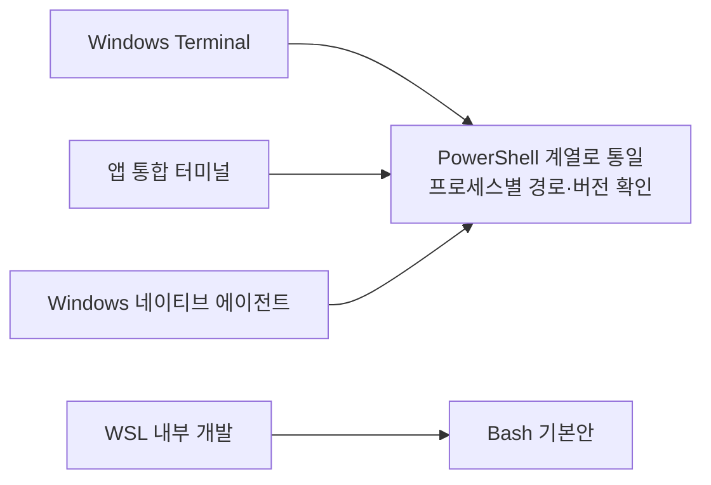
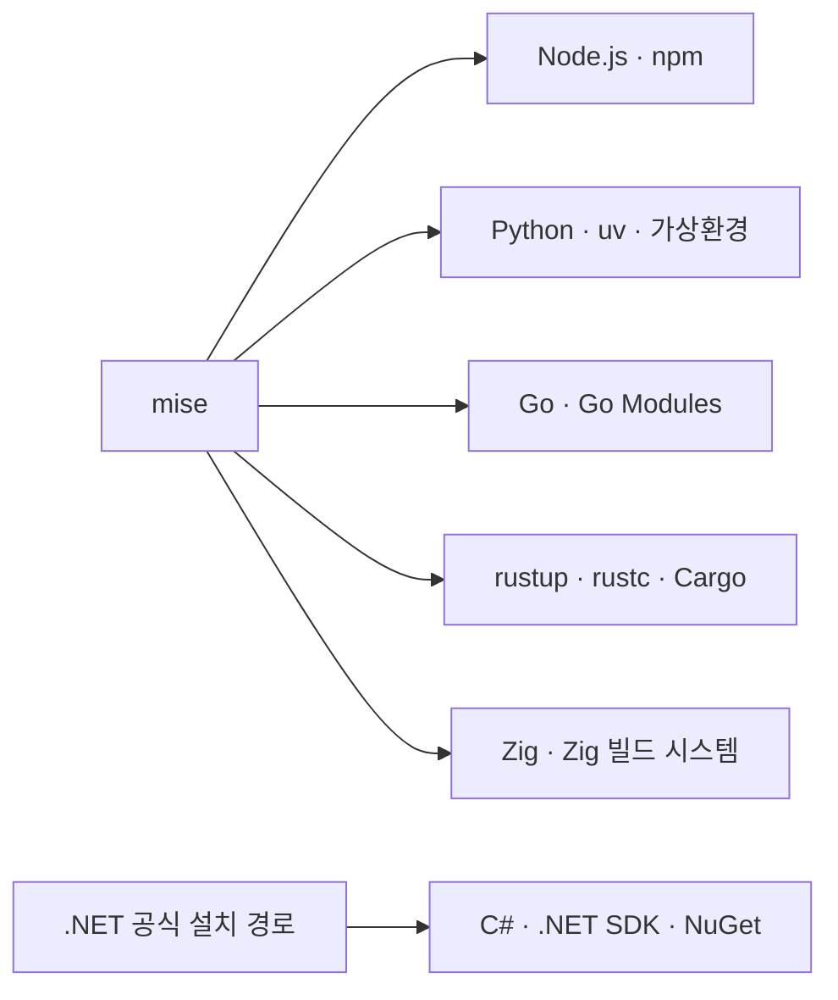
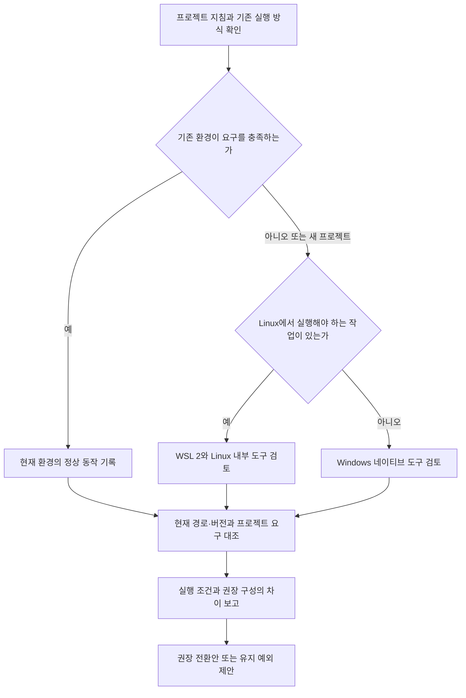
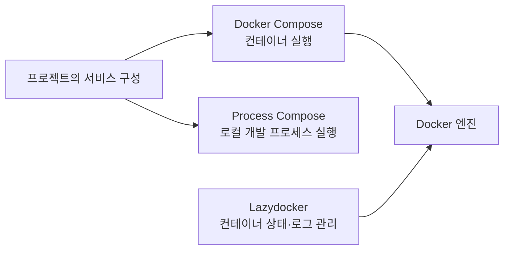

# 권장 Windows 개발환경 제안

기준일과 공식 자료 확인일은 2026-11-17입니다.
이 문서는 Windows에서 개발 도구와 AI 에이전트를 사용하는 기본 구성을 제안합니다.
새 환경은 지원 중인 Windows 11에서 네이티브 도구를 사용하는 구성을 우선 권장합니다.
기존 프로젝트는 현재 런타임과 패키지 관리 방식을 우선합니다.
Linux 실행 요구가 있으면 WSL 2 구성을 선택합니다.
기존 도구가 동작하는 환경에도 적용 가능한 권장 구성과 전환안을 제안합니다.

이 문서의 제품 선택은 저장소의 제안입니다.
링크한 제품의 동작과 지원 정책은 공식 문서에서 확인한 내용입니다.
개별 PC의 설치 상태와 프로젝트 호환성이 모두 검증됐다는 뜻은 아닙니다.
점검 ID의 구체적인 근거와 판정 규칙은 [플러그인 환경 점검 설계안](environment-checks.md)에 정의합니다.

## 기본 구성

기본 구성은 새 환경과 기존 환경의 제안에 함께 사용하는 공통 기준입니다.
기존 도구의 작동 여부와 권장 구성과의 일치 여부를 각각 확인합니다.
권장 구성과 다르면 전환안을 제시합니다.
표의 권장은 모든 도구를 플러그인의 실행 의존성으로 추가한다는 의미가 아닙니다.

| 구성 요소 | 권장 선택과 역할 | 선택 이유와 적용 조건 | 연결할 점검 |
| --- | --- | --- | --- |
| 운영체제 | 지원 중인 일반 배포 채널의 Windows 11, 첫 구현 대상은 x64 제안 | 에디션·릴리스별 지원 기간 확인, ARM64의 네이티브 의존성은 별도 검증 [Windows 지원 정보](https://learn.microsoft.com/en-us/windows/release-health/windows11-release-information) | ENV-01 |
| 프로젝트 위치 | Windows 파일 시스템의 소스 | 주 실행 도구와 파일 위치를 맞추는 Microsoft 지침 적용, 기존 경로 보존 [WSL 파일 시스템](https://learn.microsoft.com/en-us/windows/wsl/filesystems) | ENV-02 |
| 터미널 | Windows Terminal | PowerShell·WSL의 프로필과 창 관리, 앱 내부 터미널의 선택과 별도 확인 [Windows Terminal](https://learn.microsoft.com/en-us/windows/terminal/) | SH-01 |
| 대화형 셸 | PowerShell 7.6 LTS의 지원 패치 | Windows 네이티브 개발과 앱의 에이전트에 사용할 셸 종류를 맞추는 기본안, 실제 경로와 버전은 각각 확인 [Windows 앱의 실행 환경](https://learn.chatgpt.com/docs/windows/windows-app) | SH-01, PATH-01, RCM-01 |
| Windows 관리 작업용 셸 | PowerShell 7.6 LTS의 지원 패치, 실행 명령은 `pwsh` | 지원 기간과 Windows cmdlet 작업을 기준으로 선택, 5.1 전용 모듈은 기존 문맥 보존 [지원 주기](https://learn.microsoft.com/en-us/lifecycle/products/powershell), [공존과 설치 방식](https://learn.microsoft.com/en-us/powershell/scripting/install/install-powershell-on-windows) | SH-01, PATH-01 |
| 앱 설치 관리 | 일반 앱의 권장 설치 경로는 WinGet | App Installer에 연결되는 공식 경로, 기존 배포와 다르면 전환 범위와 유지 예외 확인 [WinGet](https://learn.microsoft.com/en-us/windows/package-manager/winget/) | PKG-01, PATH-01, RCM-01 |
| 개발 도구 버전 관리 | 대상 도구의 Windows 지원을 확인한 mise | 언어 도구와 개발 CLI의 버전 선택 기준, 기존 관리자와 다르면 전환안 제안 [mise Windows 설치](https://mise.jdx.dev/installing-mise.html) | TOOLS-01, RCM-01 |
| 프로젝트 작업 실행기 | 제약 없는 신규 다중언어 프로젝트는 mise tasks | 기존 Task·just·Make·npm scripts에는 권장 차이와 전환안 또는 유지 사유 제시 [작업 실행기 가이드](task-runners.md), [mise tasks](https://mise.jdx.dev/tasks/) | SH-01, ENV-02, PATH-01, REQ-01, RCM-01 |
| 소스 관리 | Git for Windows | 네이티브 Git 명령과 Windows 인증 연계, 정상적인 기존 설치 재사용 [Git for Windows](https://gitforwindows.org/) | GIT-01 |
| Git 인증 | 신규 HTTPS 구성은 Git Credential Manager | Git for Windows의 인증 도구, 기존 SSH·기업 인증은 별도 선택으로 유지 [GCM 안내](https://gitforwindows.org/), [인증 저장소](https://github.com/git-ecosystem/git-credential-manager/blob/main/docs/credstores.md) | GIT-01 |
| 편집기 | 권장 편집기는 VS Code | 편집·터미널·디버깅·WSL 연계, 다른 IDE 사용은 요구와 사용자 선택에 따른 유지 예외 [Windows 설정](https://code.visualstudio.com/docs/setup/windows), [WSL 개발](https://code.visualstudio.com/docs/remote/wsl) | IDE-01, RCM-01 |
| 에이전트 | 현재 Codex 데스크톱 앱 우선 활용 | Windows 네이티브 PowerShell 지원, 기존 셸·파일 기능 활용 [Windows의 Codex](https://learn.chatgpt.com/docs/windows/windows-sandbox) | CODEX-01, PATH-01 |
| 텍스트 검색 | 저장소 탐색이 잦으면 ripgrep의 `rg` | Windows 실행 파일 제공, 숨김 파일 탐색 범위 명시, 기본 파일 도구로 대체 가능 [ripgrep](https://github.com/BurntSushi/ripgrep) | AUX-01, REQ-01 |

Windows 11이라는 제품명만으로 현재 릴리스가 지원 중이라고 판정하지 않습니다.
Windows 10의 일반 지원 종료와 LTSC·별도 연장 지원의 조건은 구분합니다.
Windows 10은 이 제안의 신규 기본 구성이 아닙니다. [Windows 10 지원 정보](https://learn.microsoft.com/en-us/lifecycle/products/windows-10-home-and-pro)

PowerShell 7.6 LTS 권장은 기준일의 지원 표를 따릅니다.
특정 패치 버전과 설치 경로는 고정하지 않습니다.
MSI·MSIX·포터블·앱 번들 설치는 실행 파일의 위치가 다를 수 있습니다.
`C:\Program Files\PowerShell`에 없다는 이유로 미설치라고 판정하지 않습니다. [PowerShell 설치 방식](https://learn.microsoft.com/en-us/powershell/scripting/install/install-powershell-on-windows)

## 대화형 셸과 Windows 관리 작업의 구분

Windows 네이티브의 대화형 개발과 관리 작업에는 PowerShell 7.6 LTS를 기본 권장합니다.
외부 터미널과 앱의 Windows 네이티브 에이전트에 사용할 셸 종류를 맞추는 정책입니다.
실행 파일의 경로·버전·프로필까지 같다고 가정하지는 않습니다.
WSL 내부 개발에는 기존 Linux 실행 문맥에 맞춰 Bash를 기본 제안합니다.
Nushell은 테이블·JSON 처리나 사용자 선호에 따라 선택하는 도구로 둡니다.
Nu의 설치와 자동 진입은 기본 권장 구성의 필수 조건이 아닙니다.

Nushell은 Windows 네이티브 배포를 제공합니다. [Nushell 설치](https://www.nushell.sh/book/installation.html)
Nushell도 테이블·레코드 등 구조화된 데이터를 파이프라인에서 다룹니다.
구조화된 데이터 처리는 PowerShell만의 선정 근거로 사용하지 않습니다.
PowerShell은 .NET 객체를 다루고 Nushell은 자체 데이터 타입을 다룹니다. [PowerShell 사용자를 위한 Nushell 안내](https://www.nushell.sh/book/coming_from_powershell.html)

| 비교 대상 | 적합한 작업과 판단 기준 | 점검할 차이 |
| --- | --- | --- |
| PowerShell | 기본 대화형 개발·Windows 관리 작업·cmdlet·기존 `.ps1` 스크립트·지원 중인 LTS 기준 | 실제 `pwsh` 경로·모듈 호환성·프로필·실행 정책 |
| Nushell | 선택 도구·개발 CLI·테이블과 JSON 처리·Windows와 Linux의 공통 명령 작업 | 사용하는 경우 실제 `nu` 경로·버전·외부 명령 구문·환경 설정·mise 활성화 |

두 셸 모두 외부 개발 CLI를 실행하는 구성을 검토할 수 있습니다. [Nushell 외부 명령](https://www.nushell.sh/book/running_externals.html)
Nushell을 일상 셸로 사용하면서 필요한 Windows 조회를 `pwsh` 보조 프로세스로 실행할 수 있습니다.
PowerShell cmdlet은 PowerShell 프로세스를 통해 호출합니다. [PowerShell 실행 방식](https://learn.microsoft.com/en-us/powershell/scripting/learn/shell/optimize-shell)
프로세스 사이의 결과는 JSON 등 명시한 데이터 형식으로 전달하도록 제안합니다.
`.ps1`과 `.nu`의 문법 및 실행 프로그램은 각각 보존합니다.

mise는 PowerShell과 Nushell의 활성화를 모두 안내합니다. [mise 셸 설정](https://mise.jdx.dev/shell-setup.html)
현재 공식 문서에서 Nushell의 디렉터리 이동에 따른 환경 갱신 시점은 다음 프롬프트입니다.
같은 줄에서 경로 이동 직후 명령을 실행하는 경우에는 실제 선택된 도구를 별도로 확인합니다.
활성화 설정을 작성하는 일과 현재 환경을 조회하는 일은 구분합니다.

대화형 Nushell 선택 자체는 PowerShell 부재나 Windows 진단 실패의 근거가 아닙니다.
RCM-01은 대화형 셸의 선택과 해당 Windows 작업의 실행 요구를 각각 비교합니다.
Windows 네이티브의 대화형 PowerShell은 기본 권장 구성과 비교합니다.
Nu가 설치돼 있다는 사실만으로 권장 차이나 실행 오류를 보고하지 않습니다.
현재 기본 대화형 셸이 Nu이면 PowerShell 권장안과 유지 예외를 설명합니다.
기존 셸을 유지하는 선택에는 적용 범위와 이유를 기록합니다.
Windows 조회에 필요한 `pwsh` 조건은 해당 작업이 있을 때 별도로 판정합니다.
플러그인의 CLI는 Node.js 24 이상과 PowerShell 7을 사용합니다.
설치 패키지의 CLI에는 정적 분석에 필요한 의존성을 포함합니다.

이 비교의 공식 자료 확인일은 2026-11-17입니다.
현재 호스트의 Nu 0.115.1에서 설정 파일을 읽지 않는 제한된 조회를 수행했습니다.
구조화된 데이터를 JSON으로 출력하는 동작을 확인했습니다.
Nu가 `pwsh -NoProfile -NonInteractive`를 호출한 뒤 JSON 결과를 읽는 동작도 확인했습니다.
이 관찰은 사용자 프로필·mise 활성화·여섯 언어 도구·TUI의 전체 호환성 검증을 대신하지 않습니다.

## 데스크톱 앱의 통합 터미널과 에이전트 셸

사용자의 Windows Terminal 프로필과 데스크톱 앱의 통합 터미널 설정은 별도 대상으로 점검합니다.
앱의 통합 터미널과 에이전트의 명령 실행 환경도 구분합니다.
공식 Windows 앱 문서는 통합 터미널의 선택 예시로 PowerShell·Command Prompt·Git Bash·WSL을 안내합니다.
같은 문서는 기본 Windows 네이티브 에이전트가 PowerShell에서 명령을 실행한다고 설명합니다. [Windows 앱의 셸과 실행 환경](https://learn.chatgpt.com/docs/windows/windows-app)
현재 설치 버전의 Windows 통합 터미널 셸 선택 구현도 읽기 전용으로 확인했습니다.
선택 목록은 `powershell`·`commandPrompt`·`gitBash`·`wsl`로 고정돼 있습니다.
해당 설정 항목에는 Nu 선택이나 사용자 지정 실행 파일 입력 기능이 없습니다.
이 관찰의 적용 범위는 아래에 기록한 설치 버전의 Windows 셸 선택 항목입니다.

기본 셸 설정의 완료 조건은 새 터미널이 선택한 셸을 자동으로 시작하는 것입니다.
기본 권장안은 PowerShell로 검증합니다.
사용자가 Nu를 선택한 경우에도 매번 `nu`를 입력하는 방식은 설정 완료로 처리하지 않습니다.
수동 호출의 성공은 해당 터미널의 기본값이나 에이전트 셸이 변경됐다는 증거가 아닙니다.
터미널 기본값을 변경하는 경우에는 새 터미널 세션에서 실제 실행 파일과 버전을 확인합니다.
에이전트 셸의 변경 여부는 에이전트가 실행한 별도 조회로 확인합니다.
두 실행 경로가 다르면 같은 셸로 통일됐다는 가설을 기각합니다.

이 구분의 공식 자료 확인일은 2026-11-17입니다.
현재 대화에서 실행한 진단 프로세스는 앱 번들 `pwsh`의 PowerShell 7.6.9였습니다.
이 값은 사용자가 연 통합 터미널의 관찰값이 아닙니다.
설치된 Codex 앱 패키지 버전은 26.1111.2228.0으로 확인했습니다.
현재 앱의 Nu 선택 항목은 UI 점검 도구 오류로 직접 검증하지 못했습니다.
이후 앱 패키지의 `app.asar`에 포함된 `webview/assets/async/184348.785cd418c1.js`를 읽었습니다.
Windows 설정 함수 `na`는 고정된 `aU` 목록으로 메뉴를 생성합니다.
`aU`는 위의 네 가지 셸을 포함합니다.
이 목록과 메뉴 생성 부분을 같은 패키지에서 다시 읽어 관찰을 재현할 수 있습니다.
다른 버전의 목록이나 실제 UI가 다르면 해당 버전의 지원 범위를 다시 판정합니다.
프로필 등을 통한 Nu 자동 시작 우회 구성은 이번 점검에서 적용하거나 실행 검증하지 않았습니다.

## 설치 관리자와 런타임 관리자의 구분

앱 설치 관리자는 Git·편집기·터미널 같은 프로그램의 배포 경로를 담당합니다.
런타임 관리자는 프로젝트별 언어 버전의 설치와 선택을 담당합니다.
언어 패키지 관리자는 해당 프로젝트의 의존성과 잠금 파일을 담당합니다.
같은 도구의 업데이트 책임은 기존 설치 경로 하나에 두도록 권장합니다.

| 상황 | 권장 선택 | 이유와 제한 | 연결할 점검 |
| --- | --- | --- | --- |
| 기존 Scoop·Chocolatey·기업 배포 사용 | WinGet 권장안과 현재 배포 경로 비교 | 기존 앱의 업데이트 책임·재설치 필요 여부와 정책 제약을 반영한 전환안 또는 유지 예외 [Scoop](https://github.com/ScoopInstaller/Scoop) | PKG-01, PATH-01, RCM-01 |
| 프로젝트별 언어 버전 관리 | 적용 가능한 런타임은 mise 권장 | 선언 기반 도구 관리와 Windows·PowerShell 연동, 개별 런타임의 배포 지원은 별도 확인 [mise 도구 관리](https://mise.jdx.dev/dev-tools/), [Windows 설치](https://mise.jdx.dev/installing-mise.html) | TOOLS-01, PATH-01, RCM-01 |
| 기존 fnm·nvm-windows·공식 설치본 사용 | 현재 상태 점검 후 mise 전환안 제안 | 프로젝트 버전을 보존하는 관리자 전환과 사용자 선택에 따른 유지 예외 | TOOLS-01, REQ-01, RCM-01 |
| GitHub 이슈·PR 작업 | 기존 연결 도구로 부족하면 GitHub CLI의 `gh` 검토 | GitHub 작업 관리용 CLI, 로컬 Git 작업의 필수 조건에서는 제외 [GitHub CLI](https://cli.github.com/manual/) | AUX-01 |

mise 설치와 도구 shim 활성화는 별개의 단계입니다.
특히 Scoop을 통한 mise 설치만으로 런타임 shim이 구성됐다고 가정하지 않습니다. [mise Windows 설치](https://mise.jdx.dev/installing-mise.html)
진단은 활성화 스크립트를 실행하는 대신 현재 셸에서 관찰한 경로를 기록하도록 제안합니다.

## 기존 환경에 권장 구성을 제안하는 정책

플러그인은 기존 도구가 정상 동작해도 적용 가능한 권장 구성을 제안합니다.
공통 권장 구성은 사용 안내와 점검 기준을 공유하기 위한 설계 기준입니다.
프로젝트의 실행 요구 충족 여부와 공급자의 지원 상태는 별도로 판정합니다.
권장 구성과 다르다는 사실만으로 실행 환경을 실패 처리하지 않습니다.

제안에는 현재 구성과 권장 구성의 차이를 표시합니다.
전환 이유는 이 정책의 공통 기준과 해당 작업의 요구에 연결합니다.
변경할 설치 경로·셸 설정·버전 선언·업데이트 책임을 설명합니다.
전환 후 확인할 실제 실행 경로와 기존 개발 명령을 정리합니다.
기존 설정으로 돌아갈 방법도 전환안에 포함합니다.

예를 들어 fnm으로 Node.js를 정상 실행하는 환경에도 mise 전환을 제안합니다.
이 전환안은 프로젝트가 요구하는 Node.js 버전을 보존합니다.
기존 패키지 관리자와 잠금 파일도 보존합니다.
기존 빌드·테스트 명령과 CI의 도구 선택도 보존합니다.
프로젝트가 지정한 런타임 버전 변경은 별도의 변경으로 다룹니다.

사용자는 제안된 전환이나 현재 구성 유지를 선택할 수 있습니다.
기업 정책이나 프로젝트 요구가 전환과 충돌하면 유지 예외를 제안합니다.
이미 저장된 유지 사유와 적용 범위는 이후 제안에 반영합니다.
사용자는 전환 여부를 결정합니다.

해당 역할이 필요 없는 프로젝트에는 도구 설치를 권장하지 않습니다.
자료나 실행 근거가 부족하면 전환 가능 여부를 미확인으로 표시합니다.
mise 전용 실행 검사를 생략해도 권장 구성과의 비교는 수행할 수 있습니다.
이 비교는 [점검 설계안](environment-checks.md)의 RCM-01에 연결합니다.

## 프로젝트별 런타임 구성

런타임은 해당 언어의 개발 작업이 있을 때 추가합니다.
지원할 언어·도구 계열은 Node.js·Python·Go·Rust·Zig·C#으로 한정합니다.
컴파일 언어는 런타임과 함께 컴파일러·SDK·대상 플랫폼도 확인합니다.
기존 프로젝트에서는 선언 파일과 CI가 요구하는 지원 버전을 먼저 확인합니다.
새 프로젝트의 버전 선택은 구현 대상 라이브러리의 지원 범위와 함께 결정합니다.

| 개발 작업 | 권장 구성 | 선택 이유와 적용 조건 | 연결할 점검 |
| --- | --- | --- | --- |
| JavaScript·TypeScript 실행 | 프로젝트 지정 Node.js, 신규 후보는 Node.js 26 LTS | 공식 지원 중인 LTS와 프로젝트 요구 범위의 교집합, 기존 24·22 계열은 요구와 지원 상태에 따라 유지 [Node.js 릴리스](https://nodejs.org/en/about/previous-releases) | NODE-01 |
| Node.js 버전 전환 | mise 권장안과 기존 관리자의 차이 비교 | 프로젝트 지정 버전 보존, fnm 등 호환 대안은 정상 실행 상태와 유지 예외를 함께 표현 [fnm](https://github.com/Schniz/fnm) | TOOLS-01, PATH-01, RCM-01 |
| JavaScript 의존성 | 기존 npm·pnpm·Yarn 유지, 제약 없는 신규 단일 패키지는 npm부터 검토 | 추가 도구를 줄이는 저장소의 선택, 팀·템플릿이 pnpm을 정하면 해당 버전과 잠금 파일 사용 [npm 매니페스트](https://docs.npmjs.com/cli/v12/configuring-npm/package-json/), [pnpm 설치 형태](https://pnpm.io/installation) | NODE-02 |
| 패키지 관리자 버전 공급 | 이미 선택된 설치 경로 또는 프로젝트가 사용하는 Corepack | `packageManager` 등 선언과 실제 공급 버전 대조, Corepack의 자동 다운로드 가능성 구분 [Corepack](https://github.com/nodejs/corepack) | NODE-02 |
| Python 실행 | 프로젝트 지정 CPython, 신규 후보는 의존성이 지원하는 3.14·3.15 계열 | 기준일의 두 계열은 bugfix 단계, 보안지원 단계와 Windows 바이너리 공급 여부는 별도 확인 [CPython 지원표](https://devguide.python.org/versions/), [Windows Python](https://docs.python.org/3/using/windows.html) | PY-01 |
| Python 환경·의존성 | 기존 도구 유지, 제약 없는 신규 프로젝트는 uv와 프로젝트별 `.venv` 제안 | Python 선택·환경·잠금 관리를 연결할 수 있는 구성, 기존 pip·Poetry·Conda 흐름은 자동 전환 대상에서 제외 [uv 프로젝트](https://docs.astral.sh/uv/guides/projects/), [Python venv](https://docs.python.org/3/library/venv.html) | PY-01, PY-02 |
| Go 개발 | mise의 Go와 Go Modules | 프로젝트의 `go.mod`·`go.work` 요구와 공식 지원 계열에 맞춘 도구 선택 [mise Go](https://mise.jdx.dev/lang/go.html), [Go 도구 모음 선택](https://go.dev/doc/toolchain) | GO-01, TOOLS-01 |
| Rust 개발 | mise와 rustup 연계, Cargo로 의존성 관리 | mise의 공통 버전 선택과 rustup의 도구 모음 공급 연결, 프로젝트 지정 채널과 대상 보존 [mise Rust](https://mise.jdx.dev/lang/rust.html), [rustup](https://rust-lang.github.io/rustup/) | RUST-01, RUST-02, TOOLS-01 |
| Zig 개발 | mise의 Zig, 프로젝트의 Zig 빌드 시스템 | 기존 프로젝트 지정 버전 보존, 신규 후보는 의존성이 지원하는 정식 태그 릴리스 [mise Zig](https://mise.jdx.dev/lang/zig.html), [Zig 시작 안내](https://ziglang.org/learn/getting-started/) | ZIG-01, TOOLS-01 |
| C# 개발 | 공식 설치 경로의 .NET SDK, 신규 장기지원 후보는 .NET 10 LTS SDK | Windows 개발환경에 대한 Microsoft 권고 반영, `global.json`의 선택·대체 규칙 보존 [.NET 설치 경로](https://learn.microsoft.com/en-us/dotnet/core/tools/dotnet-install-script#purpose), [지원 정책](https://dotnet.microsoft.com/en-us/platform/support/policy/dotnet-core), [SDK 선택](https://learn.microsoft.com/en-us/dotnet/core/tools/global-json) | DOTNET-01 |

위 버전 번호는 기준일의 신규 후보입니다.
기존 프로젝트를 해당 버전으로 자동 업그레이드하는 정책이 아닙니다.
향후 점검에서는 공식 지원 자료의 확인일과 대상 OS·아키텍처도 함께 기록합니다.
Node.js의 Windows 지원 범위는 대상 릴리스 태그의 플랫폼 지원 문서를 확인합니다. [Node.js 플랫폼 문서](https://github.com/nodejs/node/blob/main/BUILDING.md#supported-platforms)
최신 브랜치의 지원표를 과거 릴리스의 근거로 사용하지 않습니다.

프로젝트 요구와의 일치 여부는 공식 지원 상태와 별도로 판정합니다.
고정 버전과 일치해도 공급자의 지원이 종료됐을 수 있습니다.
그 경우에는 프로젝트의 버전 요구를 변경하는 후속 작업으로 제안합니다.
Go는 프로젝트 요구와 공식 지원 범위에 맞는 정식 릴리스를 선택합니다.
Go의 공식 지원 범위는 최근 두 주요 릴리스 계열을 기준으로 확인합니다. [Go 지원 정책](https://go.dev/doc/devel/release#policy)
Rust는 프로젝트 지정 버전이 없으면 stable 계열부터 검토합니다.
Zig는 기존 프로젝트의 컴파일러 버전을 먼저 확인합니다.
기존 프로젝트의 명시적인 요구가 있으면 Rust nightly와 Zig 개발 빌드도 예외로 다룹니다.
이 조사에서는 Go·Rust·Zig의 특정 패치 버전을 공통 필수값으로 정하지 않았습니다.

mise의 Rust 설치는 내부적으로 rustup을 사용합니다. [Rust 연계 방식](https://mise.jdx.dev/lang/rust.html)
mise가 설정한 `RUSTUP_TOOLCHAIN`은 프로젝트의 `rust-toolchain.toml`보다 우선할 수 있습니다.
전환안은 프로젝트 선언을 읽는 mise 설정과 실제 선택된 Rust 도구 모음을 함께 확인합니다.
rustup으로 관리되는 도구 모음을 별도의 Rust 설치본으로 중복 집계하지 않습니다.
Windows의 기본 Rust 대상은 프로젝트 요구가 없으면 MSVC 계열을 우선 검토합니다.
해당 대상에 필요한 MSVC linker와 Windows SDK를 별도 확인합니다. [Rust MSVC 요구](https://rust-lang.github.io/rustup/installation/windows-msvc.html)

mise는 Windows에서도 .NET SDK 설치를 지원합니다. [mise .NET](https://mise.jdx.dev/lang/dotnet.html)
해당 기능은 Microsoft의 `dotnet-install.ps1`을 사용합니다.
Microsoft는 일반 개발환경에 설치 프로그램 사용을 권장합니다. [.NET 설치 스크립트의 용도](https://learn.microsoft.com/en-us/dotnet/core/tools/dotnet-install-script#purpose)
따라서 C#의 공식 SDK 설치는 공통 mise 권장 구성의 유지 예외로 취급합니다.
mise 기반 .NET CLI 구성이 필요한 경우에는 별도 전환안으로 제안합니다.
공유 설치 모드에서는 `mise.toml`의 SDK 버전만으로 실제 선택을 확정하지 않습니다.
적용되는 `global.json`과 실제 .NET SDK 선택 결과를 대조합니다.

언어별 버전 관리와 의존성 관리의 관계는 다음과 같습니다.

Node.js 설치만으로 Corepack의 사용 가능 여부를 보장하지 않습니다. [Corepack 배포](https://github.com/nodejs/corepack)
패키지 관리자의 동작과 설정 이름은 프로젝트가 사용하는 주요 버전의 문서로 확인합니다.
npm 12 문서의 설정을 기존 npm 10 프로젝트의 동작으로 단정하지 않습니다.
관리자 shim의 버전 조회가 다운로드를 유발할 수 있으면 선언 파일 조회에 머뭅니다.

Python 가상환경은 의존성 잠금 파일과 역할이 다릅니다.
가상환경의 Python을 절대 경로로 실행하면 셸 활성화가 필수는 아닙니다. [venv 실행](https://docs.python.org/3/library/venv.html)
기본 진단에는 `uv run`, `uv sync`, `uv tree`를 포함하지 않습니다.
이 명령은 환경 동기화나 잠금 파일 갱신을 유발할 수 있습니다. [uv 자동 동기화](https://docs.astral.sh/uv/concepts/projects/sync/)

## Windows 네이티브와 WSL 2의 선택

WSL 2와 Docker는 여섯 언어에 공통으로 조합하는 실행환경입니다.
언어 지원 범위를 여섯 계열로 한정해도 이 실행환경은 제안과 점검 범위에 포함합니다.
기존 실행 문맥을 먼저 평가합니다.
Linux 전용 명령이나 Linux 네이티브 의존성이 필수이면 WSL 2를 선택합니다.
Linux 배포 대상이라는 사실만으로 개발환경 전체의 WSL 이전을 요구하지 않습니다.
해당 프로젝트의 테스트나 네이티브 의존성이 Linux 실행을 요구하는지 확인합니다.

| 작업 방식 | 공통 권장 구성 | 적용 조건과 도구 위치 | 연결할 점검 |
| --- | --- | --- | --- |
| Windows 네이티브 개발 | PowerShell과 Windows용 개발 도구 | Windows 실행 요구 또는 기존 네이티브 절차, 소스는 Windows 파일 시스템 | ENV-02, TOOLS-01 |
| Linux 개발 | WSL 2·지원 중인 Ubuntu LTS·Bash·Linux용 mise | Linux 도구와 셸이 필요한 작업, 도구와 소스는 지정한 배포판 내부 [WSL 설치](https://learn.microsoft.com/en-us/windows/wsl/install), [Ubuntu WSL](https://ubuntu.com/wsl/docs/latest/) | WSL-01, WSL-02 |
| 로컬 Linux 컨테이너 개발 | Docker Desktop·WSL 2 백엔드·`docker compose`·Lazydocker | 컨테이너 구성과 상태 관리, 호스트 언어 도구는 실행 위치에 따라 판정 [Docker WSL 2](https://docs.docker.com/desktop/features/wsl/), [Compose 설치](https://docs.docker.com/compose/install/) | CTR-01, CTR-02, LD-01 |
| WSL에서 컨테이너 개발 | 위 두 구성과 대상 배포판의 Docker Desktop 연계 | 배포판 이름·Docker 백엔드·실제 연결 대상을 함께 확인 [WSL 연계](https://docs.docker.com/desktop/features/wsl/#enable-docker-in-a-wsl-2-distribution) | WSL-02, CTR-02 |

Windows용 mise와 Linux용 mise는 각 실행환경에서 관리합니다.
Windows에 도구가 설치됐다는 사실만으로 WSL 내부 도구의 준비를 판정하지 않습니다.
공유할 버전 선언은 프로젝트 기준으로 유지합니다.
가상환경과 네이티브 의존성·빌드 산출물은 실행환경별로 구분합니다.

Docker Desktop의 WSL 2 백엔드는 사용자용 Ubuntu 배포판 없이 Windows 명령줄에서 사용할 수 있습니다. [Docker의 배포판 조건](https://docs.docker.com/desktop/features/wsl/#enable-docker-in-a-wsl-2-distribution)
컨테이너 실행만 필요한 작업에는 사용자용 배포판 설치를 추가 요구하지 않습니다.
Docker Desktop에 포함된 Compose를 우선 활용합니다. [Docker Compose 구성](https://docs.docker.com/compose/install/)
WSL에서 직접 개발할 때는 사용자용 배포판과 Linux 내부 개발 도구를 함께 제안합니다.
두 실행환경이 모두 필요한 경우에는 해당 배포판의 Docker Desktop 연계를 제안합니다.

기존 WSL 내부 Docker Engine을 사용하는 환경은 연결 대상과 데이터 위치부터 확인합니다.
Docker Desktop 전환안에는 기존 엔진·CLI와의 관계를 포함합니다. [Docker의 WSL 전환 안내](https://docs.docker.com/desktop/features/wsl/)
전환안은 기존 이미지·볼륨·context·작업 경로에 미치는 영향을 설명해야 합니다.
기업 정책이나 기존 실행 요구가 있으면 해당 엔진의 유지 예외를 기록합니다.

| 선택 도구 | 역할과 선택 조건 | 구체적인 구성과 선택 이유 | 연결할 점검 |
| --- | --- | --- | --- |
| WSL 2 | Linux 전용 도구나 기존 Linux 개발 절차 | 지정한 배포판의 셸·런타임·소스 경로를 함께 선택, Windows 실행 파일 호출은 별도 기록 [WSL 비교](https://learn.microsoft.com/en-us/windows/wsl/compare-versions), [파일 시스템 경계](https://learn.microsoft.com/en-us/windows/wsl/filesystems) | WSL-01, WSL-02, ENV-02 |
| VS Code WSL 확장 | Windows 편집기와 WSL 도구의 연결 | 실행 환경 구분과 원격 개발, 최초 Server 다운로드는 진단에서 제외 [WSL 개발](https://code.visualstudio.com/docs/remote/wsl) | IDE-01, WSL-01 |
| Docker Desktop | 컨테이너 빌드·Compose·Dev Containers 요구 | Linux 컨테이너는 WSL 2 백엔드 권장, 호스트 조회와 엔진 연결 구분 [Docker WSL 2](https://docs.docker.com/desktop/features/wsl/), [Windows 조건](https://docs.docker.com/desktop/setup/install/windows-install/) | CTR-01, CTR-02 |
| Visual Studio Build Tools | MSVC·Windows SDK·네이티브 모듈 컴파일 요구 | 전체 IDE 없이 도구 모음 제공, 기존 Visual Studio workload 재사용 [Microsoft C++ 도구](https://learn.microsoft.com/en-us/cpp/build/building-on-the-command-line?view=msvc-170) | IDE-01 |
| Dev Drive | Windows 개발 파일 저장의 선택적 최적화 | 개발 파일용 ReFS 볼륨, 권한·용량·실제 효과 확인 후 선택 [Dev Drive](https://learn.microsoft.com/en-us/windows/dev-drive/) | STORE-01 |

WSL 작업의 소스 위치 예는 `/home/<user>/src/app`입니다.
`/mnt/c/...`는 Windows 파일 시스템에 접근하는 경로입니다.
Windows 도구가 주로 사용하는 소스 위치 예는 `C:\src\app`입니다.
이 구분은 Microsoft의 파일 배치 권고입니다. [WSL 파일 시스템](https://learn.microsoft.com/en-us/windows/wsl/filesystems)
Windows와 Linux 양쪽 실행이 필요하면 환경별 의존성·가상환경·빌드 산출물을 분리하도록 제안합니다.

Docker의 백엔드별 파일 공유 조건은 같지 않습니다.
WSL 2 백엔드의 경로 권고를 다른 백엔드에 일괄 적용하지 않습니다. [Docker 백엔드 조건](https://docs.docker.com/desktop/features/wsl/)
Docker Desktop의 업무용 구독 적용 여부는 조직과 이용 조건을 확인해야 합니다. [Docker 이용 조건](https://docs.docker.com/subscription-billing/desktop-license/)
플러그인은 CLI 버전이나 회사 계정 존재만으로 계약 상태를 확정하지 않습니다.

## 프로젝트 작업 실행기의 선택

신규 다중언어 프로젝트에는 mise tasks를 기본 권장합니다.
도구 버전 선언과 공통 명령 진입점을 함께 관리하려는 저장소의 선택입니다.
기존 Task·just·Make·npm scripts는 현재 프로젝트의 계약을 우선합니다.
전환안에는 기존 명령·잠금 파일·셸·CI·배포 경로의 보존 범위를 설명합니다.
기존 구성의 유지 사유가 저장돼 있으면 권장안에 포함합니다.
실행기의 필수 설치·자동 변환·새 hook·필수 마이그레이션을 추가하지 않습니다.

mise도 작업 의존 순서와 캐시 기능을 지원합니다.
Task만 그 기능을 제공한다고 비교하지 않습니다. [mise 작업 설정](https://mise.jdx.dev/tasks/task-configuration.html)
PowerShell에서 실행기를 호출해도 내부 작업 셸이 PowerShell이라고 가정하지 않습니다.
Windows의 Task는 내장 셸을 사용합니다.
just의 기본 셸은 `sh`입니다.
mise의 Windows 기본 인라인 셸은 `cmd /c`입니다.
PowerShell 작업은 `pwsh`를 명시합니다.
각 기본값의 공식 근거와 설정 예시는 [작업 실행기 가이드](task-runners.md#windows에서-셸을-구분하는-방법)에 기록합니다.

기본 진단은 실행기 설정을 정적으로 탐지합니다.
includes와 지원하지 않는 동적 문법은 미확인으로 남깁니다.
목록 조회와 dry run도 설정을 평가할 수 있으므로 자동 실행하지 않습니다.
프로젝트의 작업 선언과 CI 호출이 일치하면 사용자가 직접 확인할 명령을 안내할 수 있습니다. [수동 확인 명령](diagnostic-cli.md#수동-확인-명령)

## 개발 중 서비스 관리

컨테이너 개발에는 Lazydocker를 권장 도구로 추가합니다.
여러 로컬 개발 프로세스를 함께 운영하는 프로젝트에는 Process Compose를 권장합니다.
두 도구의 역할은 다음과 같이 나눕니다.

| 도구 | 역할 | 선택 이유와 적용 조건 | 연결할 점검 |
| --- | --- | --- | --- |
| Docker Compose | 컨테이너 서비스의 구성과 실행 | 기존 Compose 파일과 프로젝트 명령 활용 [Compose](https://docs.docker.com/compose/) | CTR-01, CTR-02 |
| Lazydocker | 컨테이너·이미지·볼륨의 상태와 로그를 보는 TUI | Docker 작업을 한 화면에서 확인하는 용도, Windows와 Linux 공식 배포 제공 [Lazydocker](https://github.com/jesseduffield/lazydocker) | LD-01, CTR-02 |
| Process Compose | 로컬 개발 서버·워커 등의 실행과 관리 | 여러 프로세스의 시작 순서·재시작·헬스체크·로그를 프로젝트 설정으로 관리 [Process Compose](https://f1bonacc1.github.io/process-compose/) | PC-01, PC-02 |

예를 들어 데이터베이스는 Docker Compose로 실행할 수 있습니다.
API 서버와 워커는 Process Compose로 관리할 수 있습니다.
해당 컨테이너의 상태와 로그는 Lazydocker에서 확인할 수 있습니다.
기존 실행 스크립트와 프로젝트의 런타임 선택은 전환안에 보존합니다.

두 CLI는 mise registry에 등록되어 있습니다. [mise 도구 목록](https://mise.jdx.dev/registry.html)
개발 CLI의 버전 관리도 mise를 우선 제안합니다.
기존 설치가 있으면 현재 경로와 버전을 확인한 뒤 전환안을 비교합니다.
설치할 때는 선택한 릴리스와 OS·아키텍처에 맞는 배포 파일을 확인합니다.
registry 등록 여부만으로 이 PC의 실행 호환성을 확정하지 않습니다.

Lazydocker는 선택한 릴리스의 Docker·API 요구와 Compose 명령 설정을 확인합니다.
공식 설정의 Compose 명령은 프로젝트가 사용하는 `docker compose`와 대조합니다. [Lazydocker 설정](https://github.com/jesseduffield/lazydocker/blob/master/docs/Config.md)
Lazydocker가 연결하는 엔진은 Docker CLI가 조회한 대상과 따로 확인합니다.

Process Compose는 Windows 네이티브 배포와 Linux 배포를 제공합니다. [공식 배포 설정](https://github.com/F1bonacc1/process-compose/blob/main/.goreleaser.yaml)
Windows의 기본 명령 실행 셸은 `cmd`입니다. [명령 실행 설정](https://f1bonacc1.github.io/process-compose/configuration/)
PowerShell이나 Bash를 사용하는 프로젝트는 프로세스 명령과 실제 셸을 대조합니다.
WSL에서 사용할 때는 해당 배포판의 Linux 실행 파일과 작업 경로를 확인합니다.
프로젝트의 `process-compose.yaml`은 작업 범위가 정해졌을 때 제안합니다.

기본 점검에서는 두 도구의 TUI나 개발 프로세스를 기동하지 않습니다.
Process Compose의 현재 소스는 버전 조회에도 공통 초기화를 수행할 수 있습니다. [버전 명령](https://github.com/F1bonacc1/process-compose/blob/main/src/cmd/version.go), [공통 초기화](https://github.com/F1bonacc1/process-compose/blob/main/src/cmd/root.go)
따라서 버전 조회의 로그·업데이트 확인 여부는 대상 릴리스별로 검증해야 합니다.
해당 조회가 기본 점검의 변경 제한을 충족하지 못하면 로컬 메타데이터와 미확인 상태를 기록합니다.
이 절의 공식 자료 확인일은 2026-11-17입니다.

## 저장소 정책과 실제 실행의 확인

`.gitattributes`와 `.editorconfig`를 프로젝트의 줄바꿈·인코딩 기준으로 우선합니다.
Git의 `text`와 `eol` 속성은 추적 파일의 줄바꿈 처리를 제어합니다. [Git attributes](https://git-scm.com/docs/gitattributes)
진단 결과만으로 전역 Git 설정을 변경하지 않습니다.
PowerShell 정책 때문에 스크립트가 차단되면 적용 범위와 오류를 확인합니다. [PowerShell 실행 정책](https://learn.microsoft.com/en-us/powershell/module/microsoft.powershell.core/about/about_execution_policies)
패키지 관리자 실행 실패를 해결하기 위해 실행 정책을 일괄 완화하지 않습니다.

설치 여부보다 현재 셸이 해석한 실행 경로를 먼저 확인합니다.
그다음 실제 실행 버전을 프로젝트의 기대 조건과 비교합니다.
앱에 번들된 실행 파일과 외부 터미널의 도구가 같다고 가정하지 않습니다.
셸에서 실행한 조회와 Codex에서 실행한 조회는 실행 문맥을 붙여 구분합니다.

## 성능 주장의 확인 조건

이 제안에서는 Windows·WSL·Dev Drive·버전 관리자 사이의 속도 순위를 주장하지 않습니다.
파일 위치에 대한 공식 권고와 이 저장소에서 측정한 결과는 구분합니다.
성능이 선택의 근거가 되는 경우에는 동일 커밋·런타임·의존성으로 같은 빌드나 테스트를 비교합니다.
캐시가 없는 조건과 있는 조건은 따로 측정합니다.
실행 순서를 바꿔 반복한 뒤 중앙값과 편차를 기록합니다.
차이가 편차 안에 있거나 반복 시 방향이 바뀌면 해당 조건의 우위 가설을 기각합니다.

## 초기 환경 조사 기록

초기 제안은 2026-11-17에 확인한 공식 자료와 해당 호스트의 관찰을 바탕으로 작성했습니다.
당시 호스트에서 OS 정보와 명령 경로를 읽어 도구의 공존 사례를 확인했습니다.
Git·WinGet·Node.js·uv의 로컬 버전 조회 성공도 확인했습니다.
이 관찰은 플러그인 구현의 테스트나 다른 PC의 호환성 검증을 대신하지 않습니다.
WSL 배포판 내부 실행과 Docker 엔진 연결은 이번 작업에서 검증하지 않았습니다.
초기 조사 당시 저장소에는 프로젝트용 런타임 선언과 의존성 잠금 파일이 없었습니다.
Go·Rust·Zig·C#의 설치와 실제 빌드는 이번 작업에서 실행하지 않았습니다.
