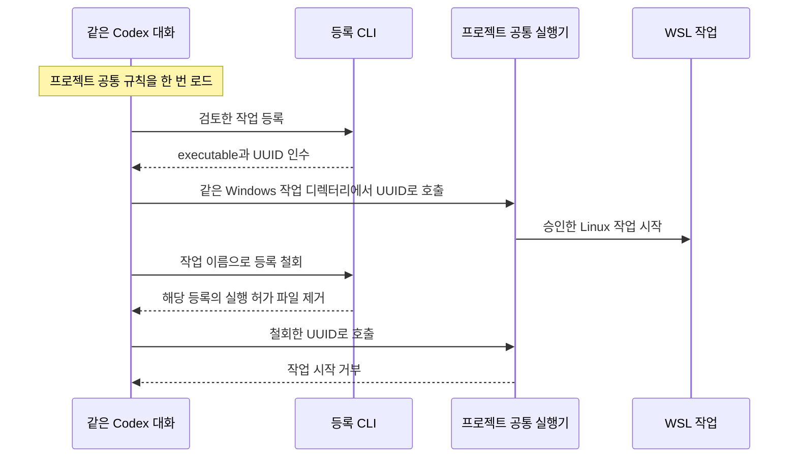

# 과거 사용법 — 0.3.2·0.3.3 WSL 작업 등록

이 문서는 0.3.2의 작업별 등록과 0.3.3의 공통 실행기 절차를 보존한 기록입니다.
아래 명령과 규칙은 해당 설치본을 설명합니다.
현재 플러그인은 읽기 전용 진단과 수동 확인 명령 안내를 제공합니다. [진단 CLI 사용법](diagnostic-cli.md)

실제 Codex 앱에서 확인한 동작은 [0.3.2 검증 기록](verification.md#032-wsl-작업-등록)에 있습니다.

## Windows 프로젝트와 Linux 작업 준비

`--project`에는 Codex에서 열 Windows 프로젝트의 절대 경로를 지정합니다.
`--distro`와 `--linux-cwd`에는 작업을 수행할 배포판과 그 안에 이미 있는 Linux 프로젝트의 절대 경로를 지정합니다.
작업 디렉터리와 실행 파일은 배포판의 네이티브 Linux 파일 시스템에 있어야 합니다.
실제 경로가 `/mnt/c` 같은 Windows 드라이브 마운트에 있으면 네이티브 Linux 경로를 선택합니다.
등록에는 대상 Windows 프로젝트 밖에 있는 플러그인 설치본을 사용합니다.
Windows 실행 파일을 빌드할 때는 Windows `PATH`에서 확인할 수 있는 기존 Go가 필요합니다.

아래 예시는 WSL의 `/home/me/src/example`에 있는 Python 프로젝트에서 `tests.test_api`의 테스트를 실행합니다.
Make를 사용하는 프로젝트는 네이티브 Linux 작업 디렉터리 안의 `Makefile`에 있는 작업을 선택합니다.

```makefile
.PHONY: check
check:
	/usr/bin/python3 -m unittest tests.test_api
```

Go Task를 사용하는 프로젝트는 같은 Linux 디렉터리의 `Taskfile.yml`에 있는 작업을 선택할 수 있습니다.

```yaml
version: '3'
tasks:
  check:
    cmds:
      - /usr/bin/python3 -m unittest tests.test_api
```

실제 프로젝트에서 사용 중인 작업 이름과 도구 경로로 바꿉니다.
작업이 평가하는 설정·포함 파일·의존 작업·스크립트와 배포판의 실행기·인터프리터는 사용자가 신뢰해야 합니다.
Windows 작업 공간의 편집과 실행 대상을 분리하려면 작업이 읽는 코드와 설정도 Linux 쪽 프로젝트에 둡니다.
작업 자체는 배포판의 사용자 권한으로 실행되므로 그 코드가 읽거나 수정하는 대상은 작업의 동작을 검토해 판단합니다.

## 공통 실행기 활성화

[CLI 준비 절차](diagnostic-cli.md#실행-전제조건)의 `$cli`와 `$projectRoot`를 사용합니다.
0.3.3의 공통 실행기를 사용하려면 Windows 프로젝트마다 한 번 활성화합니다.
첫 명령은 프로젝트를 읽기 전용으로 검토하고 `confirmation` 값을 반환합니다.

```powershell
node $cli wsl-enable --project $projectRoot
```

검토 결과의 프로젝트를 확인한 뒤 같은 명령에 실행 옵션과 반환된 값을 붙입니다.

```powershell
$enableConfirmation = '<활성화 검토 결과의 confirmation 값>'
node $cli wsl-enable --project $projectRoot --execute --confirm $enableConfirmation
```

활성화는 보호된 고정 경로에 `project-runner-v1/wsl-run.exe`를 설치합니다.
선택한 Windows 프로젝트 안에 `.codex/rules/windows-agent-devkit-wsl-runner.rules`를 추가합니다.
공통 규칙의 `allow` 접두사는 그 실행 파일의 절대 경로 한 항목입니다.
규칙과 설정에서 쓰기 대상은 이 프로젝트 규칙 파일 한 개로 한정합니다.
Codex의 프로젝트 신뢰와 샌드박스·승인 설정은 사용자가 관리합니다.
앱이 권한 승인을 요청하면 사용자가 검토한 호출을 직접 승인합니다.

활성화 전에 규칙을 읽은 Codex 대화에서는 프로젝트 규칙을 한 번 다시 로드합니다.
공통 규칙이 로드되면 같은 대화에서 이후에 등록한 작업을 규칙 재로딩 없이 실행할 수 있습니다.

Codex 로컬 규칙의 `allow`는 일치하는 명령을 샌드박스 밖에서 실행할 수 있게 합니다.
프로젝트 로컬 규칙은 신뢰된 프로젝트에서 적용됩니다.
공식 규칙 문서 확인일은 2026-11-18입니다. [OpenAI Codex Rules](https://developers.openai.com/codex/rules)

## 검토하고 등록

아래 네 필드를 Windows에서 읽을 수 있는 `wsl-check.json`에 저장합니다.
`args`의 순서는 작업을 실행할 때 그대로 사용됩니다.
작업 인수에는 비밀 값을 넣지 않습니다.

```json
{
  "context": "wsl",
  "trusted": true,
  "tool": "/usr/bin/make",
  "args": ["check"]
}
```

Go Task를 선택했다면 `tool`을 배포판에 설치된 `task`의 실제 Linux 절대 경로로 바꿉니다.
`--task-file`에는 선택한 명령을 담은 JSON을 지정합니다.

아래 배포판과 경로는 준비한 실제 대상으로 바꿉니다.
`--task-name`에는 영문자 또는 숫자로 시작하는 1~64자의 등록 이름을 지정합니다.
나머지 자리에는 영문자·숫자·하이픈·밑줄을 사용할 수 있습니다.

```powershell
$taskFile = Join-Path $projectRoot 'wsl-check.json'
$registerArgs = @(
  '--project', $projectRoot,
  '--task-name', 'check-api',
  '--distro', 'Ubuntu-24.04',
  '--linux-cwd', '/home/me/src/example',
  '--task-file', $taskFile
)
node $cli wsl-register @registerArgs --format json
```

첫 명령은 승인 입력을 확인하는 읽기 전용 검토입니다.
검토 결과에서 Windows 프로젝트 경로, 등록 이름, 배포판, Linux 작업 경로, 도구와 인수 개수를 확인합니다.
인수 원문과 순서는 작업 JSON에서 확인합니다.
해당 범위를 등록하기로 결정했으면 결과의 `confirmation` 값을 아래에 넣습니다.
확인한 입력이나 플러그인 버전이 달라지면 다시 검토해 지문을 받습니다.

```powershell
$confirmation = '<검토 결과의 confirmation 값>'
node $cli wsl-register @registerArgs --execute --confirm $confirmation
```

Codex 앱이 이 등록 명령의 권한 승인을 요청하면 사용자가 검토한 호출을 직접 승인합니다.
공통 실행기를 사용하는 새 등록은 실행 파일의 절대 경로 `executable`과 문자열 배열 `args`를 반환합니다.
`args`의 유일한 값은 해당 등록 세대를 식별하는 UUID입니다.
이 UUID는 `--task-name`으로 지정한 등록 이름과 별개입니다.

## 조회하고 실행

```powershell
node $cli wsl-tasks --project $projectRoot --format json
```

공통 실행기를 쓰는 `active` 작업의 `executable`과 `args`를 확인합니다.
공통 규칙을 읽은 Codex 대화에서 실행합니다.
호출의 Windows 작업 디렉터리를 `--project`와 같은 경로로 지정합니다.
실행 파일의 절대 경로를 직접 호출하고 인수로 UUID 하나를 전달합니다.
Codex에서 PowerShell 명령으로 호출할 때 UUID를 작은따옴표로 감쌉니다.
명령에 변수나 작업 인수의 확장을 사용하지 않고 목록의 값을 직접 넣습니다.

```powershell
& '<executable의 절대 경로>' '<args의 UUID>'
```

실행기는 등록한 배포판의 Linux 작업 디렉터리에서 승인된 도구와 인수로 작업을 시작합니다.
성공 결과에는 `checkId: "WSL-02"`와 `task.execution: "succeeded"`가 표시됩니다.
실행 파일의 종료 코드도 함께 확인합니다.
일반 `wsl.exe` 호출은 Codex의 기존 승인 정책을 따릅니다.
실제 실행 결과, 적용 범위와 Windows 작업 공간 편집의 영향은 [설치본 검증 기준](completion-contract.md#설치본-검증-기준)에 따라 확인합니다.

## 철회

```powershell
node $cli wsl-unregister --project $projectRoot --task-name 'check-api' --execute
node $cli wsl-tasks --project $projectRoot
```

성공한 철회는 `state: "revoked"`로 표시합니다.
철회는 해당 등록 세대의 실행 허가 파일(lease)을 즉시 제거합니다.
공통 규칙은 프로젝트에 남아 다른 등록 작업에도 계속 적용됩니다.
같은 대화에서 철회한 UUID를 다시 호출하면 실행기가 작업 시작을 거부합니다.
이미 시작한 작업은 계속 실행됩니다.
작업 변경을 다시 승인하려면 새 입력으로 검토부터 진행합니다.



## 0.3.2 방식의 등록

기존 등록과 공통 실행기를 활성화하지 않은 프로젝트의 등록에는 0.3.2와 동일한 작업별 실행 파일과 프로젝트 규칙을 적용합니다.
Git 작업 트리에서는 등록 결과의 `gitExcluded`로 해당 작업 규칙의 로컬 제외 여부를 확인합니다.
신뢰된 같은 Windows 프로젝트에서 작업별 규칙을 로드한 뒤 목록의 전용 `.exe`를 인수 없이 직접 호출합니다.
0.3.2 전용 실행 파일이 호출하는 검증의 개별 조회와 작업에는 15초 제한이 적용됩니다.
철회하면 해당 작업의 규칙이 제거되고 봉인된 실행 파일은 캐시된 규칙으로 호출해도 작업 시작을 거부합니다.
