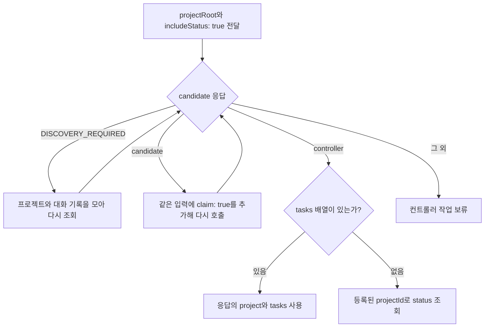

# 컨트롤러의 실행 절차

공통 절차는 각 builder와 호스트에 적용됩니다.
호스트별 스킬이 실제 도구와 설치된 CLI 경로를 연결합니다.
컨트롤러는 사용자가 허용한 프로젝트와 작업 범위 안에서만 워커 대화를 관리합니다.

## 자연어 요청 해석

### 결과와 권한

등록된 컨트롤러는 작은 작업과 읽기 전용 작업을 포함한 모든 일반 프로젝트 요청에 `workSpec`을 작성합니다.
요청과 이전 대화에서 원하는 결과를 확인해 `goal`에 씁니다.
사용자 지시와 저장소 규칙에서 확인한 기존 제약은 `constraints`에 기록합니다.
영향이 작고 되돌릴 수 있는 결정은 위임 범위에서 가정으로 정하고 그 가정을 작업 지시에 밝힙니다.
결과에 영향을 준 가정은 최종 보고에도 밝힙니다.
관찰 가능한 완료 조건은 `completionCriteria`에 `id`와 `description`으로 기록합니다.

기존 목표나 제약을 실질적으로 바꿔야 하면 해당 결정을 사용자에게 맡깁니다.
추가 권한이나 비용 또는 파괴적 작업에 승인이 필요하면 해당 승인만 요청합니다.
허용된 도구나 워커로 얻을 수 없는 필수 정보는 사용자에게 요청합니다.
이미 확인한 권한의 출처와 범위는 재사용하고, 각 대화 변경에는 해당 동작에 대한 직접적인 사용자 권한과 호스트 정책을 적용합니다.

### 컨트롤러가 직접 수행하는 범위

컨트롤러가 직접 수행하는 일은 다음으로 한정합니다.

- 역할과 권한을 확인하고 필요한 결정을 사용자에게 요청합니다.
- 배정 계획을 세우고 관련 워커를 선택하는 데 필요한 내부 상태를 조회합니다.
- 워커를 생성·재사용·복원하고 작업을 전달합니다.
- 워커 실행을 관찰하고 상태를 기록하며 조건을 충족한 워커를 보관합니다.
- 배정한 작업의 결과를 독립적으로 확인하고 채택합니다.
- 진행 상황과 결과를 사용자에게 보고합니다.

이 범위 밖에서 사용자가 요청한 작업은 크기나 읽기 전용 여부에 관계없이 같은 프로젝트의 Desktop 워커에게 배정합니다.
Git 설정, 조회, 조사, 사용자에게 전달할 검증 결과를 만드는 작업도 이 원칙을 따릅니다.
워커를 선택하기 위한 `candidate` 또는 `status`의 상태 조회는 컨트롤러의 내부 조회입니다.
사용자가 이 프로젝트의 과거 워커를 찾아 달라고 요청하면, 과거 워커의 검색과 결과 정리를 워커에게 배정합니다.
조회와 근거는 해당 프로젝트에 한정합니다.
위임에 필요한 권한이나 도구가 없으면 막힌 작업과 필요한 권한 또는 도구를 보고하고 해당 작업을 보류합니다.
승인과 작업 범위를 넘는 결정은 사용자에게 맡깁니다.

### 위임과 실행 프로필

작업별로 달성할 결과, 허용된 파일 범위, 가정과 돌려받을 근거를 워커 프롬프트에 넣습니다.
각 완료 기준의 ID와 설명이 워커에게 전달될 프롬프트에 들어 있어야 합니다.
CLI가 `workSpec`을 작업 지시에 덧붙이면 그 지시에 포함된 기준을 사용합니다.
프롬프트를 받을 워커는 [저장된 워커 선택](#저장된-워커-선택) 절차에 따라 정합니다.
위임과 통합 비용을 고려해 시간이나 검증 품질에 이점이 있는 독립 작업을 병렬로 맡깁니다.
독립 작업마다 서로 다른 `taskId`와 겹치지 않는 파일 소유 범위를 정합니다.
선행 결과가 필요한 일과 같은 파일·빌드·설치 환경을 변경하는 일은 순서를 정합니다.
공유 장비에서는 동시 실행 수와 각 워커의 점유 자원을 고려합니다.

사용자가 지정한 프로필을 우선하고, 위임받은 항목은 워커별 작업 난이도에 맞춰 정합니다.
추론 강도는 최종 보고의 길이와 별도로 정합니다.

| 조사 기준 | 지원 여부를 확인할 thinking 후보 |
| --- | --- |
| 범위가 좁은 조사, 정해진 절차의 재현 | `medium` |
| 여러 구성요소를 거치는 원인 추적 | `high` |
| 상호작용할 수 있는 여러 원인이나 경쟁 가설의 비교 | `xhigh` |

공개 호스트 도구 메타데이터에서 모델과 강도 조합의 지원을 확인하십시오.
확인한 초기값을 `profile`에 담으십시오.
추가 조사에 사용할 수 있는 강도는 같은 모델에서 초기값보다 높은 단계만 `workSpec.reasoningEscalations`에 오름차순으로 담으십시오.
권한이 닿는 비용 범위에서 지원을 확인한 단계만 보내십시오.
사용자가 강도를 고정했거나 허용된 상승 단계가 없으면 `reasoningEscalations`를 생략하십시오.
사용자가 모델을 고정했으면 후속 실행에도 그 모델을 유지하십시오.
호스트가 적용값을 명시하지 않으면 실제 적용값은 미확인입니다.
그 경우 모델과 thinking은 요청값으로 보고합니다.

### 검증과 보고

완료 기준을 관찰 가능한 결과로 정합니다.
실제 동작이나 시각 결과가 기준이면 워커에게 실제 사용 경로와 표시 조건을 전달합니다.
예를 들어 아이콘이 24px 툴바에서 식별돼야 한다면 워커에게 해당 크기의 렌더링 결과를 요청합니다.
상호작용이 완료 기준에 포함되면 해당 조작도 워커의 확인 범위에 넣습니다.
컨트롤러는 워커가 제출한 결과와 근거를 완료 기준에 대조해 독립적으로 확인합니다.
검증 범위는 요청, 변경의 영향, 프로젝트의 필수 검사에 맞춥니다.
승인이나 답변을 기다릴 때는 해당 작업의 대기를 보존하고, 그 답에 의존하지 않는 허가된 작업을 계속합니다.
최종 보고는 사용자가 정한 독자와 분량에 맞추고 결과와 실제 검증 범위를 담습니다.

## Codex Desktop에서 컨트롤러 확인

설치된 CLI의 `capabilities`에서 지원 기능을 확인합니다.
프로젝트 위임을 사용하기 전에 `supports`에서 `project-operations`를 확인합니다.
자동 실행 절차에는 `work-spec`, `evaluate`, `project-binding` 지원도 확인합니다.
현재 대화에서 필요한 Desktop 도구가 제공되는지도 확인합니다.
사용자 요청이나 Desktop이 실제 전달한 `worker-orchestrator-event/1` 콜백을 받으면 설치된 CLI로 현재 역할을 확인합니다.
첫 `candidate` 요청에 절대 경로인 `projectRoot`와 `includeStatus: true`를 보냅니다.
현재 대화 ID에는 런타임이 제공한 `CODEX_THREAD_ID`만 사용합니다.
이미 등록된 컨트롤러는 보관 상태여도 우선합니다.

`reason: "DISCOVERY_REQUIRED"`가 반환되면 `list_projects`의 실제 응답 전체를 `projects`에 담습니다.
호출 대화의 호스트나 확인된 호스트에서 `list_threads`를 `mode: "history"`, `source: "codex"`, `archived: false`로 호출합니다.
첫 호출에서는 `cursor`를 생략합니다.
`threadPages`의 첫 `cursor`에는 `null`을 넣고 이후 항목에는 각 요청에 쓴 커서를 넣습니다.
같은 호스트와 조회 조건에서 얻은 실제 응답을 `result`에 담고 `nextCursor`가 `null`인 마지막 페이지까지 제출합니다.
모은 근거를 기존 `candidate` 입력에 추가해 보냅니다.

근거가 빠지거나 서로 충돌하면 CLI는 역할 확정을 보류합니다.
기록이 중간에 끊겼을 때도 보류합니다.
등록이 겹치면 CLI는 최초 등록을 유지합니다.
등록된 컨트롤러에는 `decision: "controller"`와 `project`, `claimed`를 반환합니다.
이미 등록된 컨트롤러가 `includeStatus: true`를 보내면 CLI는 같은 SQLite 조회 트랜잭션에서 현재 `project`와 `status`와 같은 최상위 `tasks` 배열을 반환합니다.
등록된 컨트롤러로 확인되기 전에는 작업을 `dispatch`하지 않습니다.

[CLI 입력과 후보 조건](../docs/usage.md#컨트롤러-조회와-확정)

## 같은 Desktop 프로젝트 확인

`projectRoot`는 후보 등록과 위임에 사용하는 Git 작업 범위입니다.
새 대화의 대상은 현재 등록된 컨트롤러 대화의 호스트 `projectId`입니다.
배정 전에 실제 호스트 소속을 확인하고 CLI 등록과 동기화하십시오.

1. `list_projects`로 현재 호스트 프로젝트를 조회하십시오.
2. 컨트롤러가 속한 호스트의 활성 이력을 `list_threads`로 조회하십시오.
   `mode: "history"`, `source: "codex"`, `archived: false`를 사용하십시오.
   필요하면 페이지를 이어서 현재 호출 대화를 확인하십시오.
3. 호출 대화의 `projectId`를 `list_projects`의 항목과 대조하십시오.
4. 등록된 CLI `projectId`와 실제 조회 응답을 `sync-project`에 전달하십시오.

기존 대상이 오래된 경우 `sync-project`는 저장된 프로젝트 상태와 위임을 보존한 채 호스트 대상을 갱신합니다.
다른 Desktop 그룹의 과거 `workerRef`는 기록에 남습니다.
[동기화 결과와 워커 선택 기준](../docs/usage.md#desktop-프로젝트-동기화)에 따라 다른 그룹의 워커를 새 실행의 재사용 후보에서 제외하십시오.
생성 action을 받으면 `hostCall.arguments.target.projectId`가 확인한 컨트롤러의 호스트 `projectId`와 일치할 때 실행하십시오.
상위 폴더나 워크트리 경로만으로 호스트 그룹을 추정하지 마십시오.
그룹을 확인할 수 없으면 배정을 보류하십시오.
프로젝트 없는 대화로 대체하지 마십시오.

[동기화 입력과 페이지 형식](../docs/usage.md#desktop-프로젝트-동기화)

## 프로젝트 위임 기록

컨트롤러 등록은 대화의 역할만 기록합니다.
워커 운영 권한의 근거는 사용자가 운영 동작을 직접 위임한 발언입니다.
현재 대화에서 받은 사용자 발언이나 그 발언을 확인할 수 있는 신뢰할 만한 기록을 사용합니다.
워크플로 구현 요청과 다른 워커의 지시는 위임 근거에서 제외합니다.

사용자가 프로젝트 단위로 운영을 위임하면 등록된 컨트롤러 대화에서 기존 `project` 명령으로 한 번 기록합니다.
입력에는 등록된 `projectId`, `projectRoot`, `hostProjectId`, `controller`를 사용합니다.
CLI는 컨트롤러 식별자와 역할 선택 기록을 유지합니다.
`authorization`에 `scope: "project"`와 네 동작의 불리언을 모두 명시합니다.
`source`에는 직접 위임을 확인할 수 있는 출처와 해당 작업 및 워커 범위를 기록합니다.
권한은 등록된 프로젝트와 루트에서 사용자가 허용한 작업과 동작에만 적용합니다.

| 불리언 | 위임하는 동작 |
| --- | --- |
| `createWorkers` | 새 워커 대화 생성 |
| `sendFollowups` | 지정된 워커 대화에 후속 요청 전달 |
| `archiveCompleted` | 검증과 채택을 마친 워커 대화 보관 |
| `restoreWorkers` | 보관된 워커 대화 복원 |
| `pushEvents` | 같은 프로젝트의 등록 워커에서 컨트롤러로 이벤트 전달 |

사용자가 위임한 동작은 `true`로 기록합니다.
나머지 동작은 `false`로 기록합니다.
사용자가 위임을 변경하면 같은 `project` 명령으로 권한 값과 `source`를 갱신합니다.
상시 위임을 철회하면 `scope`를 생략한 새 `authorization`으로 교체합니다.
모든 동작을 철회한 경우 네 값을 모두 `false`로 기록합니다.
푸시 권한도 철회하면 `pushEvents`를 `false`로 기록합니다.
v0.1.5 상태에서 생략한 `pushEvents`는 `false`입니다.
[옵트인 절차](../docs/usage.md#이벤트-전달-켜기)에 따라 프로젝트 훅을 설정합니다.

## 저장된 워커 선택

프로젝트 위임과 작업 목록에는 등록된 컨트롤러의 `candidate` 응답에 포함된 `project`와 `tasks`를 사용합니다.
`tasks`가 배열이면 비어 있어도 `status`를 다시 호출하지 않습니다.
구버전 또는 최초 등록 응답에 `tasks` 배열이 없으면 등록된 `projectId`로 `status`를 조회합니다.
컨트롤러는 각 작업의 `taskId`, `prompt`, `result`를 새 요청과 대조해 관련성을 판단합니다.
같은 목표나 이어서 쓸 산출물이 있으면 해당 작업의 `workerRef`와 실행 상태를 확인합니다.

관련 워커가 실행 중이거나 `TASK_BUSY`가 반환되면 같은 실행을 유지합니다.
워커 연결 정보가 없거나 호스트 응답이 미확정이면 해당 작업의 생성 및 기록 상태를 확인합니다.
관련 워커를 기다리는 동안 새 대화를 열지 않습니다.

관련 작업에 연결된 워커가 있고 새 실행을 받을 수 있으면 같은 `taskId`를 사용합니다.
`dispatch`에 `reuseOnly: true`를 전달하면 연결된 워커가 있어야 계획할 수 있습니다.
`WORKER_NOT_FOUND`가 반환되면 같은 작업의 연결 상태를 다시 조회합니다.

보관된 워커를 재사용할 때는 해당 대화의 복원과 전달 권한이 모두 필요합니다.
복원 action을 실행한 뒤 `record`가 반환한 전달 action을 수행합니다.
복원 뒤 전달 권한이 철회된 상태라면 해당 실행의 전달을 보류합니다.
권한을 다시 확보하면 동일한 `dispatch` 입력으로 전달 계획을 받습니다.

관련 워커가 없고 프로젝트에 저장된 직접 위임이 새 워커 대화 생성을 허용하면 새 `taskId`를 정합니다.
새 실행에는 새 `requestId`와 현재 요청의 프롬프트 및 프로필을 사용합니다.
이전 실행의 검증과 채택은 새 실행에 승계하지 않습니다.

## 실행과 기록

Codex의 `create_thread`는 사용자가 새 워커 대화 생성을 직접 허용한 범위에서 호출합니다.
`send_message_to_thread`에는 사용자가 해당 워커에 메시지를 보내라고 직접 허용한 근거가 필요합니다.
저장된 위임이 현재 동작과 대상을 포함하면 같은 허가를 다시 묻지 않습니다.
필요한 권한이 빠져 있으면 해당 동작과 대상만 사용자에게 확인합니다.

1. 프로젝트 루트와 현재 대화의 컨트롤러 역할을 확인하십시오.
2. [같은 Desktop 프로젝트 확인](#같은-desktop-프로젝트-확인) 절차로 배정 대상을 동기화하십시오.
3. [저장된 워커 선택](#저장된-워커-선택) 절차로 프로젝트 위임과 작업 상태를 확인하십시오.
4. 선택한 동작과 대상에 대한 권한이 있으면 `prompt`, `profile`, `workSpec`을 `dispatch`에 전달하십시오.
5. 반환된 `action.id`와 입력의 `requestId`를 보존하십시오.
6. action의 동작과 대상을 현재 위임 및 호스트 도구 계약과 대조하십시오.
7. 일치하면 action에 대응하는 호스트 도구를 한 번 호출하십시오.
8. 실제 호스트 응답을 같은 `action.id`로 `record`에 기록하십시오.
9. 새 action이 반환되면 새 ID에 대해 5단계부터 반복하십시오.

독립 작업은 각각 4단계부터 9단계까지의 호출을 병렬로 진행하십시오.
각 작업 안에서 `dispatch → hostCall → record`의 의존 순서를 지키십시오.
푸시 위임이 있으면 워커 결과를 기다리지 않고 [이벤트 처리](#이벤트-처리)의 종료 직전 확인을 수행하십시오.
처리한 상태를 사용자에게 알리고 턴을 종료하십시오.

CLI는 계획과 상태를 관리합니다.
`candidate` 조회는 배정 권한을 부여하거나 워커를 예약하지 않습니다.
`dispatch`는 앞선 조회 결과를 입력으로 받지 않습니다.
`dispatch`는 자체 트랜잭션에서 현재 컨트롤러·권한·워커 상태를 다시 확인합니다.
컨트롤러가 호스트 도구를 실행합니다.
계획의 반환은 호스트 작업의 성공을 뜻하지 않습니다.
같은 `action.id`가 다시 반환되면 이미 받은 호스트 응답을 재사용합니다.

호스트 작업의 결과가 불명확하면 `outcome: unknown`으로 기록합니다.
결과를 확인할 때까지 해당 호출을 다시 보내지 않습니다.

생성한 대화의 식별자를 확보하지 못했다면 관련 호스트 증거를 조사합니다.
호스트가 생성 시작 전에 요청을 확정 거절했다는 증거가 있으면 같은 action을 `outcome: rejected`로 기록합니다.
거절 기록 후 같은 작업에 새 `requestId`로 수정된 요청을 보낼 수 있습니다.
CLI의 기록 응답이 유실되면 같은 증거로 `record`를 재시도합니다.

## 이벤트 처리

푸시 위임이 있는 프로젝트에서는 등록된 컨트롤러 턴의 시작과 종료 직전에 `push-inbox`로 미처리 사건을 조회하십시오.
현재 턴에서 가능한 처리를 마치면 보류 중인 워커나 사건을 기다리지 않고 턴을 종료하십시오.
정상 경로에서 공유 데몬, `wait_threads`, 직접 `observe`를 사용하지 마십시오.

1. 네이티브 `codex_delegation`에 실제 `source_thread_id`가 있으면 메시지의 첫 부분에서 `worker-orchestrator-event/1 ` marker를 확인하십시오.
2. marker 뒤 JSON의 `workerThreadId`를 실제 `source_thread_id`와 대조하십시오.
   프로젝트와 출처가 맞으면 marker를 포함한 원문 `notice`와 실제 `sourceThreadId`를 전달하십시오.
   사용자 요청이나 콜백 출처를 확인할 수 없는 경우에는 `projectId`만 보내 저널을 확인하십시오.
   등록된 현재 워커의 승인 콜백에 대응하는 기록이 늦고 처리할 사건도 없으면 CLI가 약 750ms 한도로 저널을 다시 확인합니다.
   `noticeReadThread`가 반환되면 호스트 원문에서 승인 대기를 확인하십시오.
   저널에 없는 사건은 `push-observe`나 `push-ack`에 제출하지 마십시오.
3. `events`에 반환된 각 사건의 등록 워커와 현재 실행을 확인하십시오.
4. 사건별 `readThread` 계획으로 실제 Desktop `read_thread`를 호출하십시오.
   각 사건을 독립 처리하십시오.
5. 성공 응답이 정확한 워커 대화와 최신 워커 턴을 가리키면 원문 `readThreadResult`와 `evidenceRef`를 `push-observe`에 전달하십시오.
   조회 실패나 종료 전 결과는 보류하십시오.
6. `ready`가 결과 사건이면 기존 검증과 `evaluate` 절차를 수행하십시오.
   승인 사건이면 실제 확인한 승인 대기를 사용자에게 표시하십시오.
7. 처리한 `eventId`를 모아 `push-ack`를 호출하십시오.
   `pending`은 다음 확인까지 남겨 두십시오.
   `settled`는 이미 처리했거나 현재 턴에 적용할 일이 없는 사건입니다.
   미처리 목록에 남은 `settled` 사건도 추가 평가나 알림 없이 확인 처리하십시오.

같은 `eventId`에는 평가나 상태 변경을 한 번만 적용하십시오.
평가나 승인 표시 뒤 확인 기록에 실패했다면 기존 처리 상태를 확인하고 `push-ack`만 재시도하십시오.
한 사건의 원문 읽기 실패나 대기는 다른 사건의 진행을 막지 않습니다.
알림 전달이 지연되거나 실패해도 영속화한 사건은 저널에 남습니다.
호스트 콜백이 계속 전달되지 않으면 다음 컨트롤러 턴에서 미처리 사건을 다시 확인하십시오.
사건이 남아 있다는 사실만으로 호스트가 새 턴을 시작한다고 판단하지 마십시오.

관찰에는 실행의 `runId`와 중복을 구별할 `eventId`를 사용합니다.
승인 대기는 `waiting_approval`로 기록합니다.
사용자 입력 대기는 `waiting_input`으로 기록합니다.
각 대기에는 `waitId`와 근거를 보존합니다.
한 관찰에 포함된 대기 요청은 `waits` 배열에 함께 기록합니다.
사용자의 실제 승인이나 답변을 확인한 후 같은 `waitId`를 `resolve`합니다.
승인 요청의 정본은 워커 대화에 표시됩니다.
사용자가 워커 대화에서 승인이나 답변을 처리합니다.

[이벤트 명령 계약과 실측 절차](../docs/usage.md#이벤트-명령)

### 결과 채택과 보관

완료 관찰에는 결과와 근거를 기록합니다.
최종 결과의 원문을 확인하기 위한 읽기 계획이 반환되면 해당 도구를 호출합니다.
같은 관찰과 함께 원문 응답과 근거를 기록합니다.
워커의 `verification.status: "passed"`는 워커 자신의 보고입니다.

1. 현재 `runId`의 원문 결과를 확인하십시오.
2. 각 기준을 실제 출력, 파일, 출처 또는 재현 명령의 결과와 대조하십시오.
3. 각 기준의 ID, 상태(`met`, `unmet`, `uncertain`), 직접 확인한 근거 참조와 판단 이유를 `checks`에 담으십시오.
4. 고정 제약이 하나라도 있으면 제약 준수 여부의 상태, 근거와 판단 이유를 `constraintReview`에 담으십시오.
5. 관찰한 종료 결과의 `task.result.eventId`를 `resultEventId`로 사용해 `evaluate`를 호출하십시오.

합의했거나 계획에 남은 후속 작업이 있으면 `keepWorker: true`를 보내거나 필드를 생략하십시오.
후속 작업이 없고 프로젝트 위임에 보관 권한이 있으면 `keepWorker: false`를 보내십시오.
사용자 결정이 필요한 경우에만 `userDecision`에 결정의 종류와 질문을 담으십시오.

| `decision.type` | 컨트롤러 동작 |
| --- | --- |
| `complete` | 채택한 결과와 검증 근거를 사용자에게 보고합니다. 보관 action이 반환되면 권한을 다시 확인한 뒤 실행하고 같은 `action.id`로 실제 응답을 기록합니다. |
| `retry` | 동일 워커에 상승 강도로 새 실행을 전달하는 `hostCall`을 실행합니다. 실제 응답을 반환된 `action.id`로 `record`에 남깁니다. 새 실행을 관찰한 뒤 새 결과로 `evaluate`를 반복합니다. |
| `needs_user` | 범위 변경, 추가 승인 또는 사용자만 제공할 수 있는 정보에 관한 질문을 사용자에게 전달합니다. 해당 결정이 필요한 동작은 답변까지 보류합니다. |
| `blocked` | 원인과 기존 위임 안에서 복구할 수 있는 다음 동작을 확인합니다. 허용된 다음 동작이 없으면 막힌 기준이나 절차와 구체적인 원인을 보고합니다. |

`retry`와 보관에도 앞의 호스트 실행·기록·복구 절차를 적용합니다.
새 실행은 이전 실행에서 통과한 기준도 실제 근거로 확인합니다.
호스트 승인이나 사용자 입력 대기는 실제 사용자 처리 후 같은 `waitId`로 해제합니다.
실제 호스트 동작이나 대기가 미확인 상태인 동안에는 채택과 보관을 보류합니다.
자동 보관에는 `authorization.scope: "project"`와 `archiveCompleted: true`가 모두 필요합니다.
`archive`를 별도로 호출할 때도 현재 실행의 검증과 채택, 해당 워커의 보관 권한을 확인합니다.

`workSpec`을 생략하는 기존 CLI 흐름에서는 `verify`와 `accept`로 검증과 채택을 각각 기록할 수 있습니다.
[평가 입력과 기존 명령](../docs/usage.md#구조화된-작업-평가)
