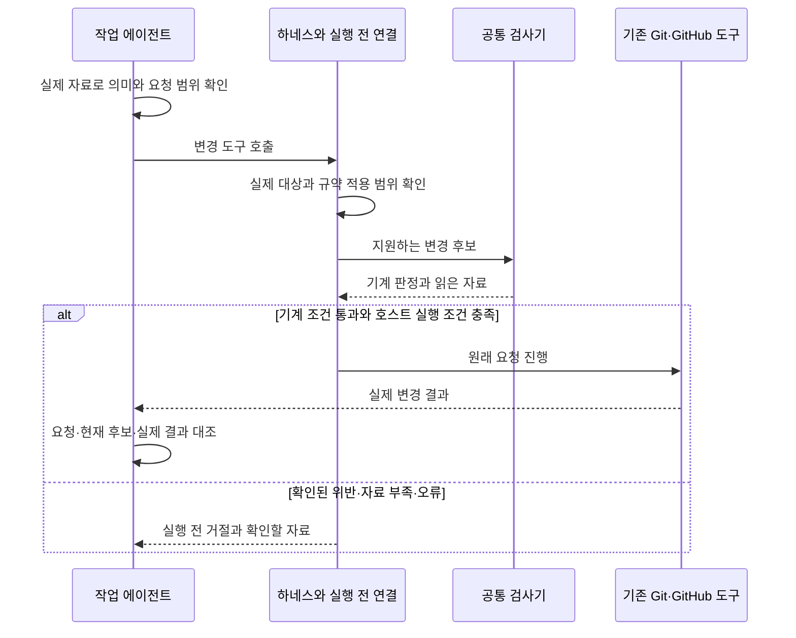

# Design

## Context

공개 기준선은 원격 `main`과 로컬 `origin/main`에서 일치한 `2898d6fff4d3515143b3cc25546286053ae1850d`다.
이 커밋의 카탈로그는 `./packages/repo-governance/plugin`을 가리키고 플러그인 manifest의 버전은 `0.2.0`이다.
배포 동작을 확인할 때 해당 커밋의 파일을 `git show origin/main:<path>`로 읽었다. [공개 카탈로그][catalog] · [Codex 플러그인 manifest][codex-manifest]

배포 기록은 RoyLabs 소스의 이관 기준으로 `441a74e4334d1240319ce635e10cc3c6062a4825`를 지정한다.
RoyLabs 커밋의 출처는 배포 기록으로 확인했다.
설계 본문은 이관 커밋 `960a8410c913b2a8d107281821925bacb0d58311`에 보존된 `plugins/repo-governance/plugin/SPEC.md`와 일곱 상세안에서 확인했다.
이관 경로와 공개 배포 경로의 Git 트리 OID는 모두 `bb4267061ff32c79aebf8e4561d3c144d50d00b8`다.
`docs/DESIGN.md`는 해당 저장소의 README와 배너의 시각 기준이다. [배포 기록][deployment] · [이관 명세][original-spec] · [이관 상세안][original-rules] · [README 시각 기준][readme-design]

공개 CI 동작은 기준선의 `plugin/templates/github-actions.yml`과 `tests/ci.test.mjs`에서 확인했다.
작업 트리에는 이 템플릿, CI 테스트, `bundle.json`의 기존 수정이 있다.
이 수정에는 공개 배포 경로를 CI의 검색 후보에 추가하는 내용이 들어 있다. [공개 CI 템플릿][ci-template] · [공개 CI 테스트][ci-tests]

## Goals / Non-Goals

**설계 목표**

- 새 초안의 의미와 적용 근거를 현재 저장소 자료로 확인한다.
- 실제로 확인할 수 있는 변경 후보에 공통 기계 검사를 적용한다.
- 같은 규칙으로 검사한 범위와 실제 호스트에서 관측한 결과를 추적할 수 있게 한다.

**이 변경의 범위**

- 공개 `0.2.0`의 기능과 원설계의 확인 기준을 OpenSpec으로 기록한다.
- 배포 기록, 코드, 테스트 또는 실제 세션 기록으로 입증하는 범위를 표시한다.

## Decisions

### 작성과 기계 검사는 같은 규약을 서로 다른 근거로 적용한다

원설계는 K1–K7 상세안이 문안의 의미와 필요한 근거를 제시하고, 공통 검사기가 확정할 수 있는 조건을 판정하도록 정했다.
이 구조에서는 이름 `shared-plugin`이 K1 형식 검사를 통과해도 개별 리소스명이 빠진 후보의 적용은 에이전트가 보류한다.
README의 시작 경로나 PR의 실제 검증 주장도 현재 저장소 자료와 실행 결과를 읽어 확인한다.
README와 PR 템플릿은 독자와 변경 규모에 맞춰 사용할 작성 예시다. [원설계 §3–6][original-spec] · [경계 테스트][boundary-tests]

권한과 실제 쓰기는 원래 도구의 책임이다.
연결부는 지원 후보를 검사하고 실제로 실행된 판정을 호스트 응답으로 전달한다.
별도 검토 모델, 수집 서버, 쓰기·머지 실행기 없이 현재 작업 에이전트와 기존 도구가 이 흐름을 수행한다. [원설계 §7][original-spec] · [공통 구조][architecture]

### 기본 도입은 clone에 둔다

Git 공통 메타데이터의 도입 기록은 연결된 worktree에서 기본 규칙을 공유한다.
worktree별 기존 도입과 제품 입력을 우선하면 다른 환경의 기준 ref나 출력 경계를 독립적으로 계속 사용할 수 있다.
선택된 입력의 오류를 노출하면 손상된 계약을 자동으로 공통 기본값으로 바꿔 검사하는 일을 막을 수 있다.
같은 clone에서 두 worktree를 만들고 한쪽에만 제품 입력을 연결한 사례로 우선순위를 확인한다.
다른 쪽이 개별 값을 읽거나 누락된 개별 입력을 clone 기본값으로 처리하면 계약과 어긋난다. [제품 계약][repository-policy] · [도입 테스트][adoption-tests]

manifest의 SHA-256은 설치 및 실행에 쓰는 공통 자료를 확인한다.
제품 스키마 호환은 기존 설정의 내용을 유지하기 위한 별도 계약이다.
이전 bundle 식별 필드의 형식이 유효하고 제품 스키마가 지원되면 그 값은 현재 배포물의 해시와 비교하는 조건으로 쓰지 않는다.
같은 버전의 배포 리소스 바이트를 바꾼 입력은 거절하고, 다른 이전 식별자가 든 유효한 제품 입력은 읽을 수 있어야 한다. [공통 입력 구현][checker-inputs] · [호환 사례][external-contract-tests]

### 검사기는 관측할 수 있는 후보에 판정을 결부한다

직접 CLI, 호스트와 CI는 v3 검사 계약을 공유한다.
`observed`의 SHA-256과 OID는 읽은 자료를 추적하는 데 쓴다.
노출되는 결과는 확인한 기계 조건과 남은 의미 확인 항목을 포함한다.
`SPEC.md` §11.2의 README Source 표에는 `text`와 `file`이 적혀 있다.
공개 v3 입력 계약은 `index`도 허용하며 변경된 README와 링크를 같은 index의 blob으로 읽는다. [이관 명세 §11.2][original-spec] · [v3 자료 계약][checker-contracts] · [검사기 안내][checker-reference]

일반 커밋과 amend의 비교 기준을 구분하면 이전에 편입된 변경을 교체하는 커밋에도 K3·K7을 적용할 수 있다.
Git 객체를 새로 만들지 않고 index·blob과 부모를 읽어 후보를 확인한다.
작업 트리와 index에 다른 README와 링크를 둔 뒤 어느 내용으로 판정했는지 확인한다.
amend에서 교체할 HEAD 자체를 기준으로 사용해 기존 편입 후보를 놓치면 계약과 어긋난다. [index 입력 구현][checker-inputs] · [Git 후보 테스트][git-tests] · [연결 회귀 테스트][native-review-tests]

### 원격 변경의 종류별로 확인할 자료를 고른다

PR 생성은 지정한 두 원격 ref를 확인하고 생성 번호 없이 검사한다.
PR 수정은 현재 PR과 바꿀 값을 조합한다.
대상 브랜치가 바뀌면 확인한 새 ref OID를 사용한다.
PR 생성에서 두 ref의 식별값을 읽은 판정은 K6 문구와 Source 형식에 한정된다.
실제 비교 범위와 PR 생성 가능 여부는 작업 에이전트와 GitHub가 확인한다. [PR 생성 테스트][pr-create-tests] · [PR 수정 테스트][pr-edit-tests]

직접 파일 반영과 squash는 실제 원격 ref 또는 PR 상태를 로컬의 일치하는 commit과 함께 확인한다.
로컬 객체가 없으면 후보를 확인하기 위해 원격 조회 결과와 객체가 모두 필요하다는 사유를 반환한다.
로컬 `origin`을 잘못 선택하거나 예상 head가 달라진 사례를 대역 조회와 Git fixture에서 확인할 수 있다.
공통 검사를 통과한 뒤에도 예상 head 조건의 효력은 head에 한정되며, 실제 base와 tree는 실행 결과에서 확인한다. [연결 구현][adapter-source] · [직접 파일 회귀 테스트][native-review-tests] · [squash 테스트][pr-merge-tests]

### CI는 별도로 활성화하며 두 비교 기준을 보존한다

고정 커밋에서 읽은 공통 검사기로 PR 이벤트의 제목·본문과 파일 편입을 확인한다.
기준 브랜치만 바뀐 파일을 PR 변경으로 집계하는 일을 막기 위해 파일 검사는 head와 유일한 merge-base를 비교한다.
PR 자료에는 이벤트의 실제 base를 유지한다.
두 브랜치가 갈라진 fixture에서 K6의 `pr-base`와 K7의 `base`가 각각 이벤트 base와 공통 조상 OID인지 확인할 수 있다. [공개 CI 템플릿][ci-template] · [PR 분기와 merge-base 테스트][ci-tests]

공개 `0.2.0` 템플릿은 `governance/plugin` 또는 checkout 루트에서 checker를 찾는다.
`git ls-tree -r --name-only origin/main`의 파일 목록으로 실제 템플릿의 선택 코드를 실행한 결과, 공개 템플릿이 가리키는 `governance/skills/repo-governance/scripts/check.mjs`는 없었다.
같은 목록에서 작업 트리 템플릿이 선택한 `governance/packages/repo-governance/plugin/skills/repo-governance/scripts/check.mjs`는 있었다.
이 판정은 공개 checkout에서의 모듈 위치 확인에 한정된다.
공개 기준선에 지원 검색 경로의 검사기가 확인되거나 실제 공개 템플릿이 해당 배치에서 검사기를 불러오면 위치 불일치 판정은 반증된다. [공개 카탈로그][catalog] · [공개 검색 코드][ci-template]

### 규격과 검증 근거

| OpenSpec 규격 | 원설계의 확인 범위 | 공개 배포에서 대조한 근거 |
| --- | --- | --- |
| [저장소 규약](specs/repository-conventions/spec.md) | K1–K7, T1–T7, A3–A4, A8–A9, FI1–FI19 | [공통 스킬][skill] · [경계 테스트][boundary-tests] |
| [계약 해석](specs/governance-contract-resolution/spec.md) | A1, A5, A7, A14–A19 | [제품 기준][repository-policy] · [도입 테스트][adoption-tests] · [제품 연결 테스트][product-tests] |
| [기계 검사](specs/governance-machine-checks/spec.md) | T1–T7의 기계 조건과 §11.2 | [검사기 안내][checker-reference] · [입력·무결성 테스트][input-tests] · [규칙 테스트][rule-tests] |
| [하네스 훅](specs/governance-host-hooks/spec.md) | C2–C7, A2, A6, E1, E6–E9, E12 | [하네스 연결 절차][native-verification] · [Windows 등록 테스트][registration-tests] · [pi callback 테스트][pi-tests] |
| [변경 후보](specs/governance-mutation-verification/spec.md) | §6.1, §6.3, E2–E5, E8–E9 | [Git 후보 테스트][git-tests] · [연결 회귀 테스트][native-review-tests] · [PR 생성][pr-create-tests] · [수정][pr-edit-tests] · [squash][pr-merge-tests] |
| [선택형 CI](specs/governance-ci-checks/spec.md) | §6.4, E10 | [공개 CI 템플릿][ci-template] · [공개 CI 테스트][ci-tests] |

## Risks / Trade-offs

- **기계 통과의 범위** — 원설계의 163개 상세안 사례와 57개 공통 사례는 검증 목록이다.
  fixture는 연결된 기계 조건만 실행한다.
  각 사례의 의미 판단과 실제 차단에는 해당 실행 기록을 연결한다. [검증 계약][verification] · [검증 범위 테스트][coverage-tests]
- **호스트별 지원 근거** — 공개 README는 Windows의 Codex Desktop에서 `dc9cbe76` 훅을 신뢰한 뒤 첫 세션의 정상 README 커밋과 깨진 링크 차단을 관측했다고 기록한다.
  해당 관측은 기록된 세션과 조건에 한정된다.
  Claude Code와 pi에는 연결 코드와 프로토콜 테스트가 있다.
  두 하네스의 실제 모델 세션 검증은 보류다. [공개 지원 상태][plugin-readme] · [하네스 연결 절차][native-verification]
- **호스트가 연결을 호출하는 조건** — Codex는 앱의 신뢰와 활성 상태를 확인해야 한다.
  Claude Code 배포 안내는 `onFailure: "block"`에 Claude Code 2.1.295 이상을 요구한다.
  pi의 통지 계약은 배포 안내에 기록된 1.5.2 API와 callback에서 확인한다. [Codex 등록][codex-hook] · [Claude 등록][claude-hook] · [pi 연결 안내][pi-reference]
- **판정 뒤 후보 변경** — 조회와 실제 쓰기 사이에 대상이나 내용이 바뀔 수 있다.
  관측한 변경은 다시 검사하고 실제 결과의 파일·ref·OID를 요청과 대조한다.
  미연결이나 시간 제한의 효과는 실제 호스트에서 확인한다. [공통 구조][architecture] · [원격 연결 절차][native-verification]
- **CI의 검증 범위** — 공개 템플릿의 fixture와 경로 선택 검사는 입력 리비전, 로딩 위치 및 기계 판정의 근거를 제공한다.
  실제 CI 실행 로그는 제품 저장소의 GitHub Actions에서 확인한다.
  서버의 머지 정책은 제품 저장소에서 관리한다. [공개 CI 테스트][ci-tests]

[catalog]: https://github.com/tttaliesin/personal-harness/blob/2898d6fff4d3515143b3cc25546286053ae1850d/.agents/plugins/marketplace.json
[codex-manifest]: https://github.com/tttaliesin/personal-harness/blob/2898d6fff4d3515143b3cc25546286053ae1850d/packages/repo-governance/plugin/.codex-plugin/plugin.json
[deployment]: https://github.com/tttaliesin/personal-harness/blob/2898d6fff4d3515143b3cc25546286053ae1850d/docs/deployment.md#자체-플러그인-소스와-배포본
[original-spec]: https://github.com/tttaliesin/personal-harness/blob/960a8410c913b2a8d107281821925bacb0d58311/plugins/repo-governance/plugin/SPEC.md
[original-rules]: https://github.com/tttaliesin/personal-harness/tree/960a8410c913b2a8d107281821925bacb0d58311/plugins/repo-governance/plugin/specs
[readme-design]: ../../../../packages/repo-governance/docs/DESIGN.md
[ci-template]: https://github.com/tttaliesin/personal-harness/blob/2898d6fff4d3515143b3cc25546286053ae1850d/packages/repo-governance/plugin/templates/github-actions.yml
[ci-tests]: https://github.com/tttaliesin/personal-harness/blob/2898d6fff4d3515143b3cc25546286053ae1850d/packages/repo-governance/tests/ci.test.mjs
[skill]: ../../../../packages/repo-governance/plugin/skills/repo-governance/SKILL.md
[boundary-tests]: ../../../../packages/repo-governance/tests/boundaries.test.mjs
[architecture]: ../../../../packages/repo-governance/plugin/skills/repo-governance/references/architecture.md
[repository-policy]: ../../../../packages/repo-governance/plugin/skills/repo-governance/references/repository-policy.md
[adoption-tests]: ../../../../packages/repo-governance/tests/native-adoption.test.mjs
[product-tests]: ../../../../packages/repo-governance/tests/product-task.test.mjs
[checker-inputs]: ../../../../packages/repo-governance/plugin/skills/repo-governance/scripts/inputs.mjs
[checker-contracts]: ../../../../packages/repo-governance/plugin/skills/repo-governance/scripts/contracts.mjs
[checker-reference]: ../../../../packages/repo-governance/plugin/skills/repo-governance/references/checker.md
[external-contract-tests]: ../../../../packages/repo-governance/tests/external-contracts.test.mjs
[git-tests]: ../../../../packages/repo-governance/tests/git-review-regressions.test.mjs
[native-review-tests]: ../../../../packages/repo-governance/tests/native-review-regressions.test.mjs
[pr-create-tests]: ../../../../packages/repo-governance/tests/native-pr-create.test.mjs
[pr-edit-tests]: ../../../../packages/repo-governance/tests/native-pr.test.mjs
[pr-merge-tests]: ../../../../packages/repo-governance/tests/native-pr-merge.test.mjs
[adapter-source]: ../../../../packages/repo-governance/plugin/skills/repo-governance/scripts/tool-call.mjs
[input-tests]: ../../../../packages/repo-governance/tests/inputs.test.mjs
[rule-tests]: ../../../../packages/repo-governance/tests/rules.test.mjs
[native-verification]: ../../../../packages/repo-governance/plugin/skills/repo-governance/references/native-verification.md
[registration-tests]: ../../../../packages/repo-governance/tests/windows-registration.test.mjs
[pi-tests]: ../../../../packages/repo-governance/tests/pi-adoption.test.mjs
[plugin-readme]: https://github.com/tttaliesin/personal-harness/blob/2898d6fff4d3515143b3cc25546286053ae1850d/packages/repo-governance/plugin/README.md#검증과-지원-상태
[verification]: ../../../../packages/repo-governance/plugin/skills/repo-governance/references/verification.md
[coverage-tests]: ../../../../packages/repo-governance/tests/coverage.test.mjs
[codex-hook]: ../../../../packages/repo-governance/plugin/hooks/codex.json
[claude-hook]: ../../../../packages/repo-governance/plugin/hooks/claude-code.json
[pi-reference]: ../../../../packages/repo-governance/plugin/skills/repo-governance/references/pi-tools.md
