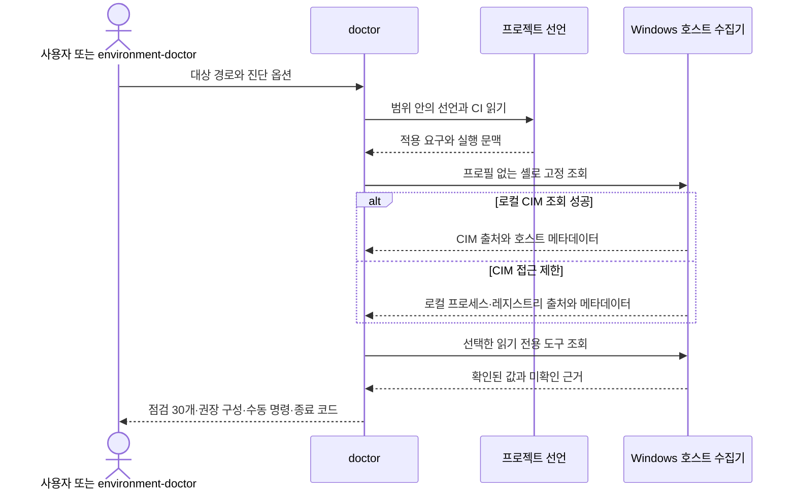

# Design

## Context

원본 대조 기준은 Windows Agent Devkit의 `2ccf5538f6ebfd6c0179c9467ae53c10a18f76d4`다.
공개 Personal Harness 커밋 `2898d6fff4d3515143b3cc25546286053ae1850d`의 마켓플레이스는 `0.3.5`를 `packages/windows-agent-devkit/release/`에서 배포한다. [원본 커밋](https://github.com/tttaliesin/windows-agent-devkit/commit/2ccf5538f6ebfd6c0179c9467ae53c10a18f76d4) · [공개 마켓플레이스](https://github.com/tttaliesin/personal-harness/blob/2898d6fff4d3515143b3cc25546286053ae1850d/.agents/plugins/marketplace.json) · [이관 기록](../../../../docs/deployment.md#자체-플러그인-소스와-배포본)

원본 커밋의 트리와 이관 소스를 `git ls-tree`로 대조했다.
`src/` 20개, `test/` 13개, 스킬 하나와 개발 스크립트 6개 중 `scripts/check-package.mjs`를 제외한 39개의 Git blob이 일치했다.
설치 스킬과 `collect-host.ps1`·`collect-advanced.ps1`은 공개 배포본에서도 원본 blob과 일치했다.
배포 CLI의 SHA-256 `8420a9aaae59a6d435d04ecc0a4a82c6150e026ca6a606be4c891133b8e8f16b`는 원본이 기록한 2026-11-20 앱 설치본의 CLI 해시와 일치했다. [공개 CLI](../../../../packages/windows-agent-devkit/release/dist/cli.mjs) · [원본 검증 기록](https://github.com/tttaliesin/windows-agent-devkit/blob/2ccf5538f6ebfd6c0179c9467ae53c10a18f76d4/docs/verification.md#L9-L32)

## Goals / Non-Goals

- 사용자가 같은 선언·옵션·조회 근거를 주면 재현할 수 있는 결과를 규격으로 삼는다.
- 권장 구성, 설치본 동작, 과거 앱 검증의 적용 범위를 각 근거에 붙인다.
- 실행 문맥별 도구 판정과 원본 설계에서 남긴 정책 질문을 이관 버전의 코드와 대조한다.
- 변경의 적용 단위는 OpenSpec 문서다.

## Decisions

### 환경 설정 지원의 초기 의도와 진단 전환의 경계

첫 CLI 커밋 `ef2c862`의 프로젝트 설계는 환경 점검에서 요청한 설정 변경과 개발 작업 지원까지 확장하는 방향을 기록했다.
첫 구현은 읽기 전용 조회였으며, 플러그인 설계에는 사용자 승인을 받은 설정 적용, 검증과 복구를 후속 범위로 뒀다. [초기 프로젝트 범위](https://github.com/tttaliesin/windows-agent-devkit/blob/ef2c8626b02c87a3ff4359b06ea1aa0a05b24d7e/docs/project-scope.md#L6-L56) · [초기 플러그인 범위](https://github.com/tttaliesin/windows-agent-devkit/blob/ef2c8626b02c87a3ff4359b06ea1aa0a05b24d7e/docs/plugin-scope.md#L38-L65)

전환 커밋 `04861ef`는 공개 `0.3.5`를 읽기 전용 `doctor`와 수동 명령 안내로 좁혔다.
이전 설정 계획·적용·복구, 선택 실행, Compose 정리와 WSL 작업 등록은 원본의 이전 계약과 검증 기록에 남아 있다.
현재 CLI는 그 명령을 입력 오류로 처리하고, 기존 유지 사유만 상태 디렉터리에서 읽는다. [읽기 전용 전환 커밋](https://github.com/tttaliesin/windows-agent-devkit/commit/04861efff514ceb7528d58c97a834139aab35f5c) · [원본 현행 범위](https://github.com/tttaliesin/windows-agent-devkit/blob/2ccf5538f6ebfd6c0179c9467ae53c10a18f76d4/docs/plugin-scope.md#L20-L60) · [원본 이전 계약](https://github.com/tttaliesin/windows-agent-devkit/blob/2ccf5538f6ebfd6c0179c9467ae53c10a18f76d4/docs/completion-contract.md#L160-L216)

### 프로젝트 요구와 관찰 근거의 연결

진단은 프로젝트 선언과 선택 옵션으로 적용할 도구를 정하고 현재 Windows 문맥의 관찰과 대조한다.
CI 행렬은 로컬 고정 요구와 분리하고, Compose의 보조 서비스는 유효한 devcontainer가 지정하는 개발 문맥과 구분한다.
이 구분을 통해 DB 컨테이너가 있는 프로젝트의 Windows 언어 요구를 보존하면서 컨테이너 내부 전용 도구를 호스트에 요구하는 일을 피한다. [원본 프로젝트 요구와 실행 문맥](https://github.com/tttaliesin/windows-agent-devkit/blob/2ccf5538f6ebfd6c0179c9467ae53c10a18f76d4/docs/completion-contract.md#L19-L65)

호스트 수집은 PowerShell 시작 이후의 CIM 접근 제한에서 로컬 프로세스와 레지스트리로 대체한다.
PowerShell 부재·수집 시간 초과·잘못된 수집 JSON은 수집 실패로 처리한다.
추가 조회는 고정 인수와 검증한 실행 파일을 사용하고 정제한 관찰만 보고한다.
패키지에는 설치 스킬과 네 가지 실행 의존성을 포함하므로 별도 MCP 서버·호스팅·대상 프로젝트의 npm 설치가 필요하지 않다. [원본 구현 구조](https://github.com/tttaliesin/windows-agent-devkit/blob/2ccf5538f6ebfd6c0179c9467ae53c10a18f76d4/docs/implementation-plan.md#L8-L45) · [호스트 조회 계약](https://github.com/tttaliesin/windows-agent-devkit/blob/2ccf5538f6ebfd6c0179c9467ae53c10a18f76d4/docs/completion-contract.md#L67-L97) · [설치 스킬](../../../../packages/windows-agent-devkit/release/skills/environment-doctor/SKILL.md)

### 원본의 설명과 공개 CLI에서 확인한 차이

| 항목 | 원본 설명 또는 의도 | 공개 `0.3.5`에서 비교할 동작 |
| --- | --- | --- |
| 지원·실패 판정 | 환경 점검 설계의 지원 종료 값은 `end_of_support`다. CLI 문서의 `fail` 설명은 허용 조회의 실패를 포함한다. | 배포 JSON은 `out_of_support`를 사용한다. 버전 타임아웃이나 출력 해석 실패는 일반적으로 `unknown`이다. 필수 명령의 미해결, 확인한 버전 위반 등은 점검별 `fail`이다. |
| Codex 설치 범위 | 원본 앱 검증은 원본 로컬 설치 환경의 `--app` 결과와 스킬 활성 상태를 기록했다. | `--app`은 `windows-agent-devkit-local`만 조회한다. Personal Harness의 공개 마켓플레이스 이름은 `personal-harness`다. `CODEX-01`은 조회한 목록의 관찰을 제공한다. 실제 Desktop 스킬 호출에는 별도 앱 근거가 필요하다. |
| IDE와 네이티브 도구 | 원본 플러그인 범위는 `--ide`가 VS Code와 네이티브 빌드 도구의 선택 점검을 요청한다고 설명한다. | `--ide`는 편집기 요청만 설정한다. MSVC·Windows SDK 조회에 필요한 `nativeBuild` 입력은 추가 진단 모듈의 픽스처에서 검증된다. 공개 CLI에는 그 요구를 직접 켜는 별도 옵션이 없다. |
| 저장소 정책 | 원본 환경 설계는 줄바꿈과 인코딩의 상태를 검토할 대상으로 둔다. | `GIT-02`는 지원하는 정책과 Git의 줄바꿈 관찰을 대조한다. 보고서는 `encodingVerification: not_run`을 기록한다. |
| 작업 실행기 | 제약이 없는 신규 다중언어 프로젝트의 공통 권장안은 mise tasks다. | 정적 CLI의 `suggest`에는 반복 CI와 실행기 선택 근거가 필요하다. 선언과 CI 연결이 충분하면 기존 실행기를 유지하고 근거가 모호하면 판단을 보류한다. |

[원본 점검의 결과 의미와 지원 상태](https://github.com/tttaliesin/windows-agent-devkit/blob/2ccf5538f6ebfd6c0179c9467ae53c10a18f76d4/docs/environment-checks.md#L257-L282) · [원본 CLI 옵션과 종료 코드](https://github.com/tttaliesin/windows-agent-devkit/blob/2ccf5538f6ebfd6c0179c9467ae53c10a18f76d4/docs/diagnostic-cli.md#L49-L111) · [공개 CLI의 설치 목록 조회](../../../../packages/windows-agent-devkit/release/dist/cli.mjs#L14935) · [원본 앱·IDE 범위](https://github.com/tttaliesin/windows-agent-devkit/blob/2ccf5538f6ebfd6c0179c9467ae53c10a18f76d4/docs/plugin-scope.md#L69-L81) · [원본 작업 실행기 정책](https://github.com/tttaliesin/windows-agent-devkit/blob/2ccf5538f6ebfd6c0179c9467ae53c10a18f76d4/docs/task-runners.md#L8-L60)

### 공개 진입점과 재현 근거

| 규격 | 공개 명령과 사용자 관찰 | 확인 근거 |
| --- | --- | --- |
| [진단 CLI](specs/windows-diagnostic-cli/spec.md) | `doctor`와 명령 생략, `--project`, `--format`, `--state-dir`, `--timeout-ms`, `--help`·`-h`, `--version`, 공통 옵션 오류 및 종료 코드 | [CLI 픽스처](../../../../packages/windows-agent-devkit/test/cli.test.mjs) · [통합 픽스처](../../../../packages/windows-agent-devkit/test/integration.test.mjs) |
| [프로젝트 도구 요구](specs/windows-project-tool-requirements/spec.md) | `--languages`, `--native`, 언어·패키지 관리자·공식 지원·권장 구성의 근거 | [프로젝트 선언](../../../../packages/windows-agent-devkit/test/project.test.mjs) · [실행 문맥](../../../../packages/windows-agent-devkit/test/project-context.test.mjs) · [버전 비교](../../../../packages/windows-agent-devkit/test/versions.test.mjs) · [지원 정책](../../../../packages/windows-agent-devkit/test/support.test.mjs) |
| [호스트 관찰](specs/windows-host-observation/spec.md) | 기본 후보 조회·CIM 대체 수집, `--wsl`, `--containers`, `--process-compose`와 수동 안내 | [호스트 수집기](../../../../packages/windows-agent-devkit/release/scripts/collect-host.ps1) · [CIM 대체 수집 픽스처](../../../../packages/windows-agent-devkit/test/collector-fallback.test.mjs) · [호스트 조회 픽스처](../../../../packages/windows-agent-devkit/test/windows.test.mjs) · [인프라 통합 픽스처](../../../../packages/windows-agent-devkit/test/integration.test.mjs) |
| [작업 실행기 권장](specs/windows-task-runner-advice/spec.md) | 기본 `doctor`의 작업 선언·CI 근거·`keep`·`suggest`·`defer`와 확인 명령 | [정적 분석 픽스처](../../../../packages/windows-agent-devkit/test/task-runners.test.mjs) · [권장 판정 픽스처](../../../../packages/windows-agent-devkit/test/task-runner-report.test.mjs) |
| [추가 진단](specs/windows-advanced-diagnostics/spec.md) | `--app`, `--codex-executable`, `--ide`, `--storage`, `--github-auth`, 적용되는 mise·.NET·Git의 추가 조회 | [볼륨 수집기](../../../../packages/windows-agent-devkit/release/scripts/collect-advanced.ps1) · [추가 진단 픽스처](../../../../packages/windows-agent-devkit/test/advanced.test.mjs) · [조회 정책 픽스처](../../../../packages/windows-agent-devkit/test/query.test.mjs) · [앱 설치 목록 픽스처](../../../../packages/windows-agent-devkit/test/integration.test.mjs) |

원본 검증 기록의 Docker 사례에서는 앱의 현재 PATH에서 클라이언트 후보를 찾지 못했다.
해당 실행은 `CTR-01: fail`, `docker_not_resolved`, 종료 코드 `1`을 기록했다.
같은 앱 문맥에서 후보가 해석되면 실패 사유를 다시 판단할 수 있다. [원본 Docker 미탐지 기록](https://github.com/tttaliesin/windows-agent-devkit/blob/2ccf5538f6ebfd6c0179c9467ae53c10a18f76d4/docs/verification.md#L34-L49)

공개 번들에서 기본 진단을 실행한 결과, 존재하지 않는 경로를 `--state-dir`로 지정했을 때 종료 코드 `0`과 고유 ID 30개를 반환했다.
해당 PC에서 `pass` 9개, `unknown` 5개, `skipped` 16개가 관찰됐다.
`RUST-02`, `WSL-02`, `CTR-02`, `PC-02`는 수동 확인으로 남았고 상태 경로는 생성되지 않았다.
이 결과의 실행 문맥은 로컬 CLI다.

## Risks / Trade-offs

- **가용성의 범위** → Windows 11 x64를 실행 기준으로 삼는다.
  `not_resolved`는 해당 조회 문맥의 결과이며 ARM64와 개별 앱 셸에는 그 문맥의 근거가 필요하다.
- **조회 성공의 범위** → 엔진 응답과 개발 서비스의 준비 상태는 각각 실제 실행 결과에서 확인한다.
  Docker context와 Compose 버전은 클라이언트 조회의 근거다.
  Dev Drive의 성능은 같은 작업·도구·캐시 조건에서 볼륨만 바꾸어 시간을 비교한다. [원본 성능 확인 조건](https://github.com/tttaliesin/windows-agent-devkit/blob/2ccf5538f6ebfd6c0179c9467ae53c10a18f76d4/docs/windows-environment.md#L401-L409)
- **시점이 있는 지원 정보** → `2026-11-17`부터 `2026-12-17`까지의 정책 유효기간을 보고서에서 확인한다.
  기간 밖의 진단은 공식 지원을 `unknown`으로 반환한다. [원본 지원 정책 계약](https://github.com/tttaliesin/windows-agent-devkit/blob/2ccf5538f6ebfd6c0179c9467ae53c10a18f76d4/docs/completion-contract.md#L99-L106)

## Open Questions

1. 공개 설치를 확인할 때 호출자가 마켓플레이스 ID를 지정할지, 설치 출처에서 도출할지 정한다.
   검증에서는 `windows-agent-devkit-local`과 `personal-harness`의 설치 목록을 각각 준비한다.
   한쪽에서만 설치한 결과를 조회해 해당 출처의 설치 관찰만 기록하는지 확인한다.
2. 공개 CLI에서 MSVC와 Windows SDK 요구를 프로젝트 선언에서 도출할지, 명시 옵션으로 받을지 정한다.
   편집기만 요청한 프로젝트와 x64 네이티브 빌드가 필요한 프로젝트를 비교한다.
   전자는 편집기 근거만으로 판정하고, 후자는 구성 요소 각각의 관찰을 남겨야 한다.
3. 도구별 실패 원인을 어느 범위까지 보고할지 정한다.
   현재 공통 실행기는 표준 오류의 크기를 계산하고 본문은 버린다.
   Git의 저장소 미확인과 mise의 관리 도구 미설치 등 메시지에 따른 판정은 그 메시지가 조회 결과에 있을 때 가능하다.
   같은 종료 코드에서 실패 사유가 표준 출력에 있을 때와 표준 오류에만 있을 때를 대조해 판정 차이를 확인할 수 있다. [조회 실행기](../../../../packages/windows-agent-devkit/src/windows.mjs) · [추가 진단 판정](../../../../packages/windows-agent-devkit/src/advanced.mjs)
