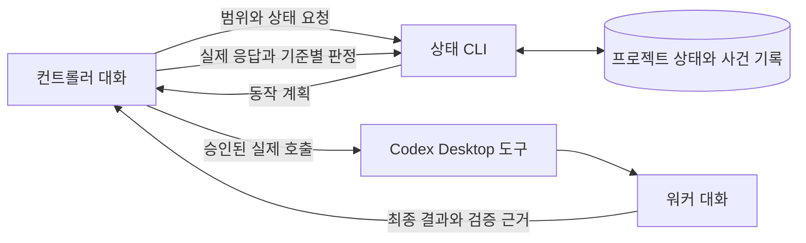

# Design

## Context

[제안](proposal.md)의 기준선은 공개 마켓플레이스가 가리키는 Worker Orchestrator `0.1.6`이다.
[배포 기록](../../../../docs/deployment.md#자체-플러그인-소스와-배포본)은 이관한 소스 `0.1.7-local.1`과 공개 배포 버전을 별도로 기록한다.
이번 작업의 대조 범위인 런타임 소스, 번들 스킬, 워크플로는 공개 배포본과 같은 내용을 사용한다.

## Goals / Non-Goals

**설계 목표**

- 기존 Codex Desktop 입력창에서 프로젝트 운영을 맡기고, 같은 컨트롤러 대화에서 작업을 요청한다.
- 컨트롤러의 역할과 사용자에게 위임받은 동작을 서로 독립적인 상태로 관리한다.
- 실행 결과와 실제 호스트 응답을 남겨 중단 후에도 같은 프로젝트와 실행의 상태를 이어받는다.

**검증 범위**

- 사용자, 컨트롤러, 워커 또는 호스트 도구가 관찰할 수 있는 동작을 기술한다.
- 공개 버전과 원본 이관 커밋을 기준으로 규격을 대조한다. 새 운영 정책의 채택은 해당 정책을 다루는 별도 변경에서 결정한다.

## Decisions

### 원본 설계 의도와 배포 행동을 연결한다

[원본 MVP 구현 계획](https://github.com/tttaliesin/worker-orchestrator/blob/7b2d76691bd677f72aaa63f5f674d8eb7ac2d79b/docs/implementation-plan.md#L1-L29)은 기존 입력창에서 프로젝트별 컨트롤러에게 일을 맡기는 흐름을 목표로 둔다.
같은 워커 재사용, 실행별 검증, 확인된 보관과 복원, 중복 요청 억제를 수용 기준으로 둔다.
[원본 사용법](https://github.com/tttaliesin/worker-orchestrator/blob/7b2d76691bd677f72aaa63f5f674d8eb7ac2d79b/docs/usage.md#L3-L15)은 사용자가 프로젝트 운영을 처음 한 번 맡긴 뒤 평소처럼 요청하는 흐름을 설명한다.
OpenSpec은 이 목표에 연결되는 외부 동작과 실패 조건을 관리한다. 버전별 함수나 화면 조작 순서는 패키지 문서와 구현에 둔다.

### 역할 탐색, 운영 위임, 호스트 호출에 각각 경계를 둔다

`candidate`는 현재 대화의 역할을 조회하거나 검증된 최초 후보를 등록한다.
프로젝트 운영 위임은 생성, 후속 전달, 복원, 보관과 이벤트 전달의 허용 범위를 기록한다.
이 분리로 컨트롤러라는 사실만으로 대화를 생성하거나 보관할 권한이 생기는 일을 막는다.
작업 저장소 루트와 Desktop 프로젝트 ID를 따로 저장하면 같은 Desktop 그룹 아래의 별도 Git 저장소도 구분할 수 있다.

### 모델의 판단과 실행 기록을 연결한다

컨트롤러는 사용자의 목표, 범위와 완료 기준을 정하고 워커의 결과를 직접 확인한다.
CLI는 현재 실행과 관찰한 결과를 연결하고, 권한·근거 참조·대기 상태에 따라 다음 상태와 호출 계획을 계산한다.
호스트 도구의 응답으로 실제 동작을 기록하면 그 계획을 저장한 시점과 실제 효과가 확인된 시점을 구분할 수 있다.
저널은 결과와 승인 사건의 전달 순서가 바뀌거나 콜백이 늦어질 때 확인할 근거를 남긴다.

### 공개 진입점과 규격을 연결한다

| 규격 | 공개 명령과 확인 경로 | 검증 근거 |
|---|---|---|
| [프로젝트 제어](specs/worker-project-control/spec.md) | `capabilities`, `candidate`, `project`, `sync-project`, `status`, 상태 디렉터리 선택 | `controller-candidate.test.mjs`, `project-operations.test.mjs` |
| [실행 생명주기](specs/worker-run-lifecycle/spec.md) | `dispatch`, `record`, `resolve`, `archive`, 생성·재사용·복원·보관 | `lifecycle.test.mjs`, `orchestrator.test.mjs`, `project-operations.test.mjs` |
| [결과 평가](specs/worker-result-evaluation/spec.md) | 작업 명세, 워커 최종 JSON, `evaluate`, `verify`, `accept`, 재시도 | `structured-work.test.mjs`, `lifecycle.test.mjs` |
| [이벤트 전달](specs/worker-event-delivery/spec.md) | `observe`, `push-config`, `push-inbox`, `push-observe`, `push-ack`, `push-result`, `journal-approval` | `push.test.mjs`, `push-journal.test.mjs`, `push-observation.test.mjs`, `codex-desktop.test.mjs` |

명령 목록은 [배포 CLI](../../../../packages/worker-orchestrator/release/lib/cli/main.mjs)를, 검증 코드는 [패키지 테스트](../../../../packages/worker-orchestrator/tests/)를 기준으로 한다.

## Risks / Trade-offs

- **시작 조건의 혼동** → CLI의 후보 판정 계약과 Personal Harness에서 이 스킬을 선택하는 규칙을 각각 확인한다. 이관 커밋 `960a841`의 공통 지침은 프로젝트 위임 또는 해당 턴의 워커 배정·콜백을 선택 조건으로 둔다.
- **상태 경로의 혼동** → 실행 환경의 `LOCALAPPDATA`와 명시한 `--state-dir`를 확인한다. 다른 경로의 빈 상태를 기존 등록이나 위임이 사라졌다는 근거로 사용하지 않는다.
- **실행 성공과 검증의 혼동** → Desktop 턴 종료, 워커가 보고한 성공, 컨트롤러의 기준별 검증, 결과 채택의 근거를 각각 보존한다. 배포 검사와 실제 호스트의 동작 관찰도 따로 기록한다.
- **짧은 작업의 고정 비용** → `0.1.6` 운영 절차는 등록된 컨트롤러의 직접 업무 범위 밖이면 조회와 설명도 워커에 맡긴다. 이 정책을 바꿀 때는 같은 완료 기준으로 직접 처리와 위임의 전체 시간 및 재작업을 비교한다.

## Open Questions

두 질문은 후속 운영 정책을 정할 때 다룬다. 이 변경에 포함된 역할, 권한, 실행, 결과, 이벤트 계약은 두 선택 모두에 적용할 수 있다.

1. 위임 전에도 자동으로 `candidate`의 조회만 실행할지 정한다. 원본 기록은 기존 입력창에서 한 번 운영을 맡기는 흐름을 설명하지만, 위임 전 후보 조회의 시점까지 정하지 않는다. 비교할 경우는 방금 설치한 미등록 프로젝트의 첫 설명 요청과, 같은 프로젝트의 첫 운영 위임 요청이다. 어느 흐름에서도 역할 조회만으로 새 워커 대화가 생성되지 않아야 한다.
2. 등록된 컨트롤러가 짧은 일반 작업을 직접 처리할 수 있는 기준을 정한다. 공개 버전의 위임 규칙을 변경하려면 기대하는 처리 시간·검증 품질과 구분 기준을 먼저 명시한다.
