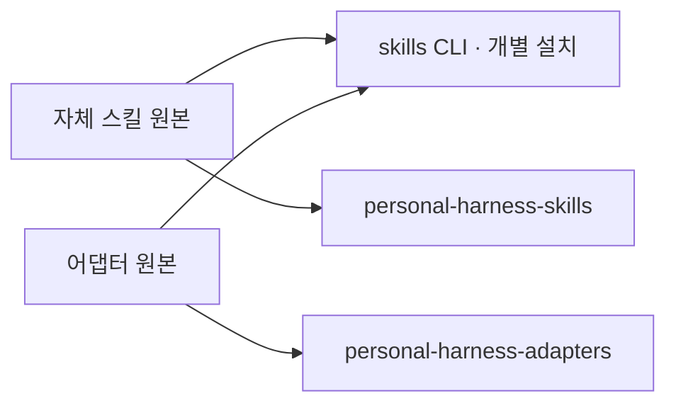

# Design

## Context

표준 `skills` CLI는 저장소의 `skills/custom/`과 `skills/adapters/`에서 단독 스킬을 찾는다.
Codex는 루트 카탈로그의 `source.path`에서 플러그인 설치 파일을 읽는다.

## Decisions

카탈로그의 `personal-harness-skills`는 `./skills/custom`을 가리킨다.
`personal-harness-adapters`는 `./skills/adapters`를 가리킨다.
각 디렉터리에는 소속 스킬 경로와 배포 버전을 지정하는 `.codex-plugin/plugin.json`이 있다.
두 설치 경로가 같은 파일을 사용하므로 스킬을 고칠 때 원본에서 수정한다.

## Verification

루트 배포 테스트는 각 카탈로그 항목과 매니페스트를 해당 그룹의 스킬 원본과 대조한다.
임시 Codex 프로필에서는 플러그인을 각각 설치한 뒤 Codex가 표시하는 스킬 목록을 해당 그룹과 대조한다.
별도 작업 디렉터리에서는 `skills` CLI로 설치한 뒤 각 스킬의 파일을 원본과 대조한다.
