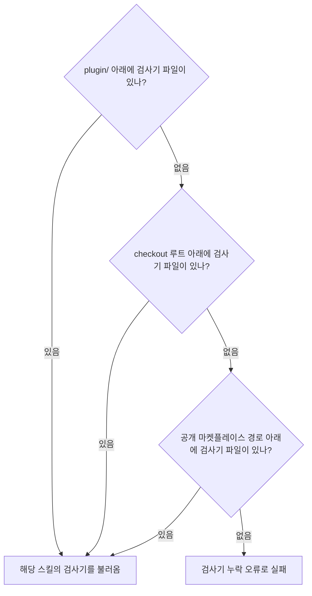

# Design

## Context

기준선은 공개 `repo-governance` `0.2.0`의 커밋 `a0eca5178f9b58ad727debaf5686a38076014e9e`다. [공개 CI 명세](../../specs/governance-ci-checks/spec.md)
이 설계는 작업 트리의 미게시 템플릿과 테스트에서 확인한 경로 선택을 설명한다. [CI 템플릿](../../../packages/repo-governance/plugin/templates/github-actions.yml) · [CI 테스트](../../../packages/repo-governance/tests/ci.test.mjs)

## Goals / Non-Goals

세 배치에서 같은 순서로 검사기 파일을 찾고 선택한 스킬에서 검사기와 bundle manifest를 함께 읽는다.
고정한 공통 ref와 PR 리비전의 검증에는 공개 CI 명세의 조건을 적용한다.

## Decisions

후보의 검사기 경로가 존재하면 검색을 끝낸다.
검색 순서를 고정하면 여러 배치에 검사기가 있어도 같은 checkout에서 같은 파일을 선택한다.

## Risks / Trade-offs

선택한 검사기의 로딩이 실패하면 PR 검사를 시작하기 전에 오류를 반환한다.
작업 트리의 CI fixture는 `plugin/`, checkout 루트와 공개 마켓플레이스 배치에서 검사기가 PR과 파일 범위 결과를 반환하는지 확인하도록 구성돼 있다.
