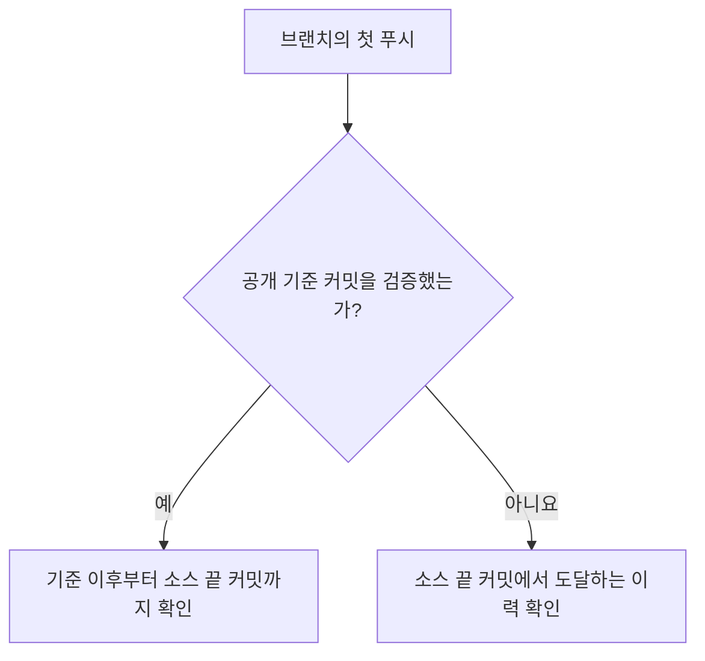

# Design

## Context

근거는 기준 커밋의 파일 원문과 해당 커밋에서 작업 트리까지의 diff다.
기존 정본의 요구사항 중 변경된 항목은 제목을 유지하고 적용 후의 시나리오 전체를 델타에 둔다.

## Goals

시나리오마다 실제로 확인할 수 있는 근거를 명시한다.
이 변경의 상태는 미게시다.

## Decisions

- 퀵스타트 검토의 기준은 독자가 받는 배포 파일과 README의 실제 위치다.
  배포물의 명령과 경로를 확인하면 개발 체크아웃에서만 동작하는 예를 찾을 수 있다. [README 스킬](../../../skills/custom/create-readme/SKILL.md)
- 의존성 준비 확인은 통합 테스트의 시작 방식에 맞춘다.
  테스트 실행기가 의존성을 시작하면 실행기에 있는 확인 절차를 사용한다.
  Compose 초기화 범위는 선택한 프로젝트의 볼륨 용도로 확인한다. [개발환경 스킬](../../../skills/custom/development-environment/SKILL.md) · [Compose 참조](../../../skills/custom/development-environment/references/compose-dependencies.md)
- Git의 종료 코드는 제외 여부에 사용하고 상세 출력은 패턴과 예외를 찾는 데 사용한다.
  최초 푸시의 이력 확인 범위는 검증된 공개 기준의 유무에 따른다. [산출물 스킬](../../../skills/custom/repository-artifacts/SKILL.md) · [Git 참조](../../../skills/custom/repository-artifacts/references/git-inclusion.md) · [저장소 가이드](../../../docs/repository-workflows.md)
- 혼합 문자열의 글꼴별 합계에서 한글을 식별해야 할 때는 언어와 스타일을 맞춘 한글 전용 요소가 근거가 된다.
  폼 예시에서 상속할 속성은 글꼴 패밀리로 한정한다.
  시각 디자인 스킬 선택은 해당 스킬의 선택 조건을 따른다. [한글 조판 스킬](../../../skills/custom/korean-typography/SKILL.md) · [글리프 검증](../../../skills/custom/korean-typography/references/glyph-review.md) · [조판 예시](../../../skills/custom/korean-typography/references/patterns.md)

## Verification

명세 검증은 OpenSpec 형식과 요구사항의 연결을 확인한다.
스킬 동작의 검증 상태는 시나리오 실행 결과를 근거로 기록한다.
게시 상태는 변경을 포함한 공개 커밋을 근거로 확인한다.
