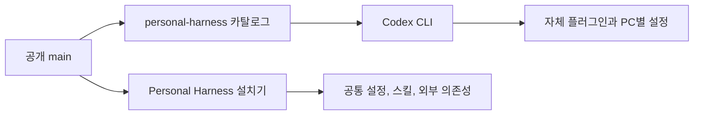

# Design

## Context

세 플러그인의 공용 소스와 테스트는 각 `packages/<이름>/`에 있다.
이전 배포 경로의 성격은 [로컬 플러그인 번들 명세](../support-local-plugin-bundles/specs/local-plugin-bundles/spec.md)에 기록되어 있다.
이 변경은 동일한 공개 기본 브랜치에서 제공하는 Codex 설치 경로를 정의한다.

## Goals / Non-Goals

- 사용자용 진입점은 Codex의 Git 마켓플레이스다.
- 공통 설정, 단독 스킬과 외부 의존성은 기존 Personal Harness 설치기의 관리 범위다.
- 각 PC의 플러그인 사용 설정, 제품별 설정과 hook 신뢰는 해당 환경에서 관리한다.

## Decisions

### 공개 기본 브랜치의 카탈로그

루트의 `.agents/plugins/marketplace.json`에 `personal-harness` 이름으로 세 항목을 둔다.
`codex plugin marketplace add tttaliesin/personal-harness`는 Git 기본 브랜치인 `main`을 사용한다.
세 항목은 `source.path`로 같은 Git 스냅샷 안의 배포 폴더를 가리킨다. [OpenAI 마켓플레이스 안내](https://developers.openai.com/plugins/build/plugins#add-a-marketplace-from-the-cli)

### 배포 경로와 소스

`repo-governance`는 공개용으로 정리한 `packages/repo-governance/plugin/`을 가리킨다.
개인용 카탈로그와 제품별 설정은 각 환경에 둔다.

`packages/windows-agent-devkit/release/`에는 기존 공개 `0.3.5` 배포본을 바이트 그대로 둔다.
첫 공개 배포 때 `docs/roadmap.md`의 개인 WSL 작업 경로 한 곳만 가렸다.

`packages/worker-orchestrator/release/`에는 승인한 공개 `0.1.6` 배포본을 바이트 그대로 둔다.
같은 저장소의 Worker Orchestrator 소스 `0.1.7-local.1`은 별도 개발 버전이다.

Git은 두 배포 경로의 줄 끝 변환을 끈다.
이전 로컬 번들과 공개 배포 디렉터리의 해시는 [배포본의 출처](../../../docs/deployment.md#자체-플러그인-소스와-배포본)에 기록한다.

## Risks / Trade-offs

- 같은 플러그인의 로컬 등록과 Git 등록이 함께 나타날 수 있다. 새 항목을 확인한 뒤 이전 로컬 항목을 끄는 절차를 안내한다.
- 줄 끝 변환을 거치면 배포 파일의 해시가 달라진다. 두 배포 경로에 적용되는 속성과 Git에 기록한 파일을 대조한다.

## Migration Plan

1. 루트 카탈로그와 배포 경로를 같은 공개 `main`에 게시한다.
2. 이전 번들 항목이 남은 PC에서는 공통 설치기가 그 항목을 건너뛴다.
3. 기존 로컬 설치를 사용한 PC에서 [활성 출처를 전환한다](../../../docs/deployment.md#기존-로컬-설치-전환).
4. 이후 릴리스는 [새 버전 게시 절차](../../../docs/deployment.md#새-버전-게시)를 거친다.

