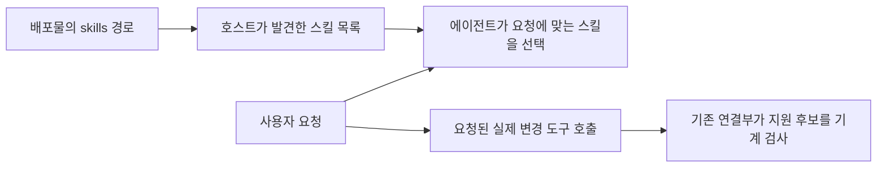

# Design

## Context

이 설계는 스킬 선택을 바꾸는 후속 변경이다.
분리 전 공개 배포의 규약은 [현행 명세](../../specs/repository-conventions/spec.md)에 둔다.
스킬 분할과 pi 검색 경로는 로컬 변경이다.
아래의 번들 간 선택 조건은 에이전트가 적용할 계획이며 실제 세션의 결과는 미확인이다.

## Goals / Non-Goals

스킬마다 `SKILL.md`의 이름과 설명으로 맡은 작업을 표시한다.
플러그인 이름·버전, 훅·pi 확장·검사기 및 제품 설정은 기존 계약을 사용한다.
이번 명세의 검증 범위는 저장소 안의 파일에 한정한다.

## Decisions

### 작업별 스킬에서 기준 원본을 직접 읽는다

호스트는 `plugin/skills/<name>/SKILL.md`의 설명을 에이전트에 제공한다.
에이전트는 [선택 규격](specs/governance-skill-routing/spec.md)의 조건에 맞는 스킬에서 해당 규약을 읽는다.

| 스킬 | 기준 원본 | 확인할 자료 |
| --- | --- | --- |
| `repo-identity` | [K1 이름][k1] · [K2 설명][k2] | 실제 관리 범위, 공개된 기능과 대상 |
| `repo-readme` | [K3 README][k3] · [README 템플릿][readme-template] | 독자와 실제 시작 경로 |
| `repo-commit` | [K4 커밋][k4] | 편입할 diff, 변경 목적과 영향 |
| `repo-branch` | [K5 브랜치][k5] | 작업 목적, 기준 ref, 이름 충돌 |
| `repo-pull-request` | [K6 PR][k6] · [PR 템플릿][pr-template] | 실제 head/base, diff와 검증 결과 |
| `repo-file-placement` | [K7 파일 편입][k7] | 파일의 용도, 소비 경로와 Git 추적 상태 |
| `repo-governance` | [제품과 도입 계약][product] · [직접 검사 계약][checker] | 실제 clone·worktree, 도입·연결 상태와 지정한 검사 입력 |

일반 커밋의 diff와 index 조회는 K4의 근거를 확인하는 데 쓴다.
실제 후보에 편입 판단이 필요한 파일이 있으면 K7 원본을 참조한다.
`repo-file-placement` 선택은 배치·추적·제외 결정이 요청에 포함된 경우로 한정한다.
제품별 기준이나 예외가 필요하면 실제 대상의 제품 계약과 예외 근거를 확인한다. [제품 입력][product]

### 같은 작업에 맞는 번들 스킬의 적용 범위를 정한다

기존 저장소 지침과 사용자가 요청한 규약으로 대상에 적용할 Repo Governance 범위를 판단한다.
그 범위에서 README 내용은 `repo-readme`가, 파일 경계와 편입은 `repo-file-placement`가 담당한다.
프로젝트 소개 문서를 새로 만들거나 구조를 다시 잡는 일반 작업은 `create-readme`의 범위다.
일반 저장소의 문서와 로컬 산출물 보관은 `repository-artifacts`의 범위다.
동일한 판단에는 한 스킬을 적용하고, 별도의 산출물 정리나 한국어 문서 표현처럼 다른 판단이 필요한 경우에 해당 스킬을 함께 선택한다.
[README 작성](../../specs/readme-authoring/spec.md) · [저장소 산출물](../../specs/repository-artifact-guidance/spec.md) · [한국어 개발 문서](../../specs/korean-development-writing/spec.md)

### 기존 패키지 루트와 로컬 실행 경로를 사용한다

Codex와 Claude Code는 기존 manifest의 `skills: ./skills/`를 사용한다.
pi 패키지는 기존 `pi.skills`의 `./skills`를 사용한다. [Codex][codex] · [Claude Code][claude] · [pi 패키지][pi-package]

로컬 `task run:pi`는 기존 `-e <plugin-root>/.pi/extensions/repo-governance.ts`와 함께 `--skill <plugin-root>/skills`를 넘긴다.
이 경로 아래의 `SKILL.md`를 재귀적으로 찾는 근거는 구현에서 확인한 pi `v1.5.2` 소스와 문서다. [Taskfile][taskfile] · [pi 연결 안내][pi-tools]

배포 파일이 바뀌면 기존 `npm run bundle:build`로 `skills/repo-governance/assets/bundle.json`을 다시 만든다.
`npm run verify:bundle`은 파일 경로와 SHA-256을 검사하고 `npm pack --dry-run` 목록과 대조한다. [번들 검증][bundle]

## Risks / Trade-offs

manifest와 실행 인자에서 확인한 스킬 검색 경로는 배포 구성의 근거다.
모델 선택은 요청별로 관찰한 스킬 사용 기록으로 판단한다.
실제 세션 관찰을 생략하면 모델 선택과 호스트에서의 실행 결과를 미확인으로 기록한다.

[k1]: ../../../packages/repo-governance/plugin/specs/naming.md
[k2]: ../../../packages/repo-governance/plugin/specs/description.md
[k3]: ../../../packages/repo-governance/plugin/specs/readme.md
[k4]: ../../../packages/repo-governance/plugin/specs/commits.md
[k5]: ../../../packages/repo-governance/plugin/specs/branches.md
[k6]: ../../../packages/repo-governance/plugin/specs/pull-requests.md
[k7]: ../../../packages/repo-governance/plugin/specs/file-inclusion.md
[readme-template]: ../../../packages/repo-governance/plugin/templates/README.md
[pr-template]: ../../../packages/repo-governance/plugin/templates/PULL_REQUEST.md
[product]: ../../../packages/repo-governance/plugin/skills/repo-governance/references/repository-policy.md
[checker]: ../../../packages/repo-governance/plugin/skills/repo-governance/references/checker.md
[codex]: ../../../packages/repo-governance/plugin/.codex-plugin/plugin.json
[claude]: ../../../packages/repo-governance/plugin/.claude-plugin/plugin.json
[pi-package]: ../../../packages/repo-governance/plugin/package.json
[taskfile]: ../../../packages/repo-governance/plugin/Taskfile.yml
[pi-tools]: ../../../packages/repo-governance/plugin/skills/repo-governance/references/pi-tools.md
[bundle]: ../../../packages/repo-governance/plugin/scripts/bundle.mjs
