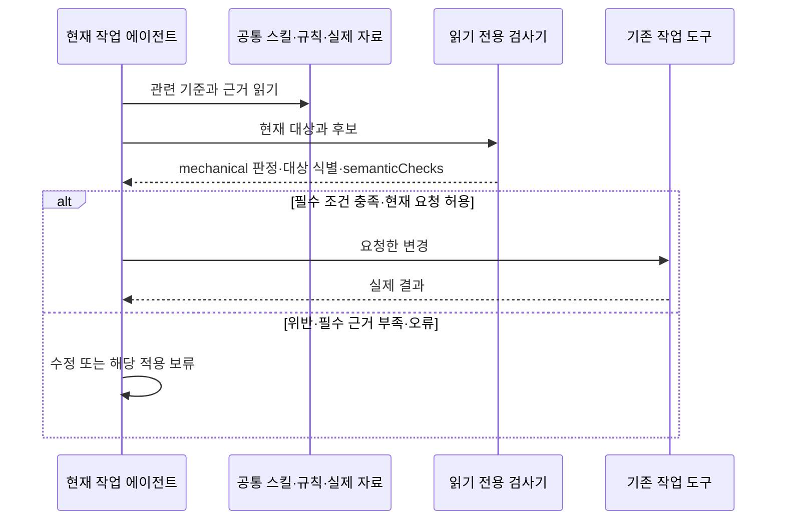

# 공통 검사 구조

현재 작업 에이전트가 스킬과 관련 규칙을 읽는다.
검사기는 Source를 읽고 기계 findings와 남은 의미 질문을 반환한다.
지원 연결부는 native 입력을 같은 검사 요청으로 바꾸고 수행한 실패를 해당 host의 거절 응답에 연결한다.
실제 변경은 작업 에이전트가 현재 요청에 따라 기존 도구로 수행한다.

## 구성 파일

| 경로 | 책임 |
|---|---|
| `SKILL.md`, `references/`, 배포 루트의 `specs/`·`templates/` | 작업 에이전트가 읽는 공통 리소스 |
| `scripts/check.mjs` | JSON stdin·한 줄 응답·종료 코드와 공개 `runCheck` |
| `scripts/contracts.mjs` | strict v3 요청·Source·응답 형식 |
| `scripts/inputs.mjs` | 실제 파일·index·revision·제공된 PR 입력의 읽기 |
| `scripts/rules.mjs`, `scripts/checks/` | 일곱 기계 검사와 의미 질문 |
| `scripts/tool-call.mjs`, `scripts/hook.mjs` | native 도구 입력 변환과 host 응답 |
| 배포 루트의 `.pi/extensions/`·`hooks/` | pi callback·Codex/Claude hook |
| 배포 루트의 `scripts/cases.mjs`·`scripts/verify.mjs` | 명세의 사례 원문과 실제 하네스 증거의 일치 확인 |
| 소스 체크아웃의 `tests/` | 회귀 테스트와 기계 fixture이며 실행 배포물과 bundle pin에서 제외 |

CLI·하네스 훅·CI는 같은 `runCheck`를 사용한다.
규칙을 하네스마다 다시 정의하지 않는다.
checker는 index 환경을 읽으며 `write-tree`나 네트워크 요청으로 대상을 만들지 않는다.

## 연결의 한계

지원하는 native 입력만 기계 검사 요청으로 해석한다.
인용 데이터·조회·미지원·복합·동적 입력의 분류는 실제 [연결 절차](native-verification.md)를 따른다.
해석한 부분의 검사와 전체 효과의 검사를 구분한다.
누락·비활성화·신뢰 미확인·timeout이 있는 hook은 실제 host에서 원래 도구가 진행될 수 있다.
이 상태를 실행된 검사기의 오류 거절과 합치지 않는다.
등록 표시와 로컬 callback 성공은 실제 세션의 자동 호출·차단 증거가 아니다.

내용 digest·OID는 읽은 대상의 식별이다.
검사 뒤 관측한 변경에는 재검사가 필요하다.
검사기는 전역 잠금·공유 승인 상태·원자적 writer·merge 실행기를 제공하지 않는다.
