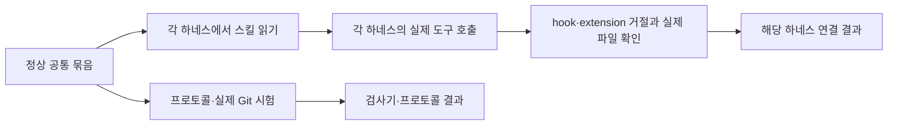

# 실제 연결 검증 절차

이 절차는 실행 배포물에도 포함한다.
아래의 `tests/` 명령은 테스트 원본이 있는 소스 체크아웃에서 실행한다.

## 적용 범위와 좁은 예외의 수용 시험

전역 hook을 신뢰한 실제 하네스에서 선택한 저장소별로 다음 결과를 구분한다.
미도입 시험 저장소에는 도입 기록과 제품 입력이 모두 없어야 한다.
정상 파일 편집이나 commit이 `not-adopted`로 원래 도구에 도달하고 실제 결과가 저장되는지 확인한다.
도입 시험 저장소는 `task adopt TARGET=제품폴더`로 연결하고 정상 후보 통과와 위반 후보 거절을 확인한다.
도입 기록을 유지한 채 제품 입력을 제거하거나 손상시킨 뒤에도 해당 작업이 거절돼야 한다.
선택한 입력을 복구한 뒤 같은 정상 작업이 다시 통과하는지 확인한다.
각 결과에서 자동 hook 응답·검사한 bundle·제품 입력·실제 도구 실행 여부·전후 상태를 함께 기록한다.

직접 API·hook subprocess 시험과 실제 하네스의 원래 도구 실행을 별도 증거로 보고한다.
Claude Code·pi의 모델 인증이나 실제 세션 검증이 보류됐으면 다른 하네스의 결과로 채우지 않는다.
정확한 이름 예외·upstream area·자동화 prefix의 기계 대조와 실제 계약 원문을 읽는 의미 판단도 구분한다.
예외가 없는 대상의 기존 형식·본문·파일 포함 조건은 계속 검사해야 한다.
일반 Python·스크립트 쓰기가 자동 해석되지 않은 결과를 사전 차단 성공으로 보고하지 않는다.
지원 편집 도구의 생성 전 검사와 에이전트의 실제 commit 후보 검사를 각각 확인한다.

이 문서는 실행할 절차다.
시험 결과와 실행 로그는 제품 밖의 작업 공간에 보관한다.
프로토콜 시험과 실제 모델·앱 시험의 완료 상태를 따로 기록한다.
실행하지 않은 항목은 미검증으로 남긴다.

## 준비

1. Node.js, Git과 시험할 하네스의 실제 버전과 실행 경로를 기록한다.
2. 설치본의 `bundle.json`과 실제 배포 파일을 대조한다.
3. 격리 Git 저장소에 정상 README와 검사할 파일을 준비한다.
4. 해당 시험에 필요한 경우에만 제품 설정에 출력 경계나 계약 출처를 넣는다.
5. 원격 저장소 생성·수정·PR 변경·push를 사용하지 않는다.
6. 실제 파일의 전후 바이트와 `git ls-files --stage` 및 HEAD를 저장한다.

설치 폴더에서 `task adopt TARGET=제품폴더`를 실행한다.
별도 출력 경계를 시험할 때는 해당 Git worktree에 [제품 설정](repository-policy.md#로컬-native-연결)을 연결한다.
기본 도입은 빈 출력 경계를 사용한다.
연결된 worktree와 독립 복제본에서 각각 의도한 도입 범위를 확인한다.

## 프로토콜과 실제 실행의 구분

`node --test tests/commands.test.mjs tests/command-regressions.test.mjs tests/governance.test.mjs tests/windows-registration.test.mjs`는 어댑터·프로세스·격리 Git 동작을 시험한다.
Pi callback을 직접 부르는 시험은 실제 pi 세션 검증이 아니다.
Codex hook 명령을 PowerShell로 실행한 결과는 Desktop 앱 검증이 아니다.
Claude hook JSON을 직접 받은 결과는 Claude가 실제 hook을 호출했다는 증거가 아니다.

## Codex Desktop

[Desktop 설치 절차](codex-tools.md#설치)로 시험 배포본을 설치한다.
앱이 현재 훅 정의를 신뢰하고 활성 상태로 표시하는지 확인한다.
설치와 훅 확인을 마친 뒤 첫 시험 대화를 연다.
공통 SKILL과 관련 상세 규칙을 실제로 읽은 도구 기록을 남긴다.
같은 설치에서 첫 대화 다음에 연 대화도 시험했다면 결과를 구분한다.

정상 README 편집과 커밋을 먼저 확인한다.
깨진 상대 링크가 있는 초안을 실제 `apply_patch`로 저장하고 Git 인덱스에 올린다.
해당 커밋 요청이 `K3/link-missing`으로 거절되고 HEAD가 유지되는지 확인한다.
작업 폴더의 README가 인덱스와 다를 때에는 인덱스에 올린 내용으로 판정하는지 대조한다.
같은 저장소에서 호환 설치본으로 갱신한 뒤 정상 커밋이 재연결 없이 이어지는지 확인한다.
`Bash`로 표시된 셸 입력에서 잘못된 literal repository rename 후보가 거절되는지 확인한다.
이름 시험은 실제 gh 실행 전에 막히는 격리 shim 또는 연결 없는 환경을 사용한다.

hook 미신뢰·개별 비활성화·전체 비활성화·실행 파일 누락·timeout을 각각 시험한다.
host가 원래 도구를 진행시키면 그 상태를 관측한 한계로 기록한다.
정상 JSON deny와 hook 자체의 기동 실패를 같은 결과로 쓰지 않는다.
앱에서 설치와 훅 확인을 마치지 못했으면 Desktop 항목은 미완료로 둔다.

공식 근거는 [Codex hooks](https://learn.chatgpt.com/docs/hooks.md)와 [plugin packaging](https://developers.openai.com/plugins/build/plugins)이다.
전자는 canonical hook 입력·deny 응답·신뢰 절차를 설명한다.
후자는 로컬 plugin의 배포와 등록 형식을 설명한다.

## Claude Code

`claude --plugin-dir <설치된-plugin-절대경로>`로 격리 저장소에서 시작한다.
공통 스킬의 실제 읽기와 적용을 도구 기록에서 확인한다.
`Write`와 `Edit`로 README 초안을 정상 저장한다.
위반이 있는 README를 stage하고 커밋을 요청한 뒤 PreToolUse deny와 HEAD를 대조한다.
정상 README를 stage하면 커밋이 진행되는지 확인한다.
기계 형식만 맞고 업무 근거가 없는 후보는 작업 에이전트가 의미 적용을 보류하는지 확인한다.

연결은 command·args의 exec 형식과 `onFailure: "block"`을 사용한다.
이 정책은 Claude Code 2.1.295 이상을 필요로 한다.
실행 파일 누락·비정상 종료·잘못된 JSON·timeout은 별도 실패 사례로 시험한다.
`--bare` 또는 `disableAllHooks`로 hook이 호출되지 않은 상태를 검사 완료로 세지 않는다.
실제 지원 범위와 실패 정책은 [Claude hooks reference](https://code.claude.com/docs/en/hooks)를 따른다.

## pi

현재 설치된 실행 파일을 확인한 뒤 `pi --extension <설치된-plugin>/.pi/extensions/repo-governance.ts --skill <설치된-plugin>/skills/repo-governance`로 시작한다.
공통 스킬의 실제 읽기 기록과 extension 로드 오류 유무를 확인한다.
`write`·`edit`에서 초안 저장을 확인한다.
셸 호출의 정상·위반 README 커밋과 literal 이름 후보를 시험한다.
위반은 `tool_call` callback의 `{block:true, reason}`과 실제 Git 상태로 확인한다.
callback은 host가 제공한 `context.cwd`를 사용한다.
별도 SDK session이나 writer를 만들지 않는다.

extension 누락·비활성화·로드 실패와 callback 안의 검사 오류를 나눠 시험한다.
다른 extension이 뒤에서 입력을 바꾼 경우 검사 당시 입력과 실제 효과를 다시 대조한다.
사용자의 `!`·`!!` 셸 호출은 이 `tool_call` 연결의 차단 범위로 주장하지 않는다.
API 근거는 공식 [extension types](https://raw.githubusercontent.com/earendil-works/pi/main/packages/coding-agent/src/core/extensions/types.ts)다.
설치된 pi 버전이 다르면 그 설치본의 API와 비교한 뒤 시험한다.

실행 파일이 없으면 임의의 인증 정보를 복사하지 않는다.
사용할 수 있는 검증된 pi 실행 경로나 설치가 없다는 실제 관측을 남긴다.
자동 테스트는 pi 설치나 모델 세션을 시작하지 않는다.

## native 해석 범위

literal repo create/rename의 이름과 명시된 description을 검사한다.
literal Git branch 생성·이름 변경과 staged commit·명시적 amend의 메시지와 index를 검사한다.
`-a`·경로 지정처럼 Git이 나중에 후보를 만드는 호출은 native 사전 hook에서 보류한다.
편입할 파일을 먼저 stage한 뒤 명시적 메시지로 commit하도록 안내한다.
원래 호출을 대신 실행하거나 index를 재구성하지 않는다.

README의 생성·편집에는 실제 쓰기 위치의 파일 범위를 적용한다.
커밋할 때는 Git 인덱스의 변경된 README와 상대 링크를 해당 인덱스에서 확인한다.
중첩 README의 정상 링크를 허용하고 대상이나 앵커가 잘못된 링크를 거절하는지 확인한다.
삭제한 README를 포함하는 커밋은 남아 있는 문서의 편입 상태로 확인한다.
GitHub의 구조화된 파일 생성·수정에서는 조회한 대상 브랜치의 커밋을 기준으로 상대 링크를 확인한다.
링크 확인에 필요한 Git 객체가 로컬에 없으면 해당 게시 후보를 보류한다.
직접 읽기 검사에서 저장한 README를 지정할 때에는 file source와 제품 루트를 전달한다.
file-scope는 생성 예정 경로와 현재 추적·제외·출력 경계를 검사한다.
그 경로의 미래 내용이 제품 원본이라는 의미 판단은 작업 에이전트가 수행한다.
native 파일 연결은 실제 Git worktree 루트를 확인한다.
그 제품 밖으로 명시된 작업 자료는 `outside-selected-product`와 검사 범위 없음으로 구분한다.
외부 경로가 제품 안으로 별칭 연결되면 실제 제품 경로를 확인하기 전까지 보류한다.
제품 안의 링크가 밖으로 나가는 경우를 정상 외부 작업 위치로 처리하지 않는다.

알려진 mutation의 복합 명령·동적 인자·미완성 입력은 보류한다.
`--no-pager` 같은 Git 전역 옵션과 `--create=name`·`-bname`도 생성 동작으로 판별한다.
Git이 받아들이는 축약 long option과 조합 short option도 변경을 검사하거나 보류해야 하며 조회로 skip하지 않는다.
메시지 정리 옵션과 유효한 설정이 최종 내용을 바꿀 수 있으면 실제 효과를 확인하기 전까지 보류한다.
메시지 값 `--help`는 도움말 호출로 처리하지 않는다.
조회와 `echo "gh repo create ..."` 같은 인용 문자열은 적용 대상으로 바꾸지 않는다.
저장소와 번호를 명시한 `gh pr edit` 및 구조화된 `update_pull_request`의 제목·본문·대상 브랜치 변경은 실제 PR을 읽기 전용으로 조회해 검사한다.
제목만·본문만·동시 수정과 UTF-8 본문 파일 후보를 확인한다.
조회한 번호·저장소 URL·전체 head/base OID·제목·본문이 완전해야 한다.
빈 제목·필수 항목이 빠진 본문은 공통 pull-request 검사의 거절을 확인한다.
대상 변경의 정상 사례는 실제 조회한 새 브랜치 OID로 K6를 통과하고 원래 도구에 도달해야 한다.
없는 대상과 head 자체를 지정한 대상 변경은 원래 도구 전에 보류돼야 한다.
새 대상이 유효해도 본문이 K6를 위반하면 실행 전에 거절돼야 한다.
생성은 저장소·head·base·제목·본문을 모두 명시한 `gh pr create`·공식 별칭 `gh pr new`와 구조화된 `create_pull_request`로 확인한다.
번호 없는 pr-create Source가 실제 조회한 같은 저장소의 원격 ref·전체 OID·내용·draft 상태를 기록해야 한다.
정상 생성 후보는 자동 K6 검사 뒤 원래 도구에 도달하고, 잘못된 본문은 K6 위반으로 실행 전에 거절돼야 한다.
원격 쓰기가 없는 대역 시험과 별도로 허용된 실제 PR 생성을 구분한다.
조회 실패·시간 초과·잘못된 대상·불완전 응답과 fork·이슈 전환·준비 표시·PR 상태 변경은 보류한다.
인증 정보와 원시 오류 응답이 거절 문구에 포함되지 않는지 확인한다.
원래 생성·수정 도구가 실행된 뒤 실제 저장 결과를 검사한 후보와 대조한다.
조회와 실행 사이의 원격 변경이나 본문 파일 변경을 원자적으로 막았다고 주장하지 않는다.

머지는 명시적인 squash·예상 head 전체 OID·최종 제목과 본문을 제공한 기존 도구 호출을 대조한다.
읽기 전용 조회가 실제 열린 PR·비draft·머지 가능 상태와 일치하는지 확인한다.
K6 PR 내용·K4 최종 commit 메시지·K7 실제 head/base의 편입 후보가 모두 통과한 정상 호출을 확인한다.
잘못된 메시지·출력 편입·오래된 예상 head·충돌·미완료 검사·누락된 로컬 객체는 기존 도구 전에 거절돼야 한다.
도움말은 조회로 통과하며 관리자 우회·자동 머지·미지원 방식은 보류한다.
대역 프로토콜 시험과 허용된 실제 서버 머지를 구분하고, 실제 결과의 commit·부모·tree·PR 상태를 확인한다.

## CI

`templates/github-actions.yml`을 제품의 workflow로 복사하고 공통 저장소와 전체 revision OID를 고정한다.
repository variables의 `REPO_GOVERNANCE_REPOSITORY`와 `REPO_GOVERNANCE_REF`에 실제 저장소와 검토한 전체 commit OID를 지정한다.
비공개 공통 저장소에는 해당 저장소 읽기만 허용한 `REPO_GOVERNANCE_READ_TOKEN`이 필요하다.
제품별 경계와 예외가 필요하면 호환되는 [제품 설정](repository-policy.md)을 제공한다.
workflow는 event의 실제 PR 자료와 고정된 head/base revision을 공통 검사기에 전달한다.
파일 검사에는 유일한 merge-base를 사용해 기준 브랜치에서만 생긴 변경을 PR 후보에 합산하지 않는다.
한 검사라도 nonzero면 실패 상태를 반환한다.
workflow는 의미 판단이나 실제 서버의 merge 강제를 구현하지 않는다.
원격 실행은 별도 허용된 CI 시험에서 확인한다.

### 기존 CI 갱신

1. 제품 저장소의 workflow를 새 `templates/github-actions.yml`로 교체한다.
   이 템플릿은 기존 공통 저장소 루트와 새 `plugin/` 배치의 검사 파일을 찾을 수 있다.
2. `REPO_GOVERNANCE_REF`를 새 공통 저장소의 전체 커밋 OID로 갱신한다.
3. 제품 PR에서 워크플로가 새 커밋과 호환되는 제품 설정으로 검사를 실행하는지 확인한다.
