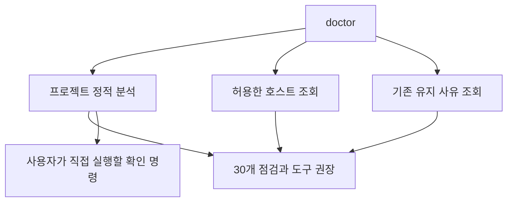

# CLI 구현 구조와 검증 경계

이 문서는 읽기 전용 진단 CLI와 로컬 패키지의 구조를 설명합니다.
명령 사용법은 [진단 CLI 사용법](diagnostic-cli.md)에 기록합니다.
모듈 사이의 반환 계약은 [모듈 계약](completion-contract.md)에 기록합니다.

## 실행 기준과 의존성

진단 CLI의 최소 런타임은 Node.js 24입니다.
Windows 호스트 조회는 PowerShell 7을 프로필 없이 실행합니다.
대상 프로젝트의 런타임·패키지 관리자·빌드 명령·배포 경로는 그대로 유지합니다.
진단기의 실행 조건을 맞추기 위해 대상 프로젝트를 재설정하지 않습니다.

| 구분 | 고정 의존성 | 역할 |
| --- | --- | --- |
| 실행 | `smol-toml@1.9.1` | 표준 TOML 파싱과 직렬화입니다. |
| 실행 | `yaml@2.9.1` | 표준 YAML 문서 파싱입니다. |
| 실행 | `semver@7.8.6` | Node.js 버전과 범위 비교입니다. |
| 실행 | `@renovatebot/pep440@6.0.0` | Python 버전과 범위 비교입니다. |
| 빌드 | `esbuild@0.28.2` | Node.js 24 대상의 설치용 CLI 번들 생성입니다. |

실행 의존성은 네 개이며 빌드 의존성은 별도로 고정합니다.
소스 개발과 검사는 저장소의 npm 잠금 파일을 기준으로 수행합니다.
설치용 번들은 실행 의존성을 포함하므로 대상 프로젝트에 진단기용 npm 의존성을 추가하지 않습니다.

## 모듈별 책임

| 모듈 | 현재 책임 |
| --- | --- |
| `src/project.mjs` | 선언·상위 적용 경계·작업 공간·CI·가상환경·컨테이너·서비스의 정적 분석입니다. |
| `src/task-runners.mjs` | 실행기 파일과 지원 범위 내 작업 선언의 정적 분석입니다. |
| `src/task-runner-checks.mjs` | 실행기 근거를 기존 check ID와 권장 차이에 연결하는 보고 통합입니다. |
| `src/windows.mjs` | Windows 문맥·명령 후보 수집과 PE 실행 파일 검증입니다. |
| `src/query.mjs` | 허용한 읽기 전용 조회를 전달합니다. |
| `src/versions.mjs` | 언어별 버전 요구와 관찰 버전의 비교입니다. |
| `src/runtime.mjs` | 실제 런타임 조회와 실행 파일 메타데이터의 선택 근거 보완입니다. |
| `src/advanced.mjs` | mise·.NET·Git·IDE·보조 도구·저장소 볼륨의 추가 조회입니다. |
| `src/infrastructure.mjs` | 패키지 관리자·Python 환경·WSL·Docker·Process Compose의 진단입니다. |
| `src/support.mjs` | 유효기간이 있는 오프라인 공식 지원 정책 판정입니다. |
| `src/app-check.mjs` | 선택한 Codex 실행 파일을 통한 앱 공유 설치 목록 조회입니다. |
| `src/exceptions.mjs` | 기존 프로젝트의 유지 사유를 읽습니다. |
| `src/doctor.mjs` | 30개 점검 결과를 모으고 수동 확인 명령을 안내합니다. |
| `src/cli.mjs` | `doctor`의 옵션과 출력 형식을 처리합니다. |
| `scripts/lib/bundle.mjs` | 개발 빌드·검사·패키지 생성이 공유하는 CLI 번들 옵션입니다. |

진단 모듈은 독립적인 정보를 병렬로 조회할 수 있습니다.



## 프로젝트 분석의 경계

분석 결과는 여섯 언어의 요구와 환경 적용 상태를 보존합니다.
TOML은 위험한 키를 거부하고 파싱 깊이를 제한합니다.
YAML은 중복 키·지원하지 않는 태그·재귀 별칭·확장 한도를 검사합니다.
기본 파일 읽기는 256 KiB, 선언 수는 128개, 탐색 깊이는 32단계로 제한합니다.
링크와 허용한 경계 밖의 파일은 따라가지 않습니다.

상위 선언은 저장소·적용되는 작업 공간·사용자 홈·파일 시스템 등의 경계 안에서 탐색합니다.
`global.json`과 언어 버전 파일은 가장 가까운 적용 선언을 선택합니다.
mise와 `.tool-versions`는 언어별로 가까운 선언을 우선합니다.
명시적인 패키지 작업 공간의 구성원만 추가 분석합니다.
CI의 버전 행렬은 로컬 버전 선택과 구분합니다.
가상환경의 관찰 버전을 프로젝트의 요구 버전으로 바꾸지 않습니다.

Process Compose와 Compose는 명령과 환경 값을 평가하지 않고 필요한 설정만 추출합니다.
devcontainer는 컨테이너 작업 문맥의 근거로 기록합니다.
보조 DB 서비스의 존재만으로 앱 전체의 컨테이너 실행을 추론하지 않습니다.
지원하지 않는 외부 포함과 동적 필드는 해당 필드의 구체적인 미확인 사유를 남깁니다.

실행기 분석은 mise tasks·Taskfile·Justfile·Makefile과 기존 npm scripts를 정적으로 탐지합니다.
includes·import·동적 변수·템플릿 등 지원하지 않는 문법은 `unknown`으로 남깁니다.
파일 존재와 작업 이름의 발견을 실행 성공으로 취급하지 않습니다.
실행기의 내부 셸·작업 경로·명령 경로·요구·권장 차이는 SH-01·ENV-02·PATH-01·REQ-01·RCM-01에 연결합니다.
기존 P0 22개와 P1 8개의 30개 check ID 계약을 보존합니다.
목록 조회와 dry run도 설정을 평가할 수 있으므로 기본 분석에서 자동 실행하지 않습니다.

## 기본 조회와 공식 지원 판정

기본 `doctor`는 설치·사용자 프로필 변경·서비스 기동을 수행하지 않습니다.
실행 경로와 PE 형식을 확인한 도구에 고정된 조회 인수 배열을 전달합니다.
미검증 wrapper·proxy·shim과 자동 설치를 유발할 수 있는 선택은 보류합니다.
프로필·시작 후크·프로젝트 명령을 기본 조회의 일부로 실행하지 않습니다.
내부 조회의 원시 출력은 필요한 관찰로 정리한 뒤 보고합니다.

공식 지원 판정은 2026-11-17 기준의 오프라인 정책 스냅샷을 사용합니다.
30일 유효기간을 지난 스냅샷은 최신 정책의 근거로 사용하지 않습니다.
현재 스냅샷의 만료일은 2026-12-17입니다.
지원 릴리스 계열의 판정은 최신 패치나 보안 취약점 확인과 구분합니다.

## 유지 사유와 확인 명령

`src/exceptions.mjs`는 이전에 저장한 유지 사유를 읽습니다.
`--state-dir`로 해당 저장 위치를 지정할 수 있습니다.
보고서는 프로젝트의 기존 유지 사유를 JSON의 `exceptions`에 표시합니다.

`doctor`는 정적으로 확인한 요구와 도구 선택을 근거로 수동 확인 명령을 안내합니다.
`RUST-02`, `WSL-02`, `CTR-02`, `PC-02`는 `skipped`로 남깁니다.
JSON 배열과 한국어 텍스트의 표시 방법은 [CLI 사용법](diagnostic-cli.md#수동-확인-명령)에 있습니다.

## 빌드와 패키지

저장소 루트에서 다음 명령을 순서대로 실행합니다.

```powershell
npm ci --ignore-scripts
node scripts/build.mjs
node --test
node scripts/check-package.mjs
node scripts/package-plugin.mjs
node scripts/check-package.mjs --packaged
```

개발 빌드는 저장소의 `dist/cli.mjs`를 생성합니다.
소스 검사는 빌드 결과와 현재 소스에서 다시 빌드한 바이트를 대조합니다.
패키지 생성은 `.local/plugin-marketplace/plugins/` 아래의 새 패키지에 `dist/cli.mjs`를 작성합니다.
`--packaged`는 로컬 마켓플레이스가 가리키는 패키지의 번들을 현재 소스의 메모리 빌드와 바이트 단위로 대조합니다.
생성한 패키지를 검사한 뒤 마켓플레이스 목록이 가리키는 경로를 교체합니다.

패키지에는 `environment-doctor` Skill, CLI 번들, PowerShell 조회 스크립트, 문서, 서드파티 고지를 포함합니다.
PowerShell 조회 스크립트는 `scripts/collect-host.ps1`과 `scripts/collect-advanced.ps1`입니다.
개발용 빌드·검사·패키지 스크립트는 소스 체크아웃에서 실행합니다.
설치 절차는 [README](../README.md#로컬-플러그인-설치)에 기록합니다.
