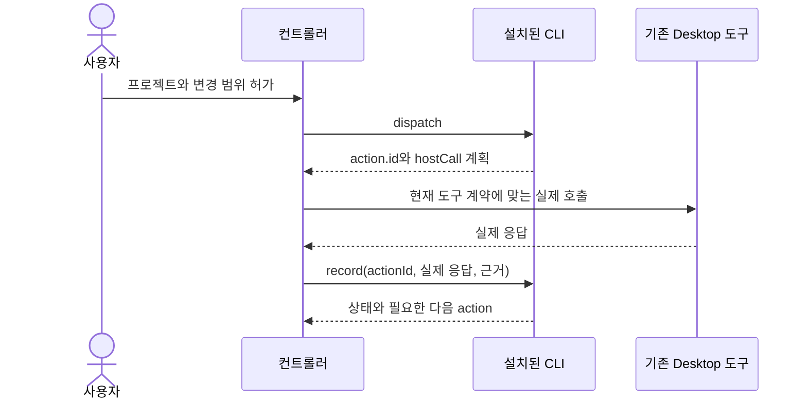
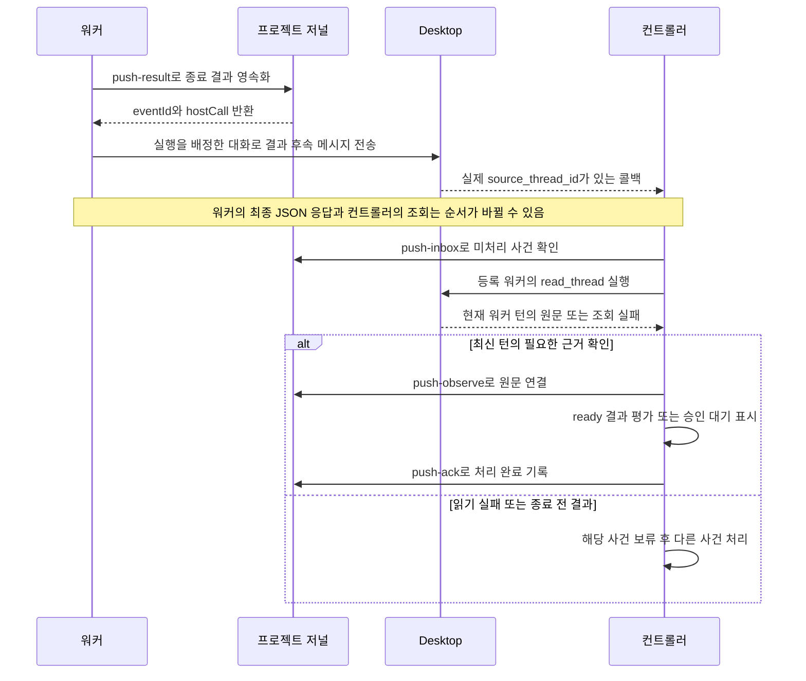

# 실행 책임

이 문서는 개발 버전의 실행 계약을 설명합니다.

공통 코어는 프로젝트별 상태와 다음 action을 관리합니다.
Codex 어댑터는 action을 기존 Desktop 도구의 호출 계획으로 변환합니다.
컨트롤러는 사용자가 허용한 범위에서 실제 도구를 호출합니다.
CLI는 호스트 도구를 직접 실행하지 않습니다.

공통 절차는 패키지의 `workflows/`에 있습니다.
호스트별 스킬은 `skills/`에 있습니다.
설치된 실행 코드는 `lib/`에 있습니다.
`dist/cli.mjs`는 `lib/cli/main.mjs`의 `main()`을 호출합니다.
소스 저장소가 없어도 설치본의 상대 import가 유지됩니다.

`projectRoot`는 실제 작업 저장소의 절대 경로입니다.
`hostProjectId`는 Desktop에 이미 등록된 프로젝트의 식별자입니다.
기존 부모 프로젝트에서 하위 저장소를 작업 범위로 사용할 수 있습니다.
MVP는 새 Desktop 프로젝트를 자동 등록하지 않습니다.

## 프로젝트와 실행 소유권

확인된 프로젝트의 일반 사용자 요청 대화는 자신이 배정한 실행의 컨트롤러입니다.
연결된 워커 대화는 계속 워커입니다.
`candidate`는 런타임의 `CODEX_THREAD_ID`와 실제 `projectRoot`를 사용합니다.
근거가 부족하면 공식 프로젝트 목록과 현재 대화까지 이어진 공식 이력을 사용합니다.
CLI는 현재 대화가 확인된 호출에서 재사용 가능한 프로젝트에 해당 대화를 등록합니다.
응답의 프로젝트 정보에는 호출 대화의 식별자와 위임을 담습니다.
`includeStatus: true`이면 호출 대화가 소유한 작업만 담습니다.

프로젝트에 처음 참여한 대화는 모든 운영 권한이 `false`입니다.
기존 위임은 원래 허가받은 대화에만 적용합니다.
`project` 명령에서 `controller`는 실제 호출 대화이며 변경 대상은 그 대화의 위임입니다.

두 컨트롤러는 서로 다른 `taskId`의 작업을 독립적으로 배정하고 기록하고 평가할 수 있습니다.
같은 `taskId`에는 해당 작업의 소유자만 접근할 수 있습니다.
CLI는 새 작업에 소유자를 기록합니다.
CLI는 새 실행의 `controllerRef`에 배정한 대화의 `threadId`와 `hostId`를 저장합니다.
다른 대화가 참여해도 진행 중인 작업과 과거 실행은 기존 소유자에게 남습니다.
`controllerRef`가 없는 이전 저장 실행은 종전 프로젝트 컨트롤러에게 속합니다.

보관은 동일 실행의 성공 결과·검증 통과·채택·대기 해제를 요구합니다.
후속 실행은 같은 대화를 재사용합니다.
보관된 대화는 복원 결과를 기록한 뒤 새 요청을 전달합니다.
새 실행은 이전 검증을 승계하지 않습니다.
불명확한 생성은 실제 대화를 확인하기 전까지 재전송하지 않습니다.

모델과 thinking은 요청 프로필입니다.
호스트가 적용값을 증명하지 않으면 실제 적용값은 미확인입니다.
로컬 `capabilities`의 출력은 호스트 도구의 현재 가용성을 증명하지 않습니다.

## 프로젝트별 이벤트 전달

사용자가 해당 프로젝트의 현재 대화에 `pushEvents: true`를 직접 위임하면 이벤트 전달을 사용할 수 있습니다.
이 필드가 없는 v0.1.5 상태는 `false`입니다.
승인 훅의 `push-config` 설정·교체와 Desktop에서 실행을 허용하는 절차는 [사용법](usage.md#이벤트-전달-켜기)을 따릅니다.
승인 훅은 프로젝트의 푸시 권한을 가진 대화가 공유합니다.
현재 또는 과거에 푸시를 위임받은 대화만 제거를 요청할 수 있습니다.
다른 대화에 푸시 권한이 남아 있으면 CLI는 공유 훅을 유지합니다.

컨트롤러는 독립 작업에 서로 다른 `taskId`와 겹치지 않는 파일 소유 범위를 부여합니다.
각 배정은 자체 `dispatch`, 호스트 호출, `record` 순서를 지킵니다.
작업 간 배정은 병렬로 진행할 수 있습니다.
컨트롤러가 배정을 기록한 뒤 해당 턴에서 워커 완료를 기다리지 않으므로 후속 처리는 콜백을 받은 턴이나 이후 컨트롤러 턴에서 진행됩니다.

### 저널과 콜백

프로젝트의 SQLite 저널은 워커가 발행한 결과와 승인 훅의 메타데이터를 보존합니다.
`PermissionRequest`의 새 관리 그룹은 `command` 훅만 사용합니다.
이 훅은 프로젝트 저널에 승인 메타데이터를 기록합니다.
정적 `mcp_tool` 훅은 별도 훅에서 확인한 실행별 전송 대상을 받아 사용할 수 없습니다.
배정한 대화는 다음 실제 턴의 `push-inbox`에서 승인 사건을 확인할 수 있습니다.
컨트롤러는 승인·결과 사건을 로컬 저널과 Desktop 원문으로 대조합니다.
컨트롤러는 자신이 배정한 워커의 현재 실행에 대응하는 승인 사건만 처리합니다.
승인 권한과 원본 요청은 워커 대화에 남습니다.

워커는 `push-result`로 자신의 종료 결과를 먼저 영속화합니다.
CLI는 저장된 실행의 `controllerRef`를 대상으로 `hostCall`을 반환합니다.
워커는 이 호출을 한 번 실행한 뒤 동일한 JSON으로 턴을 종료합니다.
콜백에는 사건을 찾을 수 있는 식별자만 담습니다.
컨트롤러는 실제 네이티브 `codex_delegation`의 `source_thread_id`와 marker의 워커 식별자를 대조합니다.
Desktop이 결과 후속 메시지를 전달하는 방식은 이 계약에서 바뀌지 않습니다.
전송 호출 접수와 실제 전달은 각각 확인합니다.
후속 메시지가 실행 중인 턴에 반영됐는지 새 턴을 시작했는지는 실제 컨트롤러 턴 ID로 구분합니다.

컨트롤러는 역할을 확인한 뒤 각 턴의 시작과 종료 직전에 자신이 배정한 실행의 미처리 사건을 확인합니다.
`push-inbox`와 `push-ack`는 호출 대화가 소유한 실행에만 적용합니다.
`push-observe`는 정확한 워커 대화와 최신 턴의 성공 원문만 기존 관찰에 연결합니다.
`ready`는 근거 확인 후 평가 또는 승인 표시가 가능한 상태입니다.
`pending`은 추가 근거가 필요한 상태입니다.
`settled`는 이미 처리했거나 현재 턴에 적용할 일이 없는 상태입니다.
같은 `eventId`의 재전달이 평가, 승인 표시나 호스트 상태 변경을 중복 적용해서는 안 됩니다.
평가에 쓸 종료 결과가 확인된 뒤에도 기존 실행별 검증, 채택, 보관 권한이 적용됩니다.

전달이 늦어지거나 실패해도 저널에 기록된 사건은 남습니다.
콜백이 계속 전달되지 않으면 다음 컨트롤러 턴의 미처리 사건 확인에서 복구합니다.
정상 경로는 공유 데몬, `wait_threads`, 직접 `observe` 호출 없이 처리합니다.
Desktop의 실제 전달과 지연은 [실측 절차](usage.md#desktop-이벤트-실측)로 확인합니다.
