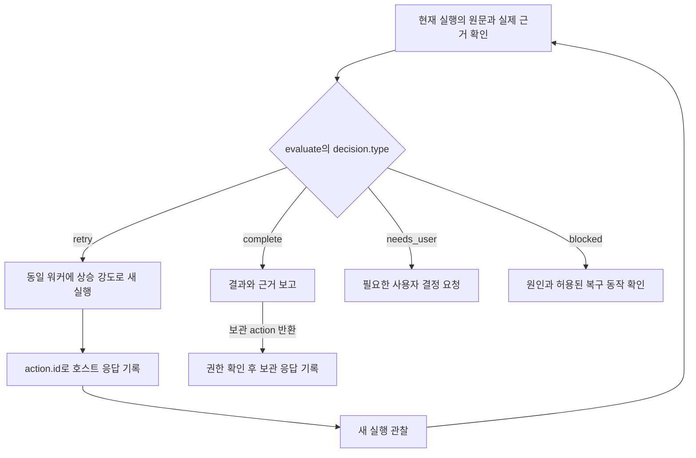

# 워커 오케스트레이터 사용법

이 문서는 개발 버전의 동작 계약을 설명합니다.
게시 버전의 사용법은 해당 설치본에 포함된 문서를 따르십시오.

## 컨트롤러에 자연어로 요청하기

확인된 프로젝트에서 일반 사용자 요청을 받은 대화는 자신이 배정한 실행의 컨트롤러가 됩니다.
이미 워커로 연결된 대화는 계속 워커입니다.
워커 운영이 필요하면 작업을 요청한 대화에 필요한 동작을 직접 맡기십시오.

> 이 프로젝트에서 필요하면 워커 대화를 열어 줘.
> 관련 작업은 같은 워커에 이어서 맡겨 줘.
> 보관된 워커가 다시 필요하면 복원해 줘.
> 검증이 끝나고 후속 작업이 없으면 워커를 보관해 줘.

컨트롤러는 사용자가 맡긴 동작과 그 출처를 해당 프로젝트의 현재 대화에 연결해 저장합니다.
이후에는 평소처럼 원하는 결과를 말하십시오.
필요하면 작업 범위, 완료 조건, 보고 형식을 함께 알리십시오.

- “오류 메시지를 점검해 줘.
  입력 검증 코드만 읽고, 문제가 재현되는 조건을 세 줄로 알려 줘.”
- “인증과 세션을 확인해서 로그인 실패 원인을 찾아 줘.
  기존 테스트로 원인을 확인하고 팀에 공유할 요약을 써 줘.”
- “지난 로그부터 이어서 재시도 가설을 확인해 줘.
  그 결론도 독립적으로 검토해 줘.”
- “이 프로젝트에서 이전에 작업한 워커를 찾아 줘.
  관련 작업과 마지막 실행 상태를 알려 줘.”

컨트롤러는 일반 프로젝트 요청에서 목표, 기존 제약과 확인 가능한 완료 기준을 정합니다.
읽기 전용 요청과 작은 작업에도 같은 절차를 적용합니다.
기존 위임 안에서 되돌릴 수 있는 가정을 정하고 실제 근거를 만들 워커를 배정합니다.
독립 작업에는 서로 다른 `taskId`와 겹치지 않는 파일 소유 범위를 배정합니다.
이벤트 전달을 켜면 컨트롤러는 독립 작업의 배정을 병렬로 기록하고 워커 결과를 기다리지 않은 채 턴을 종료합니다.
결과 후속 메시지를 받거나 다음 턴에 저널 사건을 찾으면 해당 실행을 확인합니다.
컨트롤러는 확인한 결과나 승인 대기를 보고합니다.

컨트롤러는 현재 호스트의 공개 도구 메타데이터로 확인한 모델과 thinking을 작업 복잡도에 맞춰 고릅니다.
범위가 좁고 빠른 확인에는 `medium`, 여러 구성 요소에 걸친 원인 분석에는 `high`, 서로 영향을 주는 가설을 검증할 때는 `xhigh`를 고려합니다.
실제 적용값은 호스트에서 확인된 경우에만 보고합니다.

컨트롤러의 직접 수행 범위는 역할·권한 확인과 필요한 사용자 결정 요청, 배정 계획과 워커 선택을 위한 내부 조회, 워커 운영, 워커 결과의 독립 확인·채택, 진행·결과 보고로 한정합니다.
워커 운영에는 생성·재사용·복원·전달·관찰·상태 기록·보관이 포함됩니다.
컨트롤러는 그 밖의 사용자 요청을 작업 크기나 읽기 전용 여부에 관계없이 같은 프로젝트의 Desktop 워커에 배정합니다.
Git 설정, 조회, 조사, 검증 결과를 만드는 작업도 워커가 수행합니다.

컨트롤러는 배정할 워커를 고르기 위해 프로젝트의 저장된 작업과 상태를 조회할 수 있습니다.
사용자가 요청한 과거 워커 검색은 워커에 배정합니다.
배정받은 워커는 허용된 읽기 전용 Desktop 도구를 사용해 해당 프로젝트의 기록만 조회하고, 그 프로젝트의 근거로 결과를 보고합니다.
워커는 컨트롤러의 상태를 변경하거나 다른 대화의 생성·후속 전달·복원·보관을 수행하지 않습니다.

후속 전달 권한이 있으면 관련 워커를 재사용합니다.
관련 워커가 없으면 현재 대화의 직접 위임이 허용하는 범위에서 새 워커 대화를 생성합니다.
배정에 필요한 권한이나 도구가 없으면 컨트롤러는 막힌 작업과 필요한 권한 또는 도구를 보고하고 작업을 보류합니다.
컨트롤러는 워커가 제출한 결과와 근거를 완료 조건에 대조해 독립적으로 확인합니다.
컨트롤러는 완료 기준마다 판단과 근거를 기록하고 평가 결과에 따라 채택하거나 같은 워커에 새 실행을 맡깁니다.
최종 보고의 길이와 상세 수준은 읽는 사람과 요청에 맞춥니다.

되돌릴 수 있는 가정은 밝혀 두고 작업을 진행합니다.
실제 승인이나 답변을 기다리는 동안 그 응답에 의존하지 않는 허가된 워커 운영을 계속합니다.
승인과 작업 범위를 넘는 결정은 사용자에게 맡깁니다.
목표나 기존 제약을 실질적으로 바꿔야 하면 해당 결정만 사용자에게 요청합니다.
추가 권한, 비용 또는 파괴적 작업에 승인이 필요하면 그 동작의 허가를 요청합니다.
도구나 워커로 얻을 수 없는 필수 정보는 사용자에게 요청합니다.

### 권한

워커 생성, 후속 메시지 전달, 보관, 복원은 각각 해당 프로젝트와 작업 범위에 대한 직접적인 사용자 허가가 필요합니다.
요청에 포함된 허가는 확인된 범위에서 사용합니다.
프로젝트 범위로 운영을 맡겼으면 같은 대화의 후속 요청에 저장된 허가를 사용합니다.
이 프로젝트에 처음 참여하는 대화는 모든 권한을 `false`로 시작합니다.
기존에 저장한 위임은 원래 허가받은 대화에만 적용합니다.
호스트 도구를 호출할 때는 실제 동작과 대상 대화가 그 허가에 포함되는지 확인합니다.
CLI는 실행 계획과 상태를 관리하고 컨트롤러는 워커 운영에 필요한 호스트 도구를 호출합니다.

## 설치된 CLI 사용법

Node.js 24 이상에서 설치 루트의 `dist/cli.mjs`를 실행합니다.
다음 형식은 모든 상태 명령에 공통입니다.

```text
node <설치 루트>/dist/cli.mjs <command> --state-dir <절대 경로> --input <JSON 파일>
node <설치 루트>/dist/cli.mjs <command> --state-dir <절대 경로> --input -
node <설치 루트>/dist/cli.mjs capabilities
```

`--input -`는 stdin의 JSON 객체를 읽습니다.
`--state-dir`를 생략하면 Windows에서 `%LOCALAPPDATA%/WorkerOrchestrator/state`를 사용합니다.
설치 검증은 항상 임시 절대 경로를 `--state-dir`로 지정합니다.
상태 명령은 기존 SQLite 스키마 v1과 v2를 v3으로 갱신합니다.
CLI는 갱신할 때 프로젝트와 작업 기록을 보존합니다.
CLI는 JSON 결과를 stdout으로 출력합니다.
오류는 `ok: false`와 종료 코드로 확인합니다.

자동 실행 절차를 사용하려면 `capabilities`의 `supports`에서 `project-operations`, `work-spec`, `evaluate`, `project-binding`을 확인하십시오.

다음 입력의 예시 식별자는 실제 식별자로 바꿉니다.
`projectRoot`는 존재하는 작업 디렉터리의 절대 경로여야 합니다.

### 컨트롤러 조회와 확정

`candidate`는 런타임이 제공한 `CODEX_THREAD_ID`와 실제 `projectRoot`로 현재 대화와 작업 범위를 확인합니다.
작업을 배정할 때는 첫 요청에 `projectRoot`와 `includeStatus: true`를 보냅니다.
연결된 워커에는 `decision: "worker"`를 반환합니다.
현재 대화와 프로젝트를 확인하면 같은 호출에서 재사용 가능한 프로젝트에 이 대화를 등록하고 `decision: "controller"`를 반환합니다.
별도의 역할 확정 호출이나 다른 대화 수 확인은 필요하지 않습니다.
응답의 `project.controller`와 `project.authorization`은 현재 호출 대화와 그 대화의 위임을 나타냅니다.
`includeStatus: true`이면 CLI는 같은 트랜잭션에서 현재 대화가 소유한 작업만 최상위 `tasks` 배열에 담습니다.
`includeStatus`를 생략하거나 `false`로 보내면 `tasks`를 생략합니다.
불리언이 아닌 `includeStatus` 값에는 CLI가 `INPUT` 오류를 반환합니다.

```text
node <설치 루트>/dist/cli.mjs candidate --input - [--state-dir <절대 경로>]
```

```json
{ "projectRoot": "C:/work/example", "includeStatus": true }
```

`reason: "DISCOVERY_REQUIRED"`가 반환되면 다음 순서로 조회 근거를 모읍니다.

1. `list_projects`의 실제 응답 전체를 `projects`에 넣습니다.
2. `list_threads`를 `mode: "history"`, `source: "codex"`, `archived: false`로 호출합니다.
   호출 대화의 기본 호스트를 사용하거나 확인된 `hostId`를 지정합니다.
   첫 호출에서는 `cursor`를 생략합니다.
3. 각 요청의 커서와 응답을 `{ cursor, result }` 형식으로 `threadPages`에 순서대로 넣습니다.
   첫 항목의 `cursor`에는 `null`을 넣습니다.
   각 `result`에는 `threads`와 `nextCursor`가 들어 있는 실제 `list_threads` 응답 전체를 넣습니다.
   같은 호스트와 조회 조건을 유지하며 직전 응답의 `nextCursor`를 다음 요청의 `cursor`로 사용합니다.
   현재 대화를 찾은 페이지까지 포함합니다.
4. 기존 `candidate` 입력에 `projects`와 `threadPages`를 추가합니다.

CLI는 현재 대화의 호스트와 Desktop 프로젝트 ID를 프로젝트 목록에 대조합니다.
Git으로 확인한 같은 저장소 루트와 연결된 워크트리는 같은 Git 작업 범위로 다룹니다.
부모 Desktop 프로젝트를 공유하는 별개 저장소는 작업 경로로 구분합니다.
현재 대화를 찾지 못했거나 조회 페이지가 끊겼거나 소속 근거가 충돌하면 역할 판정을 보류합니다.

### Desktop 프로젝트 동기화

`projectRoot`는 프로젝트 확인과 권한 적용에 사용하는 Git 작업 범위입니다.
Desktop의 대화 생성 대상은 현재 컨트롤러 대화가 호스트에서 갖는 `projectId`입니다.
예를 들어 이전 대상이 상위 폴더의 Desktop 프로젝트이고 현재 컨트롤러가 저장소 전용 프로젝트에 속하면, 저장소 전용 프로젝트를 생성 대상으로 사용합니다.
부모 폴더나 워크트리 경로만으로 Desktop 소속을 정하지 않습니다.

1. 새 워커를 생성하거나 기존 워커를 재사용하기 전에 `list_projects`로 현재 프로젝트 목록을 조회하십시오.
2. 현재 호스트에서 `mode: "history"`, `source: "codex"`, `archived: false`로 `list_threads`를 호출하십시오.
   필요하면 `nextCursor`를 따라 현재 호출 대화가 있는 페이지를 찾으십시오.
3. 응답의 `project.controller`에 있는 `threadId`와 `hostId`를 현재 호출 대화와 대조하십시오.
4. 호출 대화의 호스트 `projectId`를 프로젝트 목록과 대조하십시오.
5. 소속을 확인했으면 기존 CLI `projectId`와 조회 근거를 `sync-project`에 전달하십시오.

입력의 `projects`에는 `list_projects`의 실제 응답 전체를 넣습니다.
`threadPages`에는 같은 활성 이력 조회의 원문 응답을 요청 순서대로 넣습니다.
첫 페이지의 `cursor`는 `null`입니다.
이후 페이지에는 각 조회에 사용한 커서를 넣습니다.
아래 PowerShell 예시는 실제 응답을 담은 변수로 입력을 구성합니다.

```powershell
$SyncInput = @{
  projectId = $Candidate.project.projectId
  projects = $ProjectsResponse
  threadPages = @(
    @{ cursor = $null; result = $FirstHistoryResponse }
    @{ cursor = $SecondHistoryRequestCursor; result = $SecondHistoryResponse }
  )
}
$SyncInput | ConvertTo-Json -Depth 100 -Compress |
  node "$InstalledRoot/dist/cli.mjs" sync-project --state-dir $StateDir --input -
```

예시는 호출 대화 확인에 두 페이지를 사용합니다.
`$SecondHistoryRequestCursor`는 첫 응답의 `nextCursor`를 사용해 두 번째 페이지를 요청할 때 보낸 값입니다.
실제로 사용한 페이지에 맞춰 `threadPages`를 구성하십시오.

`sync-project`는 대상이 오래됐으면 기존 작업 소유자와 대화별 권한을 보존한 채 호스트 대상을 갱신합니다.
성공하면 응답의 `project.hostProjectId`를 확인한 컨트롤러의 호스트 `projectId`와 대조하십시오.
이전 대상으로 계획한 생성 action 때문에 동기화가 `PENDING_ACTION`으로 보류되면, 기존 action을 실제 호스트 근거로 정리한 뒤 다시 동기화하십시오.

다른 Desktop 그룹의 과거 `workerRef`는 기록에 남습니다.
후속 실행을 맡기기 전에 작업의 `workerHostProjectId`를 동기화한 `project.hostProjectId`와 대조하십시오.
동기화로 대상이 바뀌었고 앞서 읽은 작업 목록에 `workerHostProjectId`가 없으면, 동기화 응답의 `previousHostProjectId`를 그 목록의 기존 워커 소속으로 사용하십시오.
다른 그룹에 속한 워커는 새 실행의 재사용 후보에서 제외하십시오.

`dispatch`가 생성 action을 반환하면 `hostCall.arguments.target.projectId`를 확인한 컨트롤러의 호스트 `projectId`와 다시 대조하십시오.
소속을 확인할 수 없으면 배정을 보류하십시오.
프로젝트 없는 대화로 대체하지 마십시오.

### 프로젝트 등록과 작업 실행

`candidate`에서 `decision: "controller"`를 받으면 반환된 `project`의 식별자와 경로를 사용합니다.
`decision: "controller"`를 확인한 뒤 작업을 `dispatch`합니다.
권한 업데이트에 필요한 `projectId`, `projectRoot`, `hostProjectId`, `controller`를 그 결과에서 가져옵니다.
`hostProjectId`에는 [동기화 절차](#desktop-프로젝트-동기화)에서 확인한 현재 컨트롤러의 Desktop 프로젝트 ID를 사용합니다.
컨트롤러가 상위 폴더의 Desktop 프로젝트에 실제로 속하면 그 프로젝트를 하위 저장소의 Git 작업 범위와 함께 사용할 수 있습니다.

`project`는 다음 객체를 받습니다.
각 권한의 `true`는 해당 범위의 직접적인 사용자 허가가 있을 때만 기록합니다.
`source`에는 실제 허가의 출처를 남깁니다.
이 프로젝트의 후속 작업에도 같은 권한을 허용했으면 `authorization.scope`에 `"project"`를 넣습니다.
특정 작업에 준 권한은 `scope`를 생략하고 그 작업의 범위에서만 사용합니다.
`controller`에는 현재 호출 대화의 실제 `threadId`와 확인된 `hostId`를 넣습니다.
다른 컨트롤러의 식별자로 권한을 기록할 수 없습니다.

```json
{
  "projectId": "example",
  "projectRoot": "C:/work/example",
  "hostProjectId": "existing-desktop-project-id",
  "controller": { "threadId": "actual-controller-thread", "hostId": "local" },
  "authorization": {
    "scope": "project",
    "createWorkers": true,
    "sendFollowups": true,
    "archiveCompleted": true,
    "restoreWorkers": true,
    "pushEvents": false,
    "source": "직접적인 사용자 허가의 실제 출처와 작업 범위"
  }
}
```

이 권한은 같은 대화의 같은 프로젝트 후속 요청에 적용합니다.
권한을 바꾸려면 해당 대화에서 `project`를 다시 호출하고 사용자가 확인한 새 범위를 기록합니다.
일부 권한을 철회하려면 해당 값을 `false`로 저장합니다.
지속 운영을 끝내려면 `scope`를 빼고 현재 허가된 동작만 저장합니다.

`candidate` 응답에 최상위 `tasks` 배열이 있으면 `project`와 `tasks`를 배정 계획에 사용합니다.
배열이 비어 있어도 `status`를 다시 호출하지 않습니다.
`tasks`를 요청하지 않았다면 `projectId`로 `status`를 조회합니다.
다른 대화가 같은 프로젝트에서 작업 중이어도 현재 대화는 자체 작업을 배정할 수 있습니다.
기존 `taskId`는 해당 작업을 소유한 대화만 사용할 수 있습니다.
독립 작업을 시작하려면 다른 대화의 작업과 구별되는 `taskId`를 사용합니다.
동기화한 Desktop 그룹에 관련 워커가 있고 새 실행을 받을 수 있으면 같은 `taskId`를 선택합니다.
그 워커만 재사용하려면 `dispatch`에 `reuseOnly: true`를 넣습니다.
선택한 작업에 워커 등록이 없으면 CLI는 `WORKER_NOT_FOUND`를 반환합니다.

`dispatch`는 다음 객체를 받습니다.
컨트롤러는 자동 실행에서 `prompt`와 `profile`에 더해 `workSpec`을 전달합니다.
`workSpec`은 `goal` 문자열, `constraints` 문자열 배열과 `{id, description}`의 `completionCriteria` 배열을 포함합니다.
초기값보다 높은 단계 중 같은 모델에 대해 공개 호스트 메타데이터로 지원을 확인한 값만 `reasoningEscalations` 문자열 배열에 오름차순으로 넣습니다.
고정 모델과 강도, 사용자가 허용한 비용 범위를 지킵니다.
강도가 고정됐거나 허용된 상승 단계가 없으면 `reasoningEscalations`를 생략합니다.
기존 CLI 흐름에서는 `workSpec`을 생략할 수 있습니다.

`candidate`는 역할만 확인합니다.
`dispatch`는 자체 트랜잭션에서 호출 대화, 권한, 작업 소유자, 워커 상태를 확인합니다.
새 작업의 요청에는 새 `requestId`를 사용합니다.
동일 요청의 재조회에는 동일한 입력과 `requestId`를 사용합니다.
동일한 계획이 반환되어도 호스트 작업을 중복 실행하지 않습니다.

### 실행 한 건의 종료 결과 받기

`capabilities.supports`에서 `run-result-push`를 확인하십시오.
사용자가 이번 실행의 결과를 배정한 대화로 한 번 보내도록 허가하면 `dispatch`의 `resultPushAuthorizationSource`에 원본 사용자 메시지의 참조와 허가 범위를 기록하십시오.
배정 권한은 현재 컨트롤러의 `project` 기록으로 확인합니다.
이 실행의 결과는 `push-inbox`, `push-observe`, `push-ack`에서 배정한 대화가 처리합니다.
일회성 허가는 다음 실행이 시작되면 만료됩니다.
같은 일회성 결과의 첫 발행 응답에만 Desktop 전송 계획이 포함됩니다.
Desktop 전송이 실패한 경우 컨트롤러는 다음 턴에 저널에서 결과를 조회할 수 있습니다.

### 배정 예시

```json
{
  "projectId": "example",
  "taskId": "review",
  "requestId": "review-1",
  "prompt": "입력 검증 코드를 읽고 invalid-input 기준의 근거를 남기세요.",
  "profile": { "model": "host-supported-model", "thinking": "medium" },
  "workSpec": {
    "goal": "잘못된 입력을 거부하는 조건을 설명합니다.",
    "constraints": ["입력 검증 코드만 읽습니다.", "파일을 변경하지 않습니다."],
    "completionCriteria": [
      {
        "id": "invalid-input",
        "description": "거부 조건을 확인하고 해당 분기의 파일과 줄을 제시합니다."
      }
    ],
    "reasoningEscalations": ["high", "xhigh"]
  }
}
```

예시는 같은 모델에서 세 강도의 지원과 비용 범위를 확인한 경우입니다.
반환된 `action.id`가 이후 기록의 `actionId`입니다.
반환된 `action.runId`가 해당 실행의 식별자입니다.
CLI는 새 작업의 소유자와 새 실행의 `controllerRef`에 배정한 대화를 기록합니다.
다른 대화가 참여해도 기존 작업과 실행은 기존 소유자에게 남습니다.
`controllerRef`가 없는 이전 저장 실행은 종전 프로젝트 컨트롤러를 소유자로 사용합니다.
`hostCall`은 컨트롤러가 실행할 도구와 인수의 계획입니다.
현재 도구 메타데이터가 실제 입력과 권한을 결정합니다.
워커 프롬프트에 해당 `runId`와 설치된 worker 스킬 경로를 전달합니다.
프롬프트나 CLI가 덧붙인 작업 명세에 모든 완료 기준 ID가 들어 있는지 확인합니다.

실제 호스트 호출 후 `record`로 결과를 기록합니다.
`record`와 `evaluate`는 현재 대화가 소유한 작업에만 적용합니다.
기록 응답을 받지 못했으면 같은 `actionId`와 `hostResult`로 `record`를 다시 호출합니다.
복원 기록을 다시 제출하면 아직 결과가 기록되지 않은 후속 `send`의 기존 action ID를 받을 수 있습니다.
다음 예시는 원문 호스트 결과를 `host-result.json`에 보존한 경우입니다.

```powershell
$InputObject = @{
  projectId = 'example'
  taskId = 'review'
  actionId = $Plan.action.id
  hostResult = Get-Content -Raw -LiteralPath './host-result.json' | ConvertFrom-Json
  evidenceRef = 'host-result.json'
}
$InputObject | ConvertTo-Json -Depth 40 -Compress |
  node "$InstalledRoot/dist/cli.mjs" record --state-dir $StateDir --input -
```

`$InstalledRoot`와 `$StateDir`는 사용자가 선택한 절대 경로입니다.
`$Plan`은 `dispatch`, `evaluate` 또는 이전 `record`에서 반환된 실제 action을 담은 객체입니다.
`hostResult` 대신 계약에 맞는 `outcome`과 `receipt`를 사용할 수 있습니다.
생성 성공 receipt에는 실제 `workerRef: {threadId, hostId}`가 필요합니다.
보관·복원 receipt에는 동일한 `workerRef`와 `archived: true|false`가 필요합니다.
결과를 모르면 `outcome: unknown`과 실제 근거를 기록합니다.
불명확한 생성은 확인 전에 다시 보내지 않습니다.
생성 전에 도구가 요청을 확정 거절했다는 증거를 확보하면 같은 action을 `outcome: rejected`와 `evidenceRef`로 기록합니다.
이 입력에는 `hostResult`와 성공 receipt를 생략합니다.
상태가 `rejected`가 되면 같은 `taskId`에 새 `requestId`와 수정한 입력으로 `dispatch`합니다.
일반 오류와 시간 초과는 생성 여부를 확인할 때까지 대조 대기로 유지합니다.

### 이벤트 전달 켜기

이벤트 전달은 해당 프로젝트의 현재 대화에 사용자가 직접 위임한 경우에 켭니다.
v0.1.5 상태에 `pushEvents`가 없으면 `false`로 취급합니다.
현재 대화에서 직접 위임의 출처를 기록하십시오.
워크플로를 수정하라는 요청은 푸시 위임의 근거가 될 수 없습니다.

1. `project`의 `authorization`에 `scope: "project"`와 `pushEvents: true`를 기록하십시오.
2. 현재 대화에서 `push-config`에 `{"projectId":"example","apply":true}`를 보내 프로젝트 훅을 설정하십시오.
3. Desktop의 Hooks UI에서 대상 프로젝트와 `PermissionRequest` 훅을 확인하십시오.
4. Desktop이 훅 실행 허용을 요청하면 사용자가 해당 훅을 검토하고 허용하십시오.
5. 허용 여부와 실제 실행 여부는 아래 실측 절차로 확인하십시오.

승인 훅은 같은 프로젝트의 푸시 권한을 가진 대화가 공유합니다.
사용자가 제거를 허용하면 현재 또는 과거에 푸시를 위임받은 대화에서 `push-config`에 `{"projectId":"example","apply":true,"remove":true}`를 보내십시오.
CLI는 다른 대화에 푸시 권한이 남아 있으면 공유 훅을 유지합니다.
푸시를 위임받은 적이 없는 대화는 훅을 제거할 수 없습니다.
`remove: true`는 훅을 제거하는 요청입니다.
현재 대화의 위임을 철회하려면 `project`에서 `pushEvents: false`를 기록하십시오.

사용자가 승인 훅 교체를 허용하면 현재 대화의 푸시 위임을 확인한 뒤 개발 버전의 `push-config`를 사용하십시오.
먼저 `apply` 없이 생성할 훅을 확인하십시오.
이전 실행 경로로 설치한 훅에는 `previous: {nodePath, cliPath}`에 설치 당시의 정확한 두 절대 경로를 지정하십시오.
`apply: true`를 보내면 CLI는 기존 관리 그룹의 `command` 설정을 현재 또는 지정한 이전 설정과 대조합니다.
이전 방식의 그룹은 같은 프로젝트의 승인 후속 메시지를 보내던 `mcp_tool` 훅까지 확인한 뒤 교체합니다.
`HOOK_CONFIG_CONFLICT`가 반환되면 실제 설정과 이전 설치 경로를 확인하십시오.
교체 후 Hooks UI에서 관리 그룹에 `command`만 남았는지 확인하십시오.
다른 훅 그룹은 그대로 사용합니다.

새 관리 훅의 `PermissionRequest` 그룹은 `command` 훅만 사용합니다.
이 훅은 프로젝트 저널에 프로젝트·호스트·워커 대화·워커 턴 식별자를 기록합니다.
정적 `mcp_tool` 훅은 별도 `command` 훅에서 현재 실행의 컨트롤러를 받아 전송 대상으로 지정할 수 없습니다.
승인 요청으로 컨트롤러에게 후속 메시지를 보내지 않습니다.
실행을 배정한 컨트롤러는 다음 실제 턴의 `push-inbox`에서 승인 사건을 확인할 수 있습니다.
실제 승인과 거절은 사용자가 워커 대화의 권한 요청에서 처리합니다.

### 이벤트 명령

다음 표는 이벤트 경로의 명령 계약입니다.
설치본에서 지원 여부를 확인하고 사용하십시오.
`capabilities`의 `supports`에서 `push-event`를 확인하십시오.

| 명령 | 입력 필드 | 응답과 사용 조건 |
| --- | --- | --- |
| `push-inbox` | `projectId`, 선택 `notice`, 선택 `sourceThreadId` | 현재 대화가 소유한 실행의 미처리 `events`를 반환합니다. 각 항목에는 `eventId`, `kind`, `workerThreadId`, `workerTurnId`, `taskId`, `runId`, `workerRef`, `readThread`가 포함됩니다. |
| `push-observe` | `projectId`, `eventId`, `readThreadResult`, `evidenceRef` | 현재 워커 대화와 최신 워커 턴에 맞는 성공한 `read_thread` 원문을 기존 관찰로 연결하는 계약입니다. 처리 상태는 `ready`, `pending`, `settled`입니다. |
| `push-ack` | `projectId`, `eventIds` | 현재 대화가 처리한 자기 실행의 사건만 확인 처리합니다. 같은 사건을 다시 확인해도 중복 효과가 없어야 합니다. |
| `push-result` | `projectRoot`, `projectId`, `taskId`, `runId`, `hostId`, `workerTurnId`, `controllerRef`, `result` | 워커와 실행의 식별자를 확인하고 종료 결과를 먼저 저장합니다. `hostCall`의 대상은 실행에 저장된 `controllerRef`입니다. |

`push-inbox`에 `projectId`만 보내도 자신이 배정한 실행의 미처리 사건을 찾을 수 있습니다.
같은 프로젝트의 다른 컨트롤러가 자기 사건을 확인하거나 처리해도 현재 대화의 미처리 사건은 유지됩니다.
`notice`는 Desktop의 네이티브 `codex_delegation` 본문에서 받은 한 줄 전체입니다.
이 줄은 `worker-orchestrator-event/1 `로 시작하고 뒤에 JSON 객체가 이어집니다.
`sourceThreadId`에는 봉투에서 실제로 받은 `source_thread_id`를 전달합니다.
본문의 `workerThreadId`가 해당 출처와 같은지 대조하십시오.
일반 사용자 메시지에 들어 있는 marker나 복사한 봉투는 콜백의 출처로 사용할 수 없습니다.
저널 사건이 없을 때는 `eventId`를 만들어 `push-observe`나 `push-ack`에 넣지 마십시오.

컨트롤러는 역할 확인 뒤 턴 시작과 종료 직전에 미처리 사건을 확인합니다.
각 사건의 `readThread`에 나온 읽기 도구를 해당 워커에 호출합니다.
현재 실행과 턴이 확인된 성공 응답의 원문을 그대로 `push-observe`에 넘깁니다.
`read_thread`가 실패하거나 결과가 발행됐지만 워커 턴이 아직 실행 중이면 해당 사건을 보류합니다.
다른 사건의 처리는 계속합니다.

`ready`가 결과를 나타내면 [구조화된 작업 평가](#구조화된-작업-평가)를 수행합니다.
`ready`가 승인 대기를 나타내면 워커 대화에 원본 요청이 있다는 사실을 사용자에게 표시합니다.
처리를 마친 사건의 `eventId`를 `push-ack`에 넘깁니다.
`pending`은 이후 확인까지 남겨 둡니다.
`settled`는 이미 처리했거나 현재 턴에 적용할 일이 없는 사건입니다.
미처리 목록에 남은 `settled`에는 추가 평가 없이 `push-ack`를 적용합니다.
같은 `eventId`에는 평가, 승인 표시, 호스트 상태 변경을 중복 적용하지 않습니다.

각 컨트롤러는 독립 작업의 `dispatch → hostCall → record`를 병렬로 실행할 수 있습니다.
각 작업의 실제 호스트 응답을 기록한 뒤 워커 완료를 기다리지 않고 턴을 종료합니다.
정상 이벤트 경로에는 공유 데몬, `wait_threads`, 직접 `observe` 호출을 사용하지 않습니다.
워커가 전송에 실패해도 이미 영속화한 사건은 저널에 남습니다.
호스트 콜백 장애가 계속되면 다음 컨트롤러 턴에서 저널을 확인합니다.
저널과 후속 턴 사이의 자동 전달은 실제 Desktop에서 관찰한 범위만 보고합니다.

### Desktop 이벤트 실측

사용자가 허용한 검증 워커와 프로젝트에서 다음 절차를 실행하십시오.
각 실행의 설치본 버전, Desktop 버전, 운영체제, 요청 프로필과 확인 가능한 적용 프로필을 기록하십시오.
실험별 증거는 Git 제외를 확인한 `.local/`에 보관하십시오.
예를 들어 `git check-ignore -v -- .local/push-desktop/trace.jsonl`로 확인할 수 있습니다.
호스트의 실제 응답과 시각을 남기고 필요한 식별자만 공유하십시오.

1. **대화별 권한.** 같은 프로젝트의 두 일반 대화에서 `candidate`로 컨트롤러 역할을 확인하십시오.
   두 대화가 같은 `projectId`를 반환하는지 확인하십시오.
   사용자가 한 대화에만 맡긴 권한이 다른 대화에 표시되면 실패입니다.
2. **설정과 승인.** 푸시를 직접 위임받아 `push-config`를 실행하십시오.
   Hooks UI의 대상과 허용 상태를 확인하십시오.
   검증 워커 A에서 사용자가 허용한 승인 요청을 한 번 유발하고, 워커 B에는 A의 승인에 의존하지 않는 작업을 배정하십시오.
   승인 저널 기록, A의 원본 요청, B의 독립 완료를 각각 확인하십시오.
   새 관리 훅에서 승인 후속 메시지가 전달되면 실패입니다.
   A를 배정한 대화의 다음 턴에 `push-inbox`로 승인 사건을 확인하십시오.
   다른 컨트롤러가 이 사건을 조회하거나 확인 처리할 수 있으면 실패입니다.
   컨트롤러에 승인 대기가 표시된 뒤에도 원본 요청은 A에서 사용자가 처리해야 합니다.
3. **배정과 전달.** A와 B의 `taskId`와 파일 소유 범위를 다르게 정하십시오.
   각 `dispatch`, 호스트 호출, `record`의 시작과 응답 시각을 기록하십시오.
   컨트롤러의 배정 턴이 종료된 시각과 워커의 결과 발행 시각을 기록하십시오.
   배정 턴이 먼저 종료되는지 확인하려면 적어도 한 워커가 그때까지 실행 중인 시행을 확보하십시오.
   각 발행 뒤 처음 받은 콜백의 실제 `source_thread_id`, `eventId` 및 턴 ID를 보존하십시오.
   워커의 최종 JSON과 저널의 `result`를 객체 값으로 대조하십시오.
4. **중복과 정확성.** 같은 사건을 다시 전달하거나 확인하십시오.
   평가, 승인 표시와 호스트 상태 변경의 적용 횟수를 세십시오.
   출처가 다른 marker, 이전 턴 원문, 읽기 실패 또는 아직 실행 중인 결과가 `ready`로 처리되면 실패입니다.
   보류 사건이 있어도 다른 사건이 평가되고 확인되는지 확인하십시오.
5. **전달 손실과 복구.** 별도 실행에서 영속화 직후 후속 메시지 전송을 의도적으로 생략하십시오.
   사용자가 컨트롤러에 다음 메시지를 보내기 전까지 관찰된 턴 시작 여부를 기록하십시오.
   다음 실제 컨트롤러 턴의 시작 확인에서 동일한 `eventId`가 발견되는지 확인하십시오.
   조회가 가능해지면 평가와 확인까지 진행하십시오.
   이 실험은 다음 턴의 복구를 확인합니다.

각 실행에서 `taskId`, `runId`, `workerThreadId`, `workerTurnId`, `eventId`로 증거를 연결하십시오.
가능하면 같은 시계로 UTC 시각을 기록하십시오.
워커 결과의 영속화부터 콜백 수신까지와 콜백 수신부터 `push-ack`까지의 시간을 각각 밀리초로 계산하십시오.
전달이 누락된 경우에는 다음 실제 컨트롤러 턴까지의 대기를 별도로 기록하십시오.
병렬 경로의 시간 이득을 주장하려면 같은 작업, 프로필과 환경으로 직렬 대조군과 병렬 실행을 반복하십시오.
시행별 배정 시작부터 마지막 확인까지의 시간과 두 조건의 중앙값을 남기십시오.
호출 구간이 겹치지 않으면 병렬 배정이 확인되지 않은 것입니다.
병렬 실행의 중앙값이 줄지 않으면 해당 조건에서 시간 이득은 확인되지 않은 것입니다.

### 기존 수동 관찰

푸시 위임이 없는 대화에서는 필요한 경우 자기가 배정한 워커의 진행을 공식 `wait_threads`로 수동 관찰할 수 있습니다.
세부 근거가 필요하면 `read_thread`를 사용합니다.
다음은 정규화한 `observe` 입력입니다.

```json
{
  "projectId": "example",
  "taskId": "review",
  "runId": "actual-current-run-id",
  "eventId": "actual-event-id",
  "status": "completed",
  "result": { "success": true, "summary": "실제 워커 결과 요약" },
  "evidenceRef": "실제 관찰 근거"
}
```

공식 wait 응답은 `status`와 `eventId` 대신 원문 `hostResult`로 전달할 수도 있습니다.
호출에 실패한 경우 컨트롤러는 `isError: true`인 응답도 `hostResult`로 전달합니다.
같은 워커의 요약이 다른 호스트 ID를 반환하거나 최종 메시지의 JSON을 해석할 수 없을 때도 원문 조회를 계획할 수 있습니다.

1. `observe`가 `read_thread` 계획을 반환하면 `hostCall`의 인수로 등록된 호스트에서 원문을 조회하십시오.
2. 같은 `observe` 입력에 `readThreadResult`와 `readThreadEvidenceRef`를 추가해 다시 호출하십시오.

CLI는 등록된 호스트의 최종 응답에서 현재 `runId`를 확인합니다.
요약에 터미널 턴과 최종 메시지의 ID가 있으면 CLI는 원문 식별자와 대조합니다.
조회가 실패하거나 식별자가 다르면 CLI는 확인된 대기 상태나 미확인 상태를 유지합니다.

정규화한 입력을 직접 작성할 때 `eventId`는 같은 작업의 실행 전체에서 고유해야 합니다.
승인 대기는 `status: waiting_approval`과 `waitId`를 기록합니다.
사용자 입력 대기는 `status: waiting_input`과 `waitId`를 기록합니다.
대기 요청 여러 개를 직접 기록할 때는 `waits: [{waitId, kind}]`를 전달합니다.
첫 항목의 `kind`가 `approval`이면 `waiting_approval`을 사용하고, `input`이면 `waiting_input`을 사용합니다.
원문 wait 응답에 여러 요청이 있으면 한 관찰에서 함께 기록합니다.
각 요청의 실제 승인이나 답변을 확인한 뒤 `task.waits`에 반환된 해당 `waitId`를 `resolve`로 해제합니다.
호스트가 요청 ID 없이 대기 상태만 제공하면 재개가 관찰된 뒤 같은 턴에 생긴 대기를 새 요청으로 기록합니다.

### 구조화된 작업 평가

워커는 고정 [결과 스키마](../workflows/worker-result.schema.json)를 사용합니다.
`summary`에 각 기준 ID의 결과나 미충족 이유를 쓰고 `verification.evidenceRefs`에 실제 근거를 남깁니다.
워커의 `passed`는 자체 검증 보고입니다.

1. 현재 실행의 원문과 기준별 근거를 확인하십시오.
   실제 출력, 검증한 파일과 출처 또는 재현 명령의 결과를 사용하십시오.
2. 모든 기준의 상태, 근거 참조와 판단 이유를 `checks`에 기록하십시오.
3. 고정 제약이 하나라도 있으면 준수 여부의 상태, 근거와 판단 이유를 `constraintReview`에 기록하십시오.
4. 관찰한 결과의 `task.result.eventId`를 `resultEventId`로 지정하십시오.
5. 아래 입력으로 `evaluate`를 호출하십시오.

```json
{
  "projectId": "example",
  "taskId": "review",
  "runId": "actual-current-run-id",
  "resultEventId": "actual-result-event-id",
  "checks": [
    {
      "id": "invalid-input",
      "status": "met",
      "evidenceRefs": ["실제 분기의 파일과 줄"],
      "note": "해당 분기에서 입력을 거부하는 조건을 원문과 대조했습니다."
    }
  ],
  "constraintReview": {
    "status": "met",
    "evidenceRefs": ["실제 조회 범위와 변경 전후 확인 근거"],
    "note": "지정한 코드만 조회했고 파일 변경이 없음을 확인했습니다."
  },
  "keepWorker": true
}
```

`checks`와 `constraintReview`의 `status`는 `met`, `unmet`, `uncertain` 중 하나입니다.
각 기준 ID는 `checks`에 한 번만 적습니다.
`met`에는 컨트롤러가 직접 열어 대조한 위치나 재현 결과처럼 자체 검증을 확인할 수 있는 근거 참조를 넣습니다.
워커가 보고한 참조만 옮기면 코어는 컨트롤러 검증 근거가 부족하다고 판단합니다.
`userDecision`은 실제로 사용자 결정이 필요할 때만 포함합니다.
이 객체에는 `kind`와 `question`을 넣습니다.
`kind`에는 목표나 제약의 변경을 뜻하는 `scope`, 추가 권한이나 비용 승인을 뜻하는 `authorization`, 사용자만 제공할 수 있는 정보를 뜻하는 `user_input` 중 하나를 씁니다.



`retry`가 반환되면 새 실행의 `hostCall`을 위임과 호스트 정책에 대조하십시오.
허가에 포함되면 같은 워커에 실행하고 반환된 정확한 `action.id`로 실제 응답을 `record`에 남기십시오.
새 `runId`를 관찰하고 새 종료 결과를 다시 평가하십시오.
새 실행에는 각 기준의 검증 근거가 다시 필요합니다.
호스트 승인, 사용자 입력 대기와 불명확한 호스트 응답에는 기존 관찰과 기록 절차를 적용하십시오.

`complete`이면 확인한 결과와 실제 근거를 보고하십시오.
후속 작업이 있거나 사용자가 유지를 요청하면 `evaluate`에 `keepWorker: true`를 넣으십시오.
그 밖에는 `keepWorker`를 생략하십시오.
일반 워커의 프로젝트 단위 보관 위임 또는 현재 실행의 보관 허가가 있으면 CLI가 보관 계획을 반환합니다.
실행 한 건의 보관 허가는 배정 시 `dispatch.archiveAuthorizationSource`에 사용자 메시지의 참조와 범위를 기록합니다.
보관 action이 반환되면 현재 권한을 다시 확인하고 실제 보관 응답을 같은 `action.id`로 기록하십시오.
승인이나 사용자 입력 대기가 남아 있으면 보관하지 않습니다.

`needs_user`이면 결정이 필요한 질문만 전달하십시오.
그 결정에 의존하는 동작은 답을 받을 때까지 기다리십시오.
`blocked`이면 복구할 수 있는 원인을 확인하십시오.
허용된 다음 동작이 없으면 막힌 항목과 원인을 구체적으로 보고하십시오.

### 기존 검증 및 공통 명령

`workSpec`을 생략한 기존 CLI 흐름은 `verify`와 `accept`를 사용합니다.
다음 표에는 기존 검증 명령과 공통 명령의 입력이 포함됩니다.
`p`, `t`, `r`는 각각 실제 `projectId`, `taskId`, `runId`입니다.

| command | JSON 입력 |
| --- | --- |
| `resolve` | `{"projectId":"p","taskId":"t","runId":"r","waitId":"actual-wait-id","evidenceRef":"실제 사용자 해결 근거"}` |
| `verify` | `{"projectId":"p","taskId":"t","runId":"r","resultEventId":"actual-result-event-id","status":"passed","evidenceRefs":["실제 검증 근거"]}` |
| `accept` | `{"projectId":"p","taskId":"t","runId":"r","keepWorker":false}` |
| `archive` | `{"projectId":"p","taskId":"t","runId":"r"}` |
| `status` | `{"projectId":"p","taskId":"t"}` |

`verify.status`는 `passed` 또는 `failed`입니다.
통과에는 실제 검증 근거가 필요합니다.
`resultEventId`에는 검증을 시작할 때 관찰한 `task.result.eventId`를 넣습니다.
같은 실행의 종료 결과가 교체되면 현재 결과의 ID가 있어야 검증을 기록할 수 있습니다.
컨트롤러는 결과를 검토한 뒤 `accept`로 채택합니다.
현재 실행을 검증했고 후속 작업이 없으면 `accept`에서 `keepWorker`를 생략합니다.
일반 워커의 프로젝트 단위 보관 위임 또는 현재 실행의 보관 허가가 있으면 CLI는 채택과 함께 보관 계획을 반환합니다.
워커를 열어 두려면 `keepWorker: true`를 전달합니다.
`archive`로 이미 채택한 실행의 보관 계획을 요청할 수도 있습니다.
worktree 워커는 채택 후 유지됩니다.
보관이 허가된 worktree 워커는 [결과 채택과 보관 절차](../workflows/controller.md#결과-채택과-보관)에 따라 실제 채팅을 다시 조회한 뒤 그 응답을 `archive.readThreadResult`에 전달합니다.
보관 계획을 받으면 반환된 action을 공식 보관 도구로 실행합니다.
실제 보관 응답을 `record`에 기록해야 보관 상태가 확정됩니다.
승인이나 사용자 입력 대기가 남아 있으면 보관하지 않습니다.

후속 요청은 같은 `taskId`와 새 `requestId`로 `dispatch`합니다.
보관된 대화의 후속 실행에는 복원과 후속 전달 권한이 모두 필요합니다.
두 권한이 확인되면 `unarchive` action이 먼저 반환됩니다.
후속 전달 권한이 있으면 복원 응답을 기록한 뒤 같은 대화의 `send` action이 반환됩니다.
복원 도중 후속 전달 권한이 철회되면 복원만 기록합니다.
전달 권한을 다시 확보한 뒤 같은 `requestId`와 입력으로 `dispatch`를 다시 호출합니다.
새 실행에는 새로운 검증과 채택이 필요합니다.
